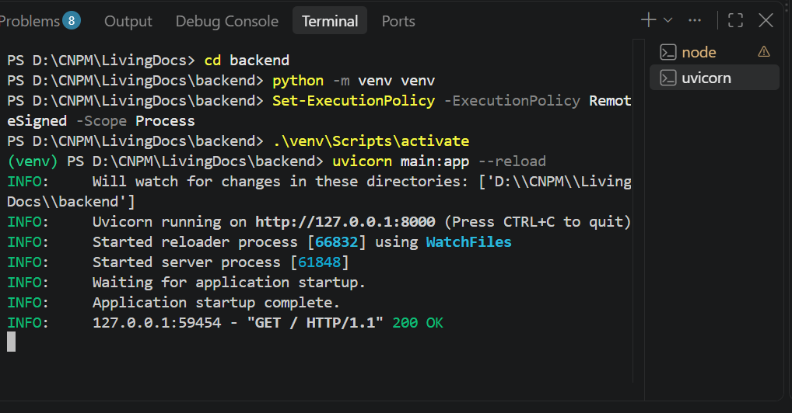
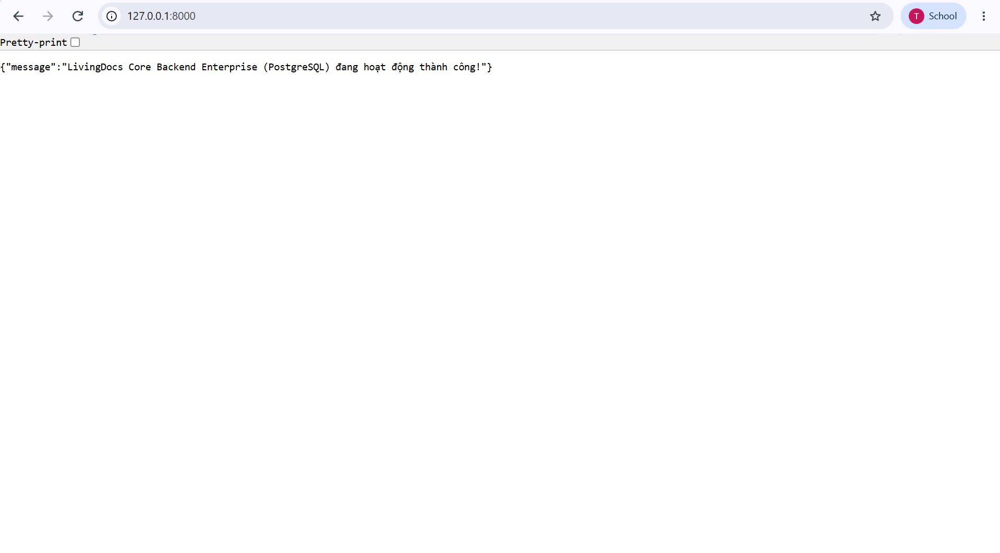
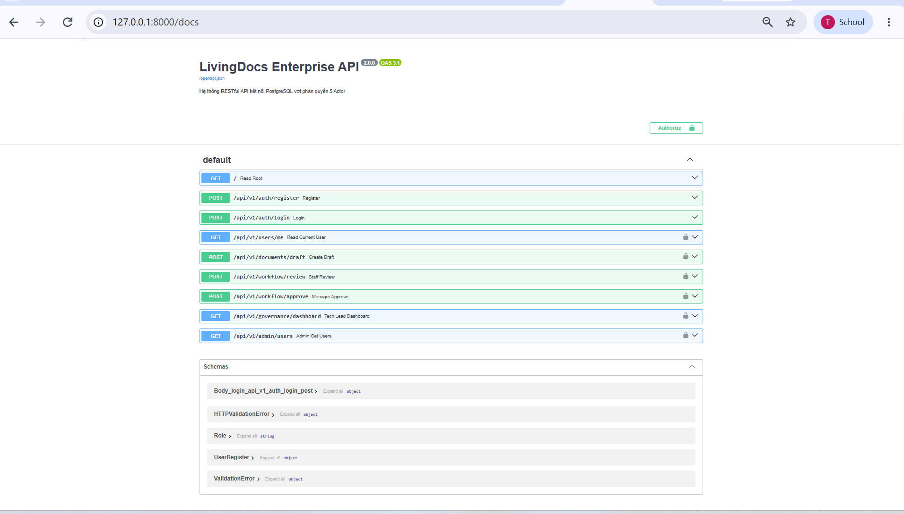
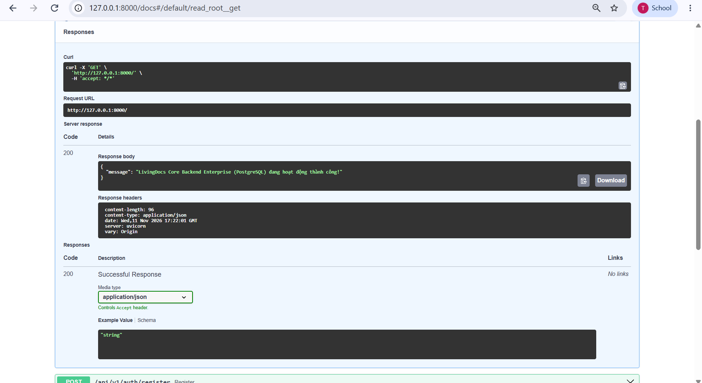

# Demo Backend – FastAPI

Bước 1: Khởi động FastAPI Server

Checkpoint 1: Kiểm tra Terminal Uvicorn

<http://127.0.0.1:8000>

Checkpoint 2: Truy cập giao diện Swagger UI

<http://127.0.0.1:8000/docs>

Checkpoint 3: Thử nghiệm gửi Request trực tiếp trên Swagger

