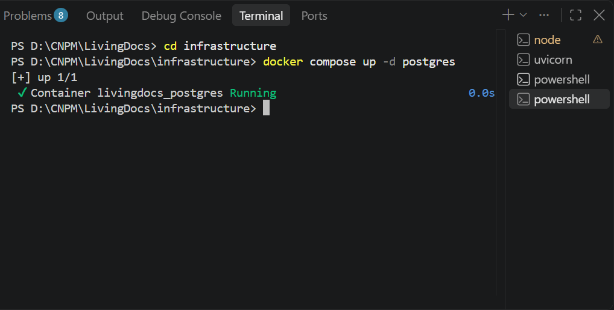
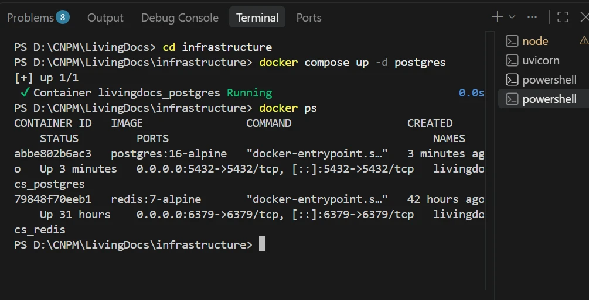
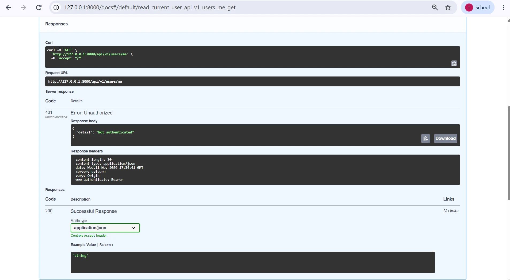

# Demo Database – PostgreSQL

Bước 1: Khởi động Container PostgreSQL

### Kiểm tra các Checkpoint kết nối PostgreSQL

Checkpoint 1: Trạng thái Container

Checkpoint 2: Gọi API tương tác Database qua Swagger

