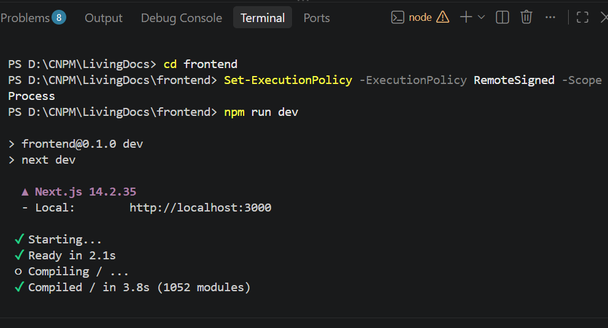
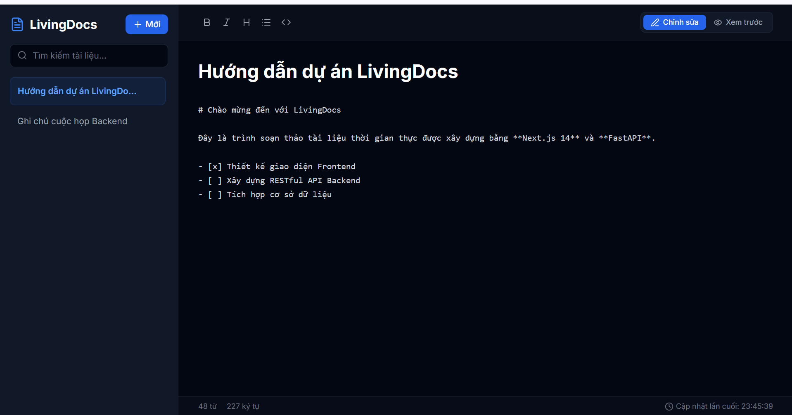

# Demo Frontend – Next\.js

**1.Khởi chạy Server Dev của Next.js**

**2.Truy cập ứng dụng:**

Trình duyệt web.

Mở trình duyệt web và truy cập địa chỉ:

`http://localhost:3000`

\*Checkpoint 1: Kiểm tra Render & Icon (Visual Layout)

\*Checkpoint 2 : Thử nghiệm Markdown Editor & Typography

Checkpoint 3: Kiểm tra Console & Network Browser
