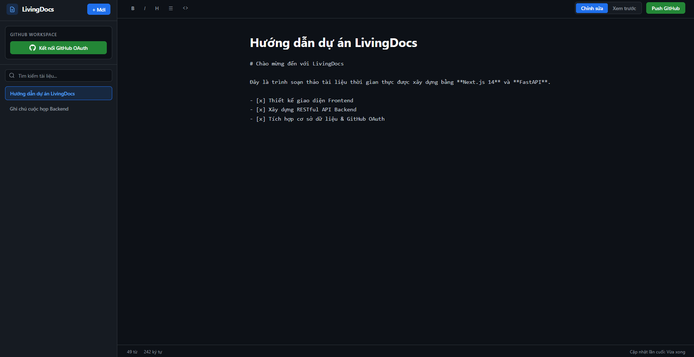
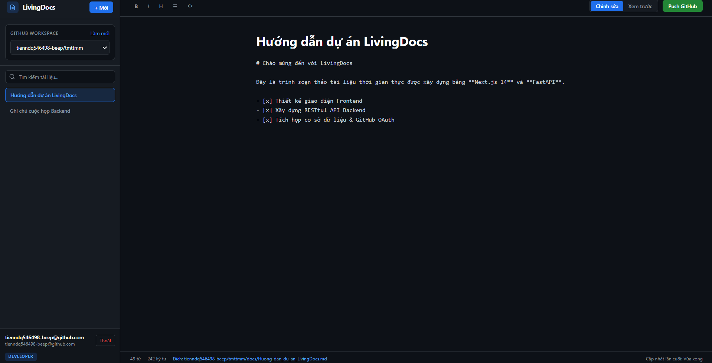
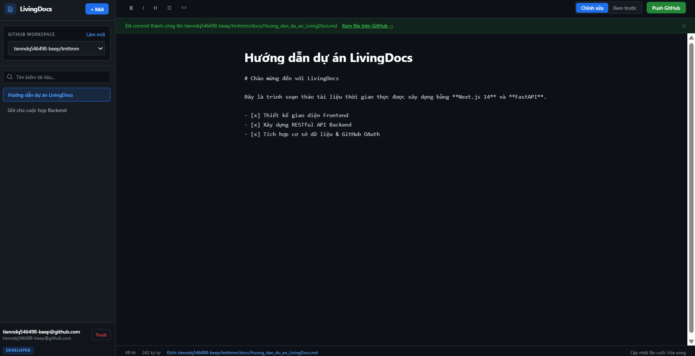
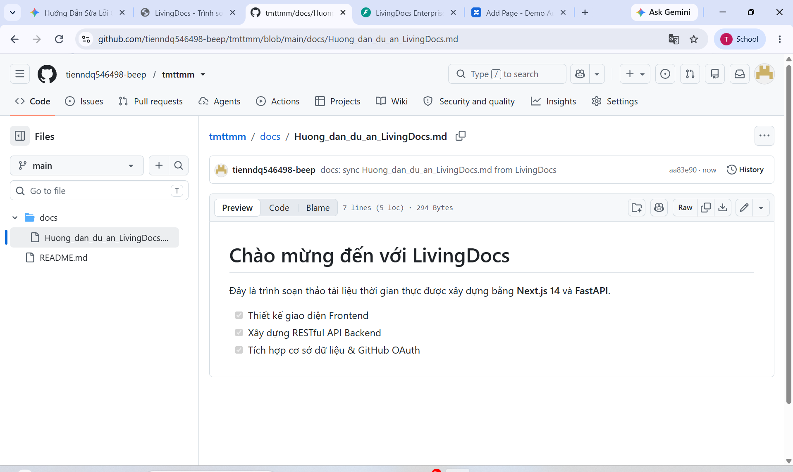
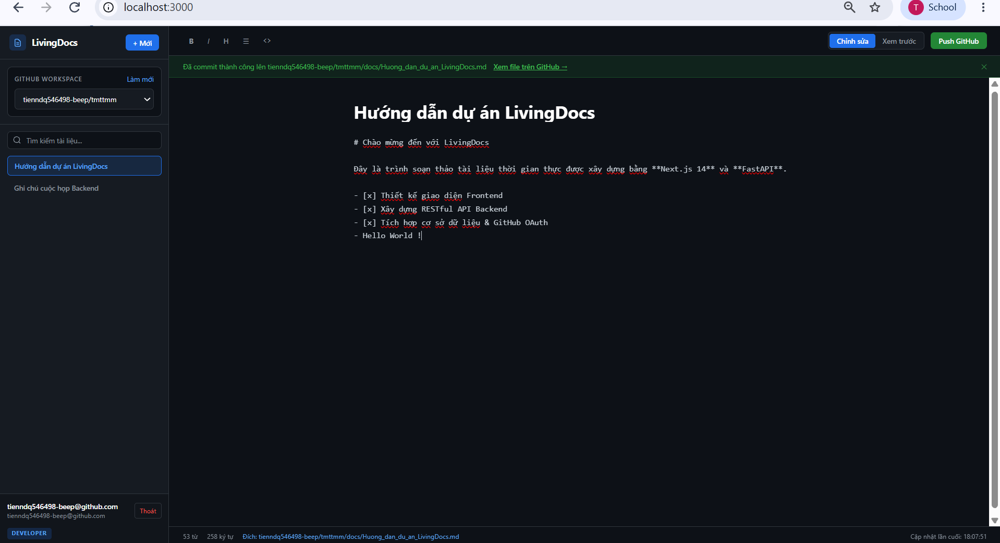
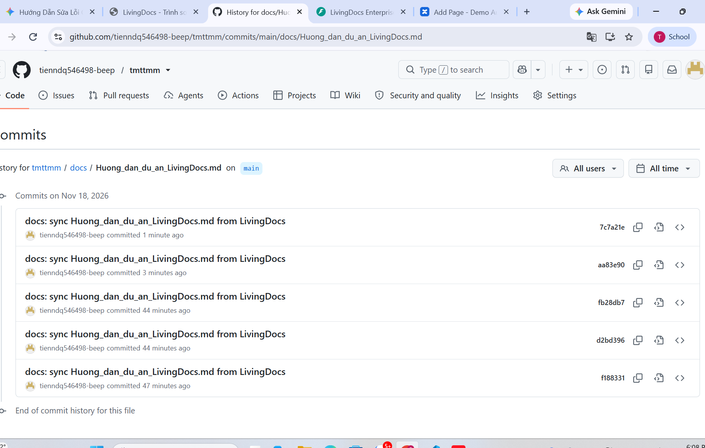
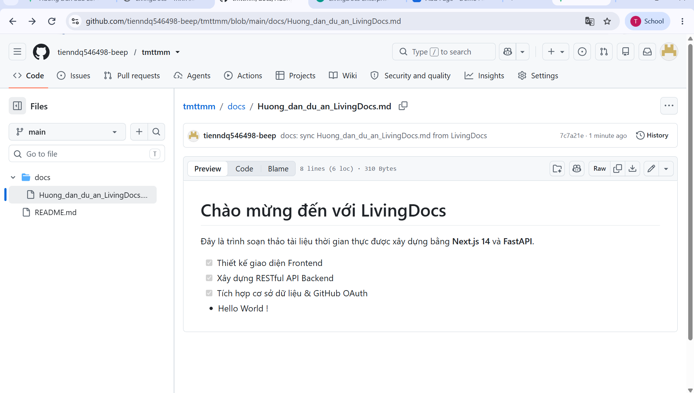

# Demo Authenticate & Manage Workspace via GitHub OAuth

**\*Xác thực tập trung qua GitHub OAuth 2.0 (Authenticate)**

Kết nối GitHub OAuth:

Thay vì bắt người dùng tạo tài khoản rời rạc, LivingDocs tích hợp xác thực tập trung qua GitHub OAuth 2.0 với quyền `repo` và `user:email`. Khi người dùng cấp quyền, Backend nhận mã `code` tại endpoint `/api/v1/auth/github/callback`, đổi lấy `github_token`, tự động khởi tạo hồ sơ trong PostgreSQL với vai trò mặc định là `DEVELOPER` và cấp phát **JWT Token** trả về Frontend để quản lý phiên làm việc phi trạng thái."

**\*Truy vấn & Quản lý không gian làm việc (Manage Workspace)**

Sau khi đăng nhập, Frontend gọi API `GET /api/v1/github/workspaces` kèm Bearer Token. Backend sử dụng `github_token` của người dùng để truy vấn trực tiếp danh sách các repository từ GitHub API — hỗ trợ cả Public lẫn Private repo — giúp chuyển đổi không gian lưu trữ tài liệu ngay trên trình duyệt mà không cần thao tác dòng lệnh Git."

**\*Soạn thảo & Đồng bộ tài liệu lên GitHub (Commit & Push)**

Khi bấm Push GitHub, Frontend gửi nội dung Markdown tới `POST /api/v1/github/commit`. Backend tự động nhận diện nhánh mặc định (`main`), mã hóa nội dung sang chuẩn **Base64** theo đặc tả của GitHub REST API và đẩy trực tiếp vào đường dẫn `docs/Huong_dan_du_an_LivingDocs.md`. Như thầy thấy trên GitHub, file đã được tạo và hiển thị đầy đủ định dạng Markdown ngay lập tức."

**\*Kiểm chứng cơ chế cập nhật phiên bản tự động (Atomic Overwrite qua **`sha`**)**

-Với GitHub Contents API, nếu cập nhật một file đã tồn tại mà không gửi kèm mã định danh phiên bản (`sha`), hệ thống sẽ báo lỗi xung đột. Nhóm đã xử lý bằng cách cho Backend kiểm tra sự tồn tại của file trước mỗi lần Push, tự động lấy mã `sha` hiện tại và thực hiện ghi đè an toàn. Trong phần History trên GitHub có thể thấy rõ hai commit nối tiếp nhau trên cùng một tài liệu.
