# Demo GitHub App Integration & Repository Synchronization

**\*Chứng minh kết nối GitHub App & Workspace Metadata**
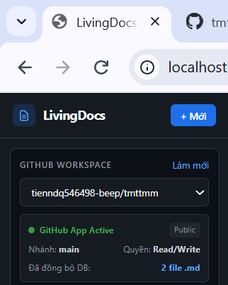

Khi người dùng chọn một repository làm không gian làm việc, Frontend gọi `GET /api/v1/github/integration-status`. Backend truy vấn trực tiếp GitHub REST API để xác thực quyền đọc/ghi của token, nhận diện nhánh mặc định `main` và đối chiếu số lượng tài liệu Markdown đã lưu trong PostgreSQL.

**\*Tạo thay đổi trực tiếp trên GitHub và kéo về bằng **`↓ Sync Repo`** (Pull Sync)**
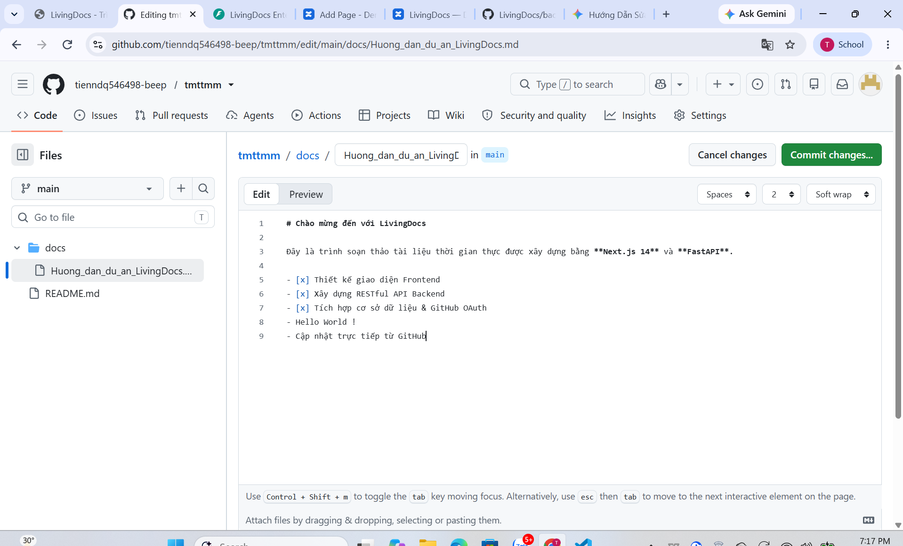
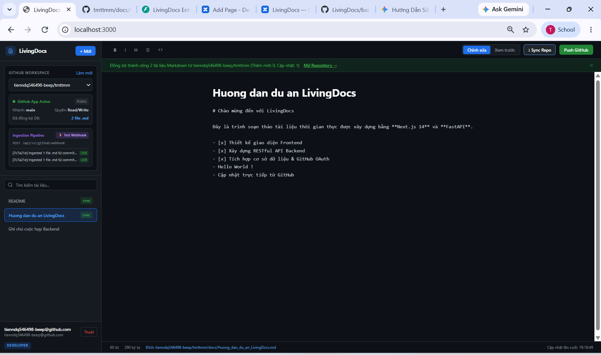

"Nút `↓ Sync Repo` kích hoạt API `POST /api/v1/github/sync`. Hệ thống dùng **Git Trees API** (`recursive=1`) để quét toàn bộ cây thư mục trên nhánh `main` và đối chiếu mã định danh `github_sha` của từng file với bản ghi trong PostgreSQL. Chỉ những file có `sha` thay đổi như `README.md` mới được tải nội dung mới qua **Git Blobs API** và cập nhật vào cơ sở dữ liệu."

**\*Biên tập trên LivingDocs và đẩy ngược lên GitHub (Push Sync)**
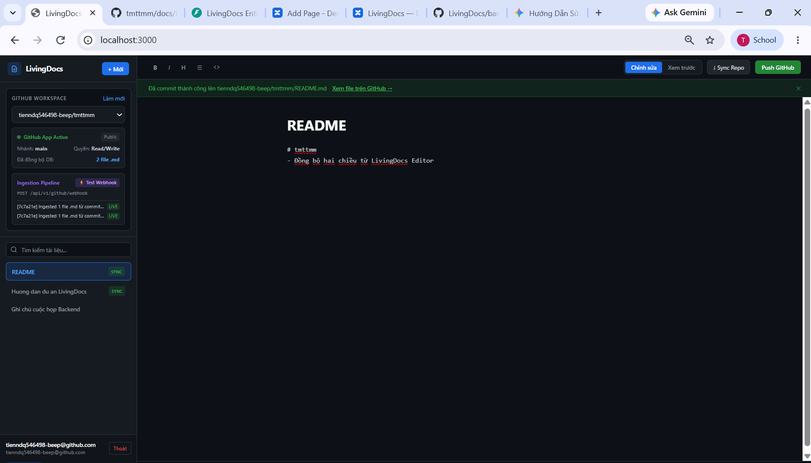
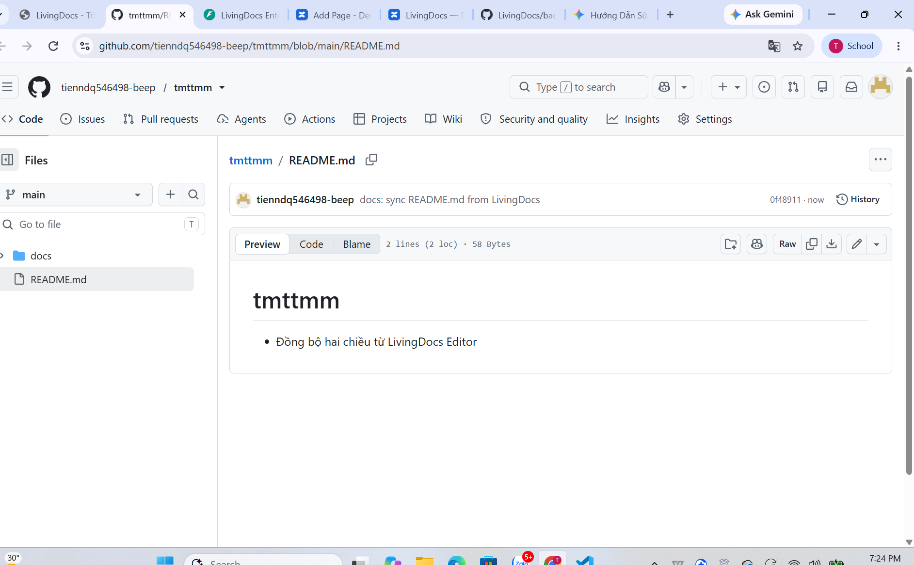

Sau khi kéo tài liệu về PostgreSQL, người dùng có thể chỉnh sửa trực tiếp trên LivingDocs và bấm `Push GitHub` (`POST /api/v1/github/commit`). Backend tự động lấy `sha` hiện tại của file trên GitHub để ghi đè an toàn, đồng thời cập nhật lại `github_sha` mới vào bảng `documents` của PostgreSQL.

**\*Đối chiếu tầng API & Database (Dùng khi hội đồng hỏi kỹ thuật)**

**Kiểm tra metadata & quyền hạn**

-Mở khóa xác thực (Authorize) trên Swagger UI
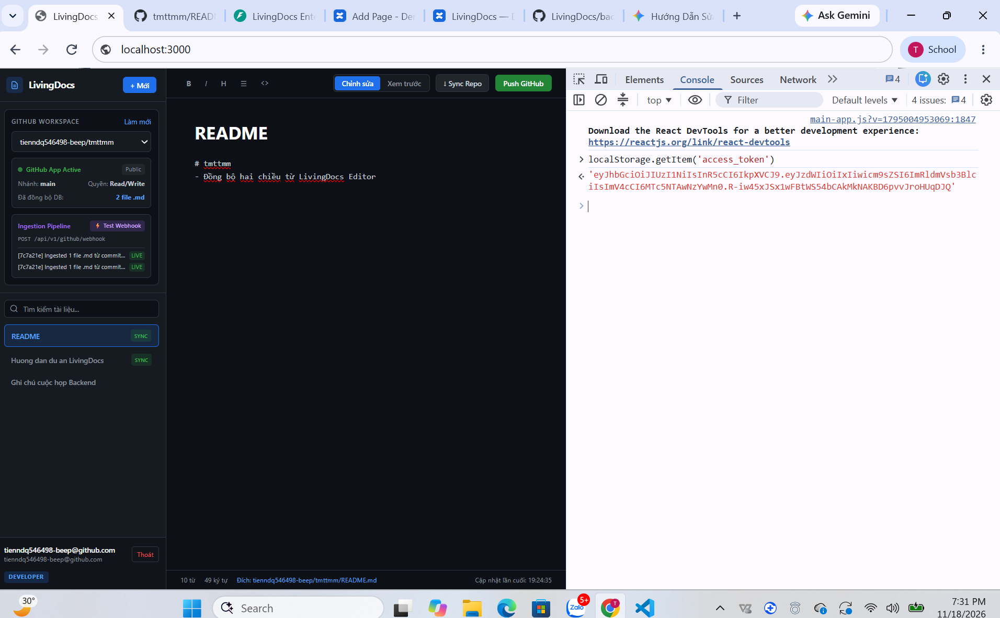

-Thực thi và giải thích 3 API cốt lõi trên Swagger UI

**Kiểm tra metadata & quyền hạn**
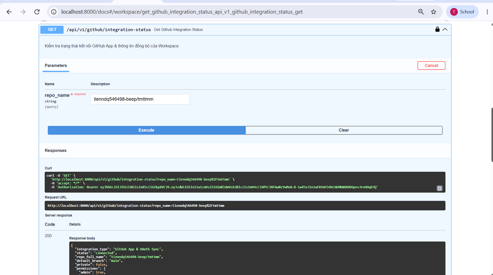

**Chứng minh cơ chế tối ưu bằng **`github_sha`
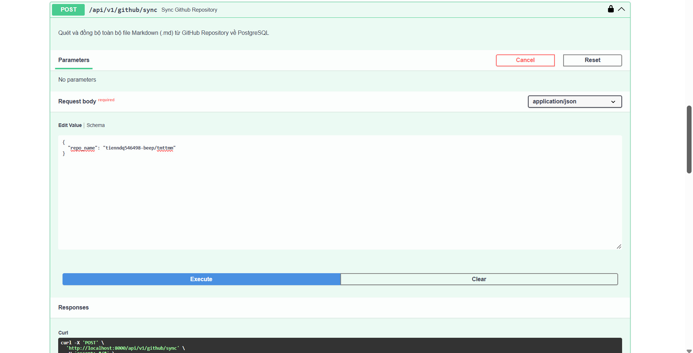
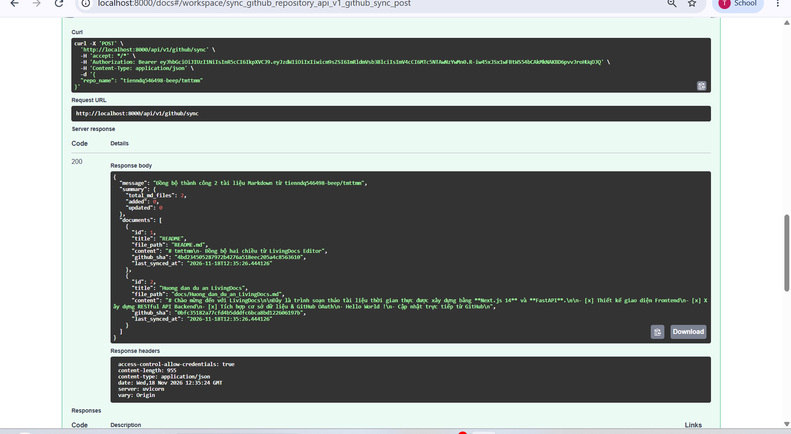

**Truy xuất dữ liệu độc lập từ PostgreSQL**
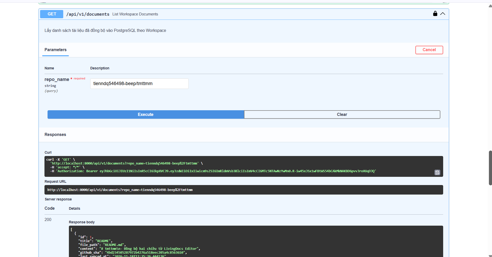

**Đối chiếu trực tiếp bản ghi trong bảng **`documents`** (PostgreSQL)**
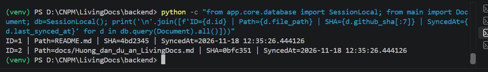

-Để kiểm chứng tính toàn vẹn dữ liệu ở tầng Backend và Database, em xin phép đối chiếu trực tiếp qua Swagger UI và PostgreSQL. Đầu tiên, khi gọi `GET /api/v1/github/integration-status`, hệ thống xác thực qua JWT Bearer Token và trả về trạng thái kết nối cùng quyền `push: true` trên nhánh `main`. Tiếp theo, khi gọi `POST /api/v1/github/sync` lần thứ hai, trường `added` và `updated` đều bằng `0` vì Backend đối chiếu trường `github_sha` lưu trong bảng `documents` với Git Trees API — chỉ những file có `sha` thay đổi mới được tải lại. Cuối cùng, dữ liệu trong bảng `documents` của PostgreSQL luôn lưu đầy đủ nội dung Markdown, mã `github_sha` và thời điểm đồng bộ gần nhất để phục vụ tìm kiếm và biên tập tức thì-
