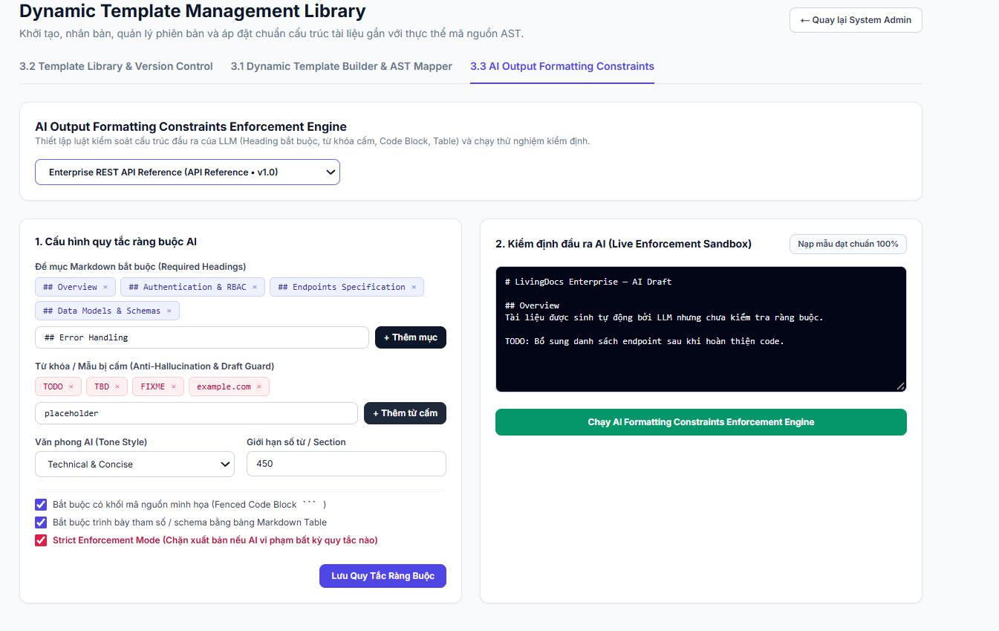
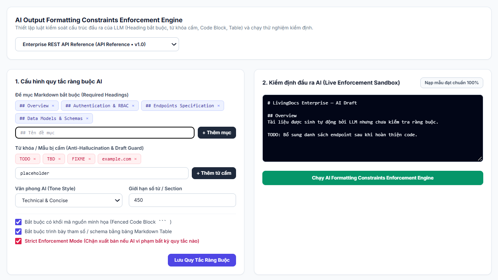
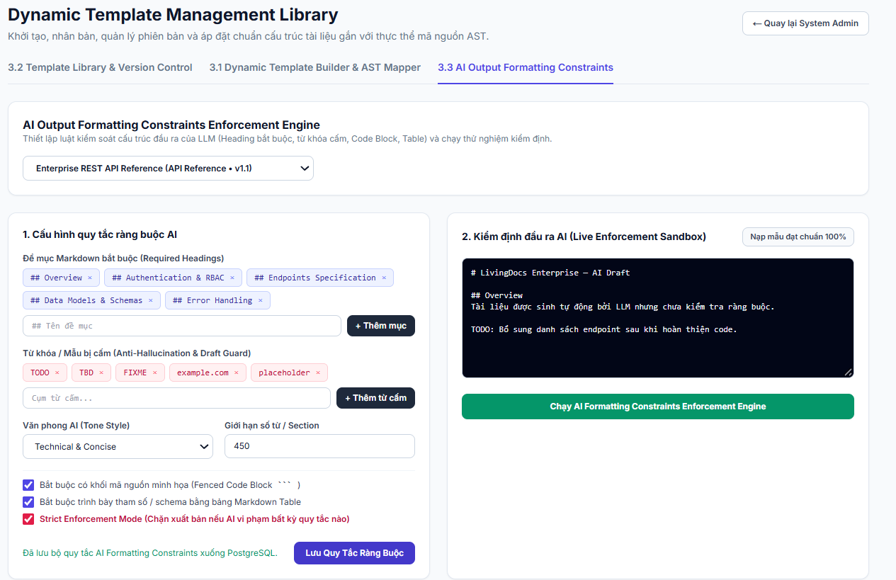
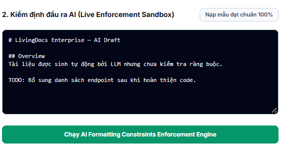
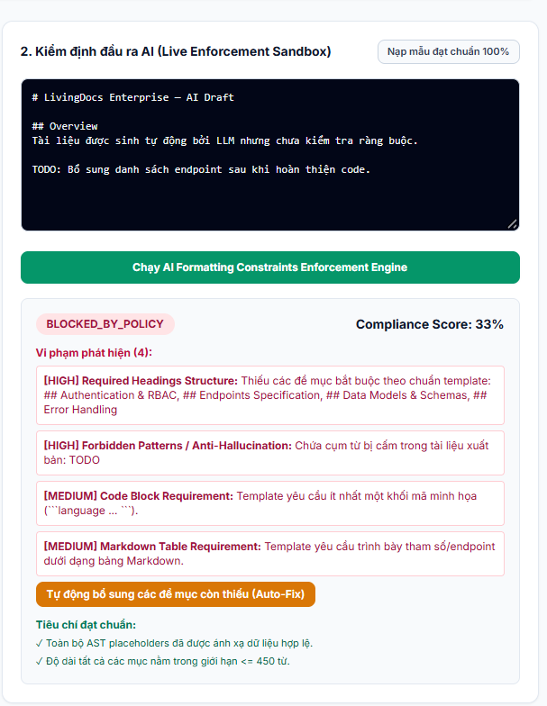
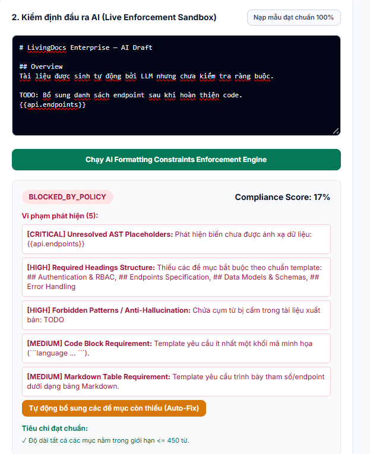
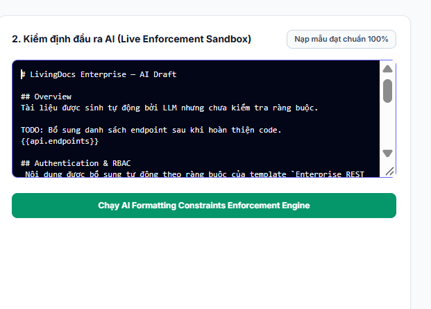
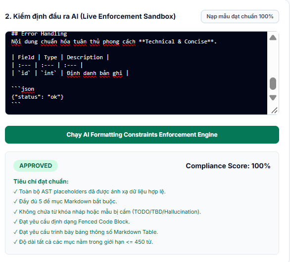

# Demo AI Output Formatting Constraints Enforcement Engine

<http://localhost:3000/templates>

## 1. Cấu hình bộ quy tắc ràng buộc đầu ra AI (Left Panel)

1. Ở góc trên bên phải, chọn template `Enterprise REST API Reference (API Reference • v1.0)` từ danh sách thả xuống.
2. 


1. Quan sát cột bên trái (**1. Cấu hình quy tắc ràng buộc AI**), bộ luật mặc định của mẫu này đã được nạp từ PostgreSQL:

- 
    - **Đề mục Markdown bắt buộc:** `## Overview`, `## Authentication & RBAC`, `## Endpoints Specification`, `## Data Models & Schemas`.
    - **Từ khóa / Mẫu bị cấm:** `TODO`, `TBD`, `FIXME`, `example.com`.
    - **Ràng buộc cấu trúc:** Tích chọn cả **Fenced Code Block (**```` ``` ````**)**, **Markdown Table** và **Strict Enforcement Mode**.
    - 

1. **Thử thêm quy tắc mới trực tiếp:**

- 
    - Nhập `## Error Handling` vào ô thêm đề mục và bấm `+ Thêm mục`.
    - Nhập `placeholder` vào ô từ khóa cấm và bấm `+ Thêm từ cấm`.
    - Bấm `Lưu Quy Tắc Ràng Buộc` để ghi cập nhật xuống PostgreSQL (`PUT /api/v1/templates/{id}`).
    - 

## 2. Kiểm định bản nháp AI vi phạm chính sách (Policy Blocking)

1. Quan sát khung **2. Kiểm định đầu ra AI (Live Enforcement Sandbox)** bên phải — hệ thống đã nạp sẵn một đoạn văn bản nháp giả lập AI sinh ra nhưng chưa chuẩn hóa (thiếu đề mục và chứa từ khóa `TODO`).
2. 


1. Bấm nút xanh lá `Chạy AI Formatting Constraints Enforcement Engine` (`POST /api/v1/templates/{id}/validate-output`):

- 
    - Nhãn quyết định hiển thị màu đỏ `BLOCKED_BY_POLICY` kèm điểm tuân thủ thấp (`Compliance Score: 33%`).
    - Danh sách vi phạm liệt kê chi tiết mức độ nghiêm trọng (`[HIGH] Required Headings Structure`, `[HIGH] Forbidden Patterns / Anti-Hallucination`, `[MEDIUM] Code Block Requirement`, `[MEDIUM] Markdown Table Requirement`).
    - 
    - 
    - *(Tùy chọn)* Gõ thêm một biến chưa map như `{{api.endpoints}}` vào khung soạn thảo và bấm chạy lại để chứng minh engine bắt lỗi `[CRITICAL] Unresolved AST Placeholders`.
    - 

## 3. Tự động khắc phục cấu trúc thiếu (Auto-Remediation)

1. Ngay dưới danh sách lỗi vi phạm, bấm nút màu cam `Tự động bổ sung các đề mục còn thiếu (Auto-Fix)`.
2. 


1. Nội dung trong khung sandbox lập tức được chèn tự động toàn bộ các đề mục Markdown còn thiếu (`## Authentication & RBAC`, `## Endpoints Specification`, `## Data Models & Schemas`, `## Error Handling`) đúng theo cấu trúc của template.

(

\# LivingDocs Enterprise — AI Draft

\##Overview

Tài liệu được sinh tự động bởi LLM nhưng chưa kiểm tra ràng buộc.

TODO: Bổ sung danh sách endpoint sau khi hoàn thiện code.  
{{api.endpoints}}

\##Authentication & RBAC

*Nội dung được bổ sung tự động theo ràng buộc của template *`Enterprise REST API Reference`.

\##Endpoints Specification

*Nội dung được bổ sung tự động theo ràng buộc của template *`Enterprise REST API Reference`.

\##Data Models & Schemas

*Nội dung được bổ sung tự động theo ràng buộc của template *`Enterprise REST API Reference`.

\##Error Handling

*Nội dung được bổ sung tự động theo ràng buộc của template *`Enterprise REST API Reference`.  )

## 4. Kiểm chứng kịch bản đạt chuẩn 100% (`APPROVED`)

1. Bấm nút `Nạp mẫu đạt chuẩn 100%` ở góc trên bên phải của khung Sandbox — hệ thống tự động sinh một tài liệu hoàn chỉnh có đầy đủ các đề mục bắt buộc, bảng thông số Markdown Table, khối mã nguồn JSON và sạch từ khóa cấm.

(

\#Enterprise REST API Reference — Verified Output

\##Overview

Nội dung chuẩn hóa tuân thủ phong cách **Technical & Concise**.

| Field | Type | Description |
| --- | --- | --- |
| `id` | `int` | Định danh bản ghi |

```json
{"status": "ok"}
```

\##Authentication & RBAC

Nội dung chuẩn hóa tuân thủ phong cách **Technical & Concise.**

| Field | Type | Description |
| --- | --- | --- |
| `id` | `int` | Định danh bản ghi |

```json
{"status": "ok"}
```

\##Endpoints Specification

Nội dung chuẩn hóa tuân thủ phong cách **Technical & Concise**.

| Field | Type | Description |
| --- | --- | --- |
| `id` | `int` | Định danh bản ghi |

```json
{"status": "ok"}
```

\##Data Models & Schemas

Nội dung chuẩn hóa tuân thủ phong cách **Technical & Concise**.

| Field | Type | Description |
| --- | --- | --- |
| `id` | `int` | Định danh bản ghi |

```json
{"status": "ok"}
```

\##Error Handling

Nội dung chuẩn hóa tuân thủ phong cách **Technical & Concise**.

| Field | Type | Description |
| --- | --- | --- |
| `id` | `int` | Định danh bản ghi |

```json
{"status": "ok"})
```

1. Bấm lại `Chạy AI Formatting Constraints Enforcement Engine`:

- 
    - Trạng thái chuyển sang màu xanh `APPROVED` với `Compliance Score: 100%`.
    - Toàn bộ 6 tiêu chí kiểm định hiển thị dấu tích xanh (`✓`) xác nhận đầu ra của AI đủ điều kiện xuất bản vào repository.
    - 
