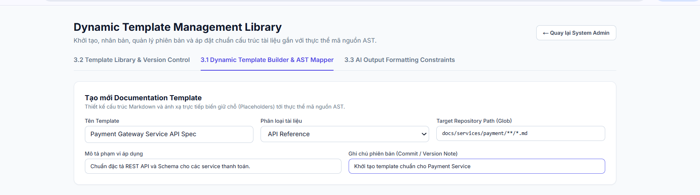
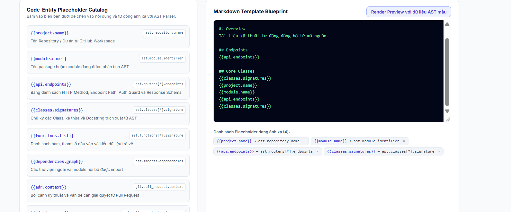
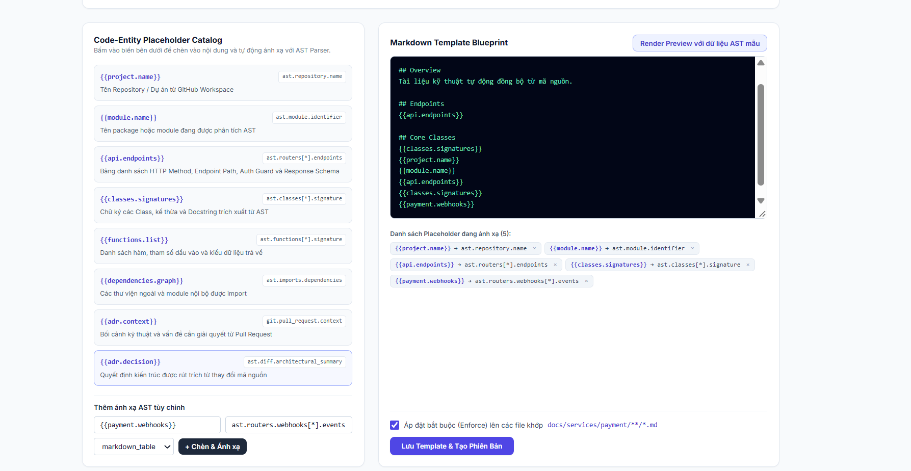
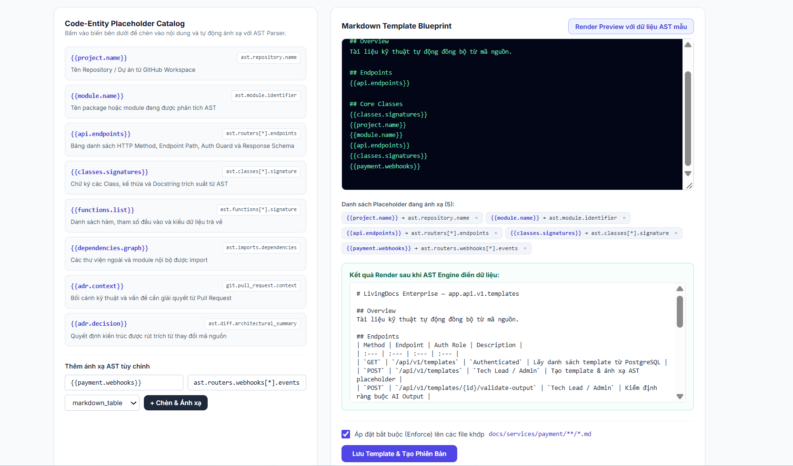
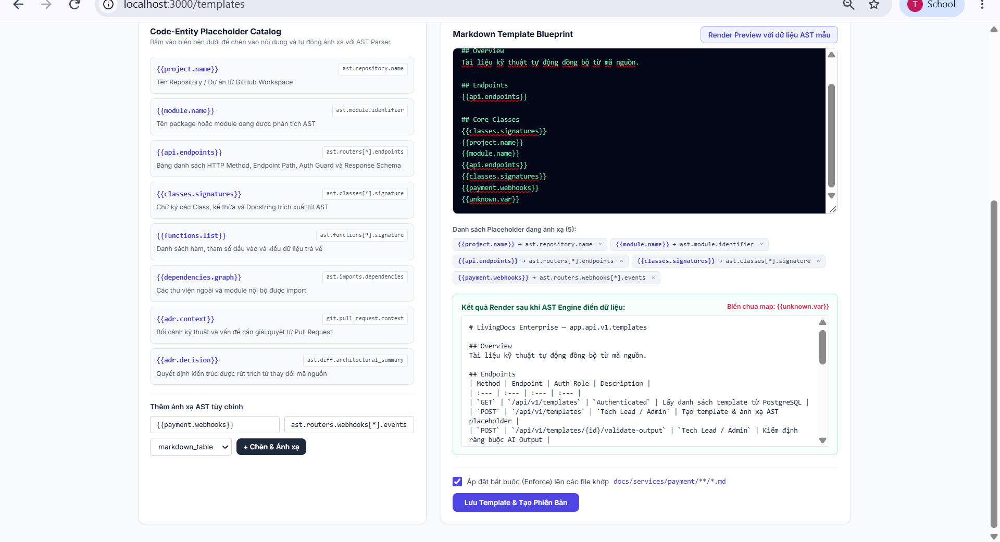
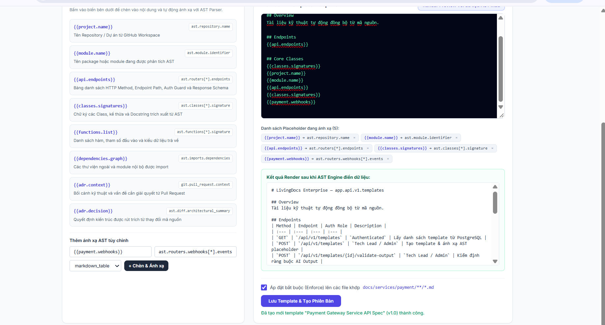

# Demo Dynamic Template Builder & Placeholder Mapping Engine

Truy cập <http://localhost:3000/templates> (đăng nhập bằng tài khoản **Tech Lead** hoặc **Administrator**) và chọn tab **3.1 Dynamic Template Builder & AST Mapper** để thực hiện kịch bản demo 4 bước dưới đây.

## 1. Khởi tạo Metadata & Phạm vi áp dụng của Template

Trên thẻ cấu hình trên cùng, nhập thông tin cho một mẫu tài liệu kỹ thuật mới (hoặc bấm **Chỉnh sửa (Builder)** 

- **Tên Template:** `Payment Gateway Service API Spec`
- **Phân loại tài liệu:** Chọn `API Reference`
- **Target Repository Path (Glob):** Nhập `docs/services/payment/**/*.md` (xác định quy tắc tự động khớp file khi hệ thống quét repository)
- **Mô tả phạm vi áp dụng:** `Chuẩn đặc tả REST API và Schema cho các service thanh toán.`
- **Ghi chú phiên bản:** `Khởi tạo template chuẩn`
- 

## 2. Ánh xạ Code-Entity Placeholders (AST Mapping)

Thao tác trên cột bên trái (**Code-Entity Placeholder Catalog**) để liên kết các biến giữ chỗ trong Markdown với thực thể trích xuất từ cây cú pháp trừu tượng (AST Parser):

1. **Chèn biến chuẩn từ Catalog:** Bấm lần lượt vào `{{project.name}}`, `{{module.name}}`, `{{api.endpoints}}`, và `{{classes.signatures}}`. Hệ thống tự động chèn biến vào khung soạn thảo bên phải và thêm thẻ ánh xạ tương ứng ở bên dưới (ví dụ: `{{api.endpoints}} → ast.routers[*].endpoints`).
2. 

1. **Tạo ánh xạ thực thể AST tùy chỉnh (Custom Mapping):**

- 
    - Nhập ô Placeholder: `{{payment.webhooks}}`
    - Nhập ô AST Source: `ast.routers.webhooks[*].events`
    - Chọn kiểu dữ liệu: `markdown_table`
    - Bấm `+ Chèn & Ánh xạ` — biến mới lập tức xuất hiện trong danh sách **Danh sách Placeholder đang ánh xạ** kèm nút xóa nhanh (`×`) nếu muốn gỡ bỏ.
    - 

## 3. Kiểm thử Render trực tiếp với dữ liệu AST mẫu

1. Tại khung **Markdown Template Blueprint** bên phải, bấm nút `Render Preview với dữ liệu AST mẫu`.
2. 

1. Quan sát khung **Kết quả Render sau khi AST Engine điền dữ liệu** xuất hiện ngay bên dưới:

- 
    - Các biến chuẩn (`{{project.name}}`, `{{api.endpoints}}`, `{{classes.signatures}}`) được tự động thay thế bằng bảng Markdown Endpoints và khối code Python Class thực tế.
    - Biến tùy chỉnh `{{payment.webhooks}}` hiển thị trạng thái đã liên kết `[AST Bound: ast.routers.webhooks[*].events]`.
    - Nếu gõ thử một biến chưa khai báo (như `{{unknown.var}}`) vào khung soạn thảo rồi bấm Render lại, hệ thống sẽ cảnh báo đỏ `Biến chưa map: {{unknown.var}}` ở góc phải để ngăn lỗi thiếu dữ liệu trước khi lưu.
    - 

## 4. Lưu bền vững xuống PostgreSQL & Kiểm chứng Versioning

1. Tích chọn `Áp đặt bắt buộc (Enforce) lên các file khớp docs/services/payment/**/*.md`.
2. Bấm nút tím `Lưu Template & Tạo Phiên Bản`:

- 
    - Terminal Backend ghi nhận `POST /api/v1/templates HTTP/1.1" 201 Created` và lưu đồng thời vào 2 bảng `doc_templates` và `doc_template_versions` (khởi tạo bản `v1.0`).
    - Quay lại tab **3.2 Template Library & Version Control** và nhấn `F5` để kiểm chứng template mới hiển thị đầy đủ nhãn `Enforced`, đường dẫn glob và bộ đếm AST Placeholders từ database.
    - 
