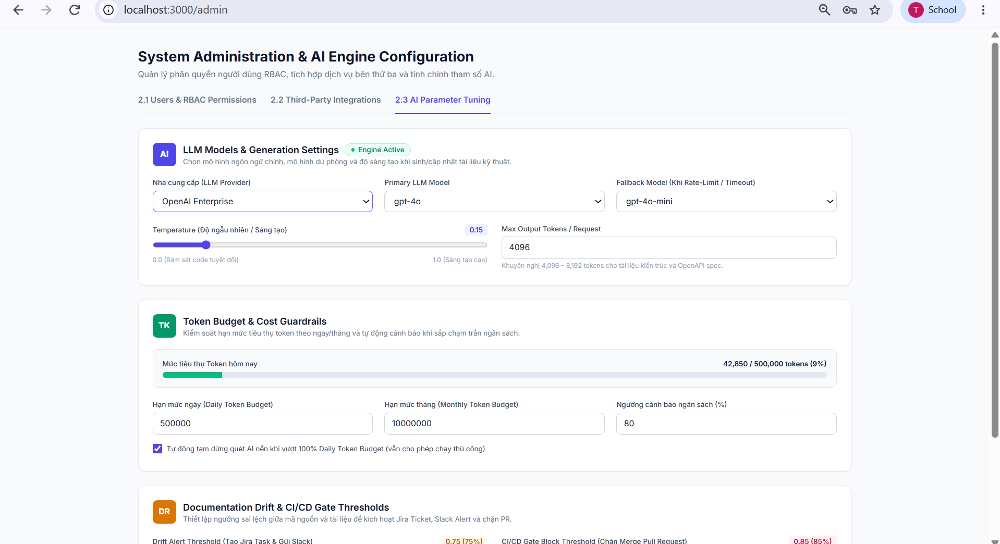
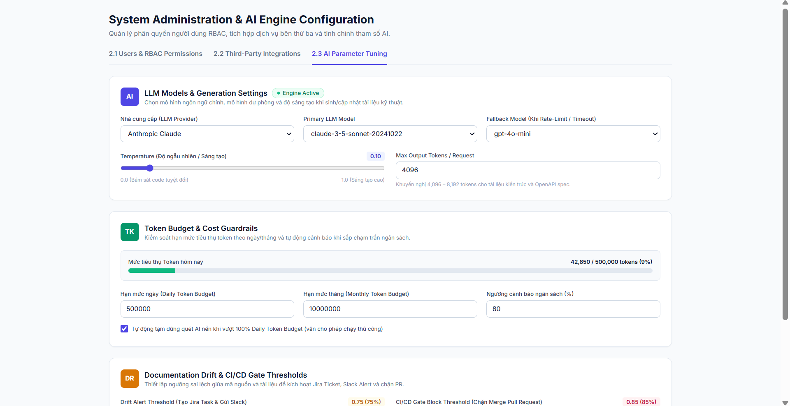
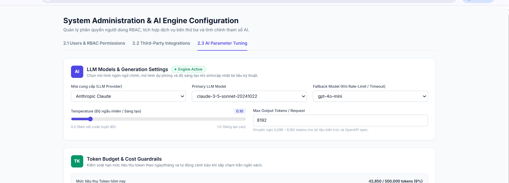
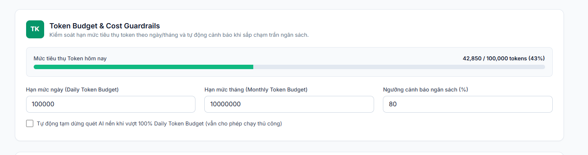
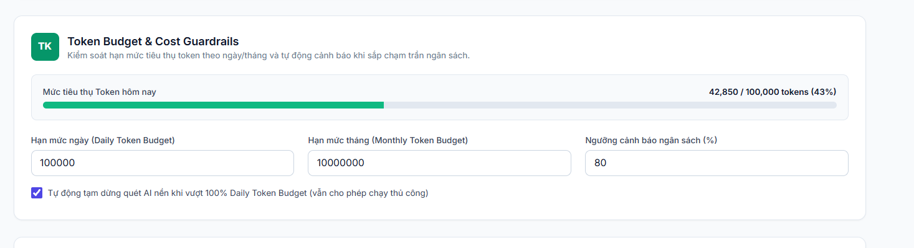
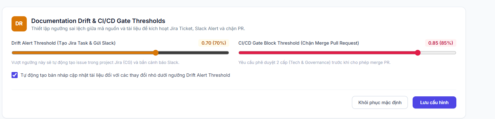
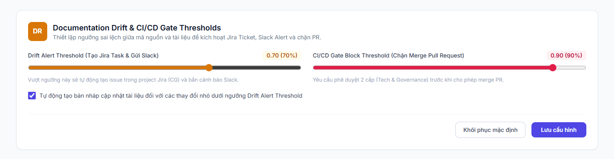
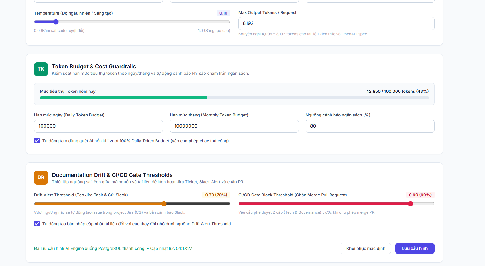
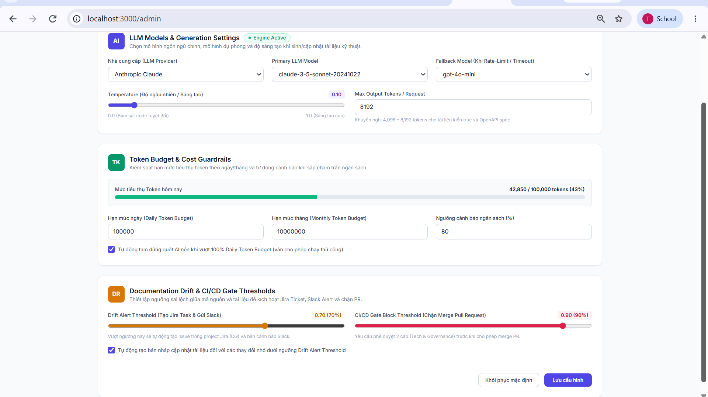
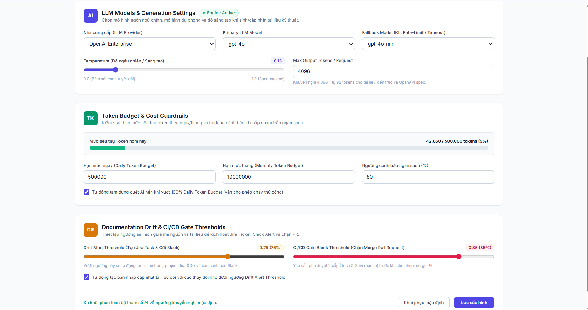

# Demo AI Parameter Tuning Panel \(LLM Models, Token Budget, Thresholds

**1.Tinh chỉnh trực tiếp 3 nhóm tham số trên giao diện**

**Card 1 — LLM Models & Generation Settings:**

Đổi Nhà cung cấp (LLM Provider) từ `OpenAI Enterprise` sang `Anthropic Claude` (hoặc `Google Gemini`) — danh sách Primary LLM Model sẽ tự động cập nhật sang các model tương ứng (`claude-3-5-sonnet-20241022` hoặc `gemini-2.5-pro`).

Kéo thanh trượt Temperature từ `0.15` về `0.10` để ưu tiên độ chính xác và bám sát mã nguồn khi AI sinh tài liệu.

Đổi Max Output Tokens / Request từ `4096` lên `8192` cho các tài liệu kiến trúc lớn.

**Card 2 — Token Budget & Cost Guardrails:**

Nhập lại Hạn mức ngày (Daily Token Budget) từ `500000` thành `100000` — thanh tiến trình phía trên sẽ lập tức tính toán lại tỷ lệ tiêu thụ từ `42,850 / 500,000 tokens (9%)` lên `42,850 / 100,000 tokens (43%)`.

Giữ nguyên Ngưỡng cảnh báo ngân sách (%) ở `80` và tích chọn Tự động tạm dừng quét AI nền khi vượt 100% Daily Token Budget để chứng minh cơ chế kiểm soát chi phí.

**Card 3 — Documentation Drift & CI/CD Gate Thresholds:**

Kéo Drift Alert Threshold từ `0.75 (75%)` xuống `0.70 (70%)` để tăng độ nhạy khi tự động tạo Jira Task (project `CG`) và bắn cảnh báo sang Slack (`LivingDocs-Demo`).

Kéo CI/CD Gate Block Threshold từ `0.85 (85%)` lên `0.90 (90%)` để chỉ chặn merge PR khi có sai lệch tài liệu nghiêm trọng.

**2.Lưu cấu hình xuống PostgreSQL & Kiểm tra log API**

lưu cấu hình :

**3.Kiểm chứng lưu trữ bền vững (Persistence) & Hoàn tác (Reset)**

Kiểm chứng F5: Nhấn `F5` tải lại toàn bộ trang `/admin`, sau đó bấm lại vào tab 2.3 AI Parameter Tuning. Toàn bộ giá trị vừa chỉnh (`Temperature 0.10`, `Max Output Tokens 8192`, `Daily Token Budget 100000`, `Drift 0.70`, `CI/CD Gate 0.90`) được tải lên từ PostgreSQL qua `GET /api/v1/admin/ai-config` và giữ nguyên trạng thái.

Kiểm chứng khôi phục mặc định: Bấm nút `Khôi phục mặc định` ở cạnh nút lưu — hệ thống gọi `POST /api/v1/admin/ai-config/reset` để đưa toàn bộ thông số về cấu hình chuẩn ban đầu (`OpenAI Enterprise`, `gpt-4o`, `Temperature 0.15`, `500,000 tokens/ngày`, `Drift 0.75`, `CI/CD Gate 0.85`).

