# Demo RBAC User & Permission Management Panel

**\*Kiểm tra dữ liệu thực từ PostgreSQL & Thẻ thống kê KPI**

<http://localhost:3000/admin>
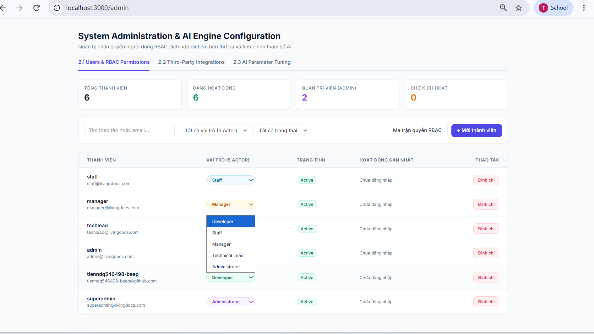
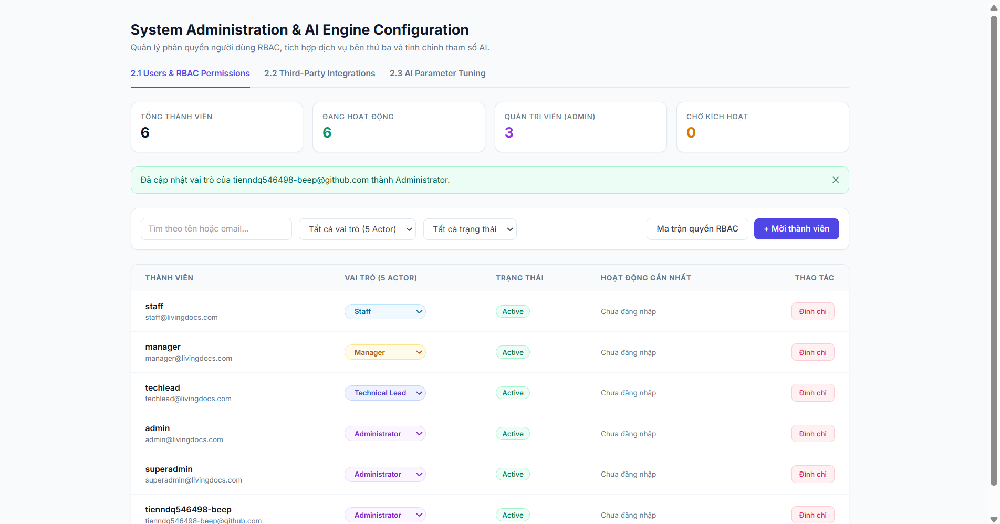

**\*Đối chiếu Ma trận phân quyền RBAC (5 Actor)**
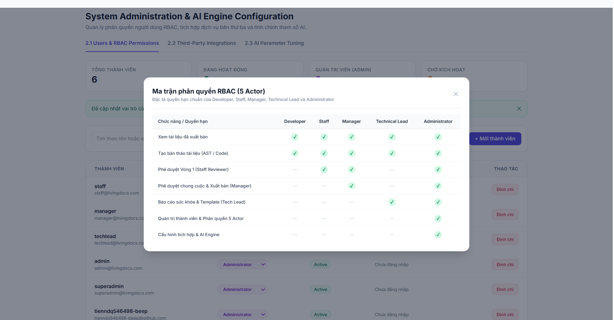

**\*Mời thành viên mới & Kiểm thử chặn trùng Email**

-Tạo lời mời hợp lệ:
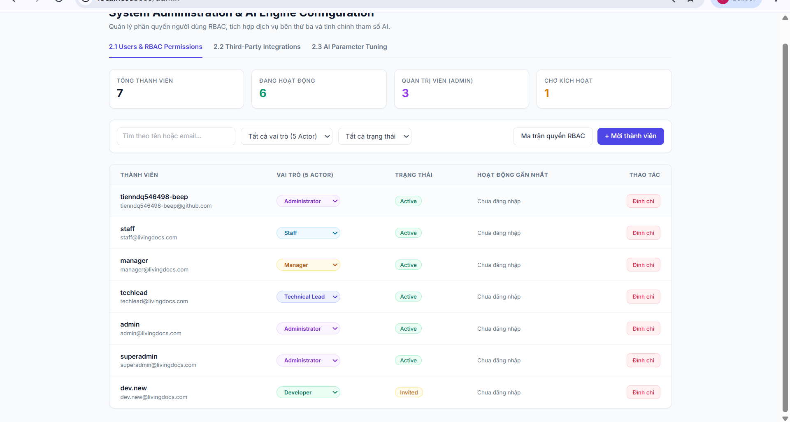

-Kiểm thử trùng lặp (Negative Test):
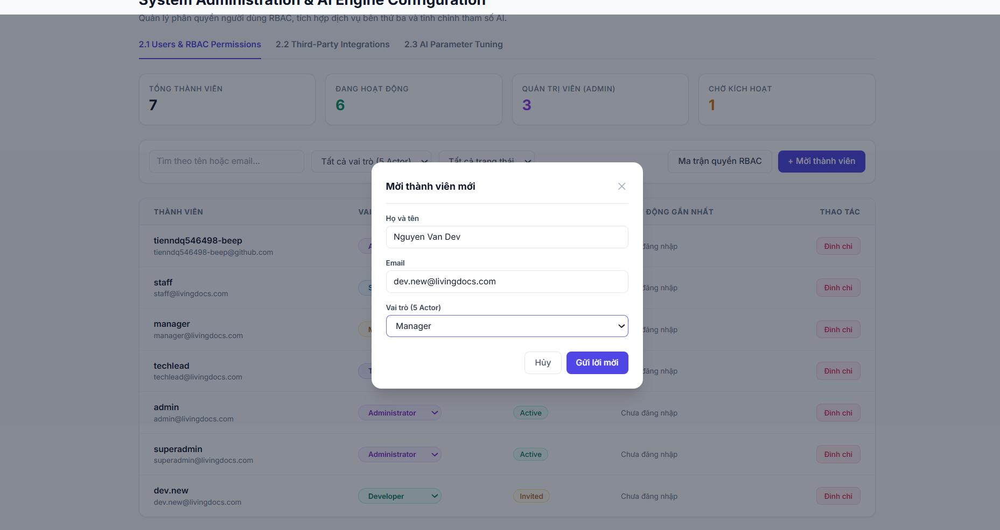
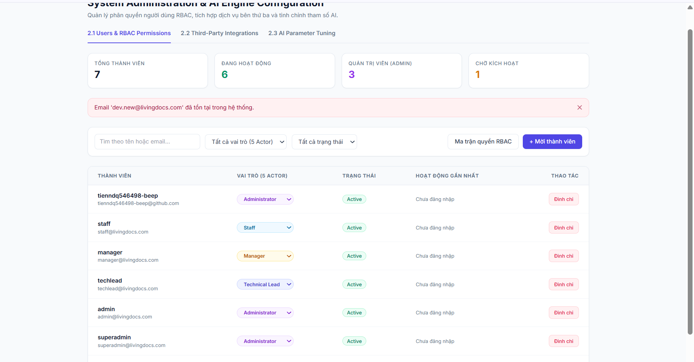

**\*Tìm kiếm & Lọc đa điều kiện (Search & Filter)**

Tìm kiếm theo từ khóa
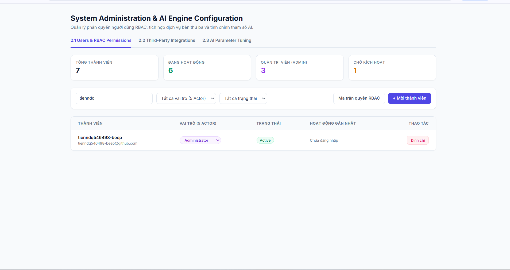

Lọc theo vai trò (5 Actor):
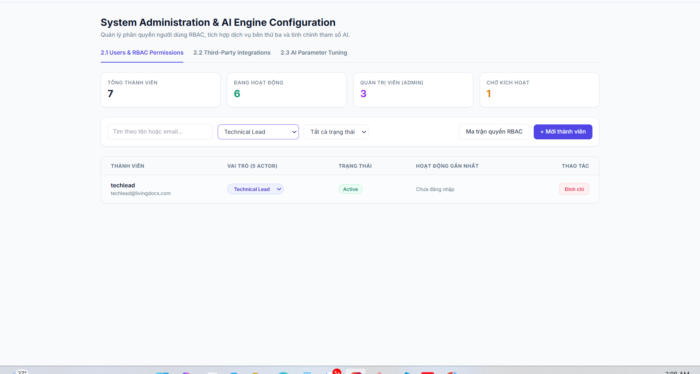

Lọc theo trạng thái:
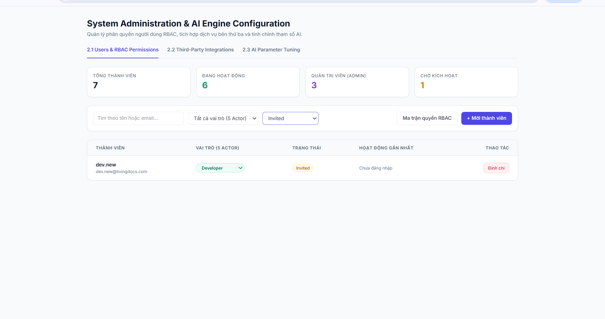

**\*Thay đổi vai trò trực tiếp & Kiểm chứng lưu bền vững**
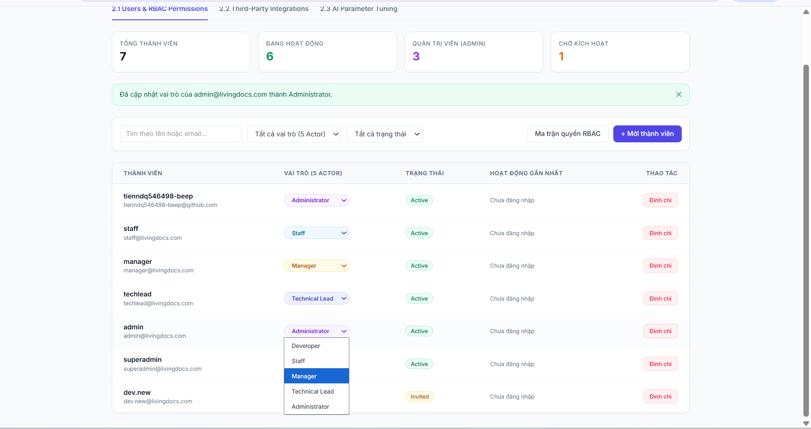
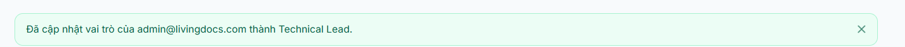

**\*Đình chỉ / Kích hoạt & Chốt chặn tự bảo vệ (Guardrails)**

đình chỉ :
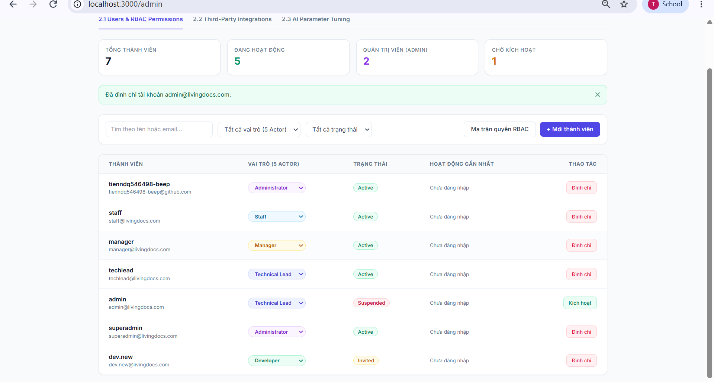

kích hoạt lại 
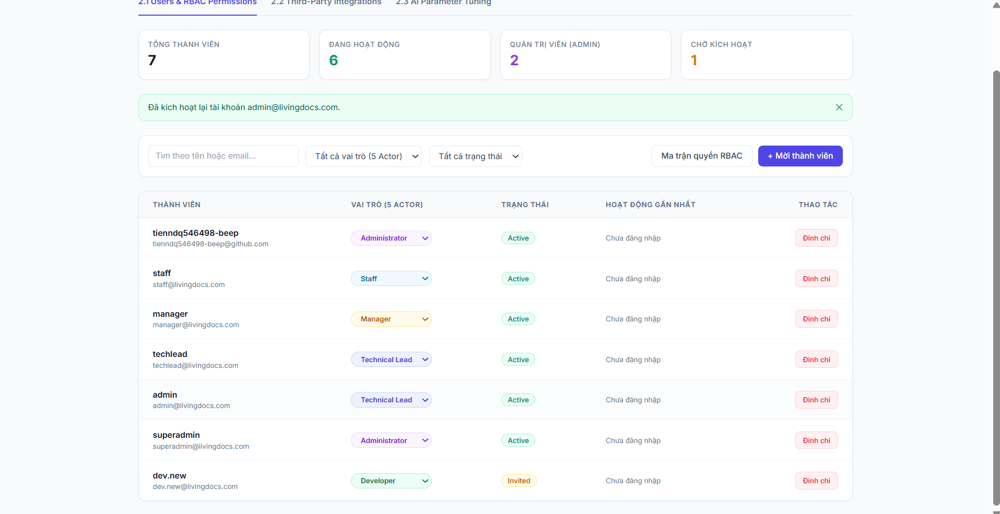

**\*Kiểm thử chốt chặn tự khóa / tự hạ quyền Admin (Admin Lockout Prevention):**
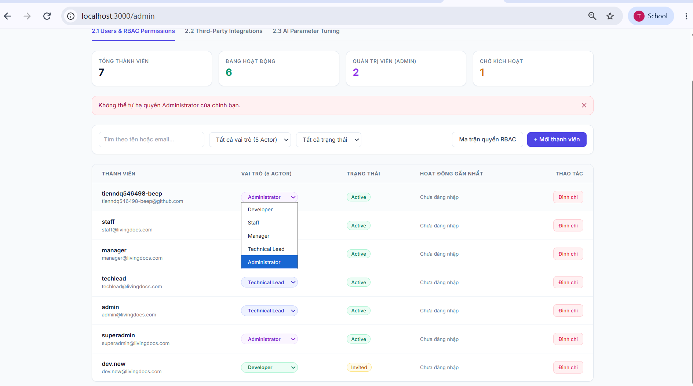

**Kết quả:** Backend từ chối yêu cầu (`400 Bad Request`) và hiển thị cảnh báo đỏ (*"Không thể tự hạ quyền Administrator của chính mình"* / *"Không thể tự khóa tài khoản đang đăng nhập"*), đảm bảo hệ thống không bao giờ rơi vào trạng thái mất hết quản trị viên.
