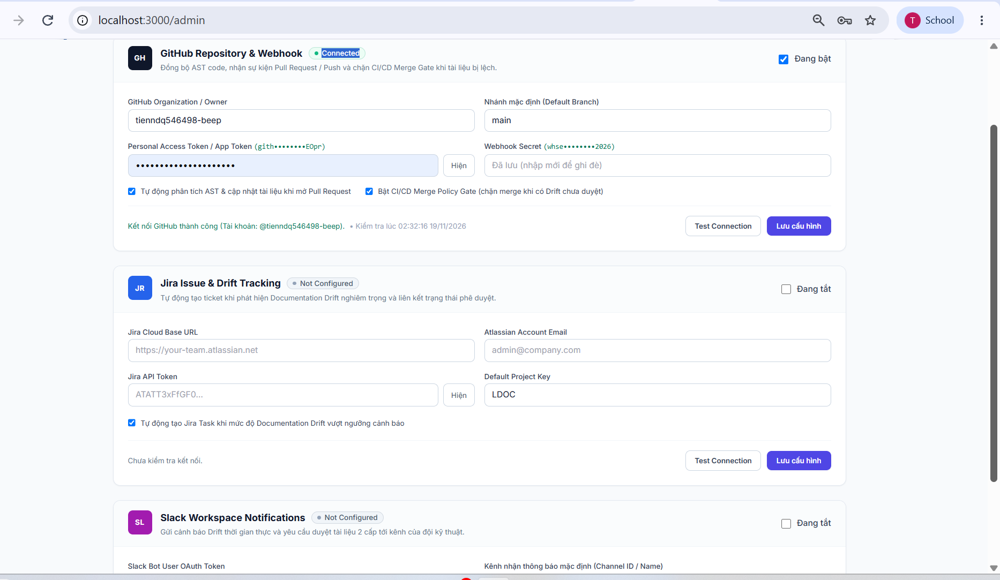
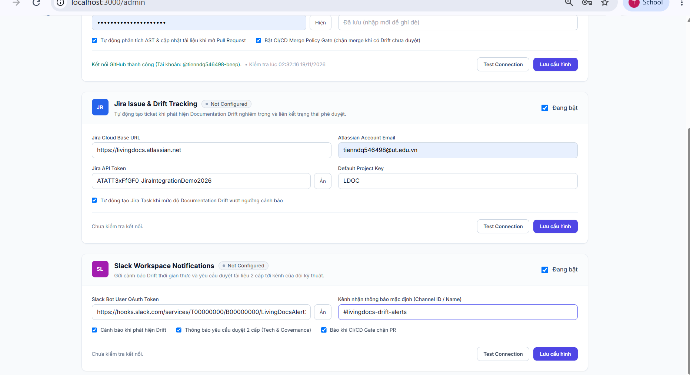
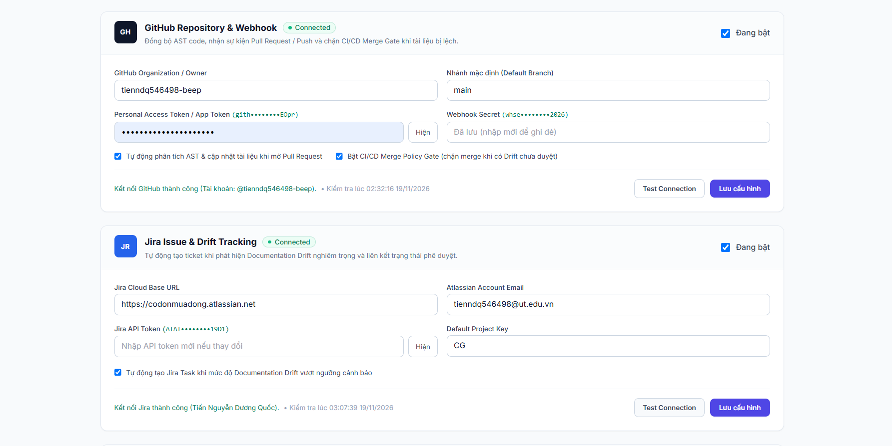
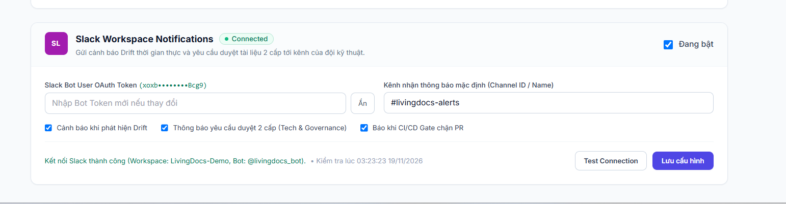
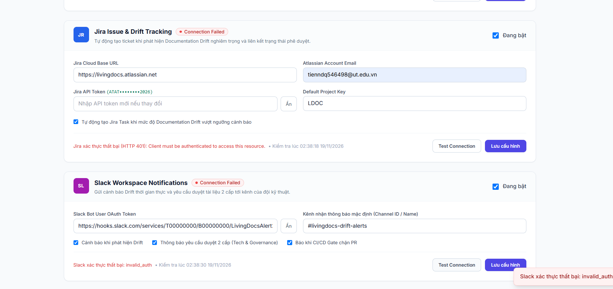
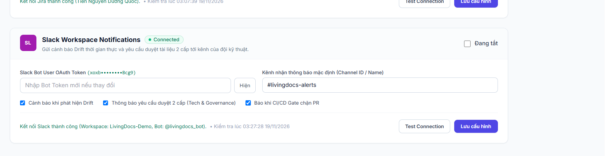

# Demo Third\-Party Service Integration Settings \(GitHub, Jira, Slack\)

<http://localhost:3000/admin>

**\*Quan sát trạng thái khởi tạo & Cơ chế che giấu khóa bí mật (Secret Masking)**

**Thao tác:** Kiểm tra 3 thẻ tích hợp mặc định tải từ bảng `integration_configs` trong PostgreSQL (`GET /api/v1/admin/integrations`):

Điểm nhấn bảo mật: Toàn bộ trường Token/Secret đã lưu đều được backend che giấu dưới dạng `••••••••xxxx` — không bao giờ trả chuỗi khóa thô (*raw secret*) về trình duyệt.

**\*Cấu hình & Mã hóa thông tin kết nối (Save & Encrypt)**

Kết quả: Backend mã hóa đối xứng toàn bộ token trước khi lưu xuống PostgreSQL và tự động chuyển ô nhập sang trạng thái che ký tự (`masked`).

**\*Kiểm thử kết nối trực tiếp (Live Test Connection & Negative Test)**

-Kiểm thử kết nối thành công (Positive Test):

- **Kết quả (**`POST /api/v1/admin/integrations/{provider}/test`**):** Hệ thống kiểm tra xác thực, đo độ trễ phản hồi (`ms`), chuyển badge trạng thái sang `Connected` (màu xanh lá) và cập nhật mốc thời gian kiểm tra gần nhất.

-Kiểm thử sai Token (Negative Test):

**Kết quả:** Backend bắt lỗi xác thực từ API ngoài, chuyển trạng thái thẻ sang `Error` (màu đỏ) kèm thông báo chẩn đoán chi tiết để Admin xử lý. *(Sau bước này, bạn điền lại token đúng để thẻ quay về *`Connected`*).*

**\*Bật / Tắt dịch vụ & Kiểm chứng lưu bền vững**

**Kết quả:** Trạng thái `Connected` của GitHub/Jira, trạng thái tạm ngưng của Slack cùng các token đã mã hóa vẫn giữ nguyên từ PostgreSQL.

- Bấm `Lưu cấu hình` khi ô đang ở trạng thái `Đang tắt`.
- Nhấn `F5` tải lại trang: nếu ô vẫn giữ nguyên `Đang tắt` và token vẫn hiển thị `xoxb••••••••Bcg9` nghĩa là cơ chế lưu bền vững hoạt động chính xác
