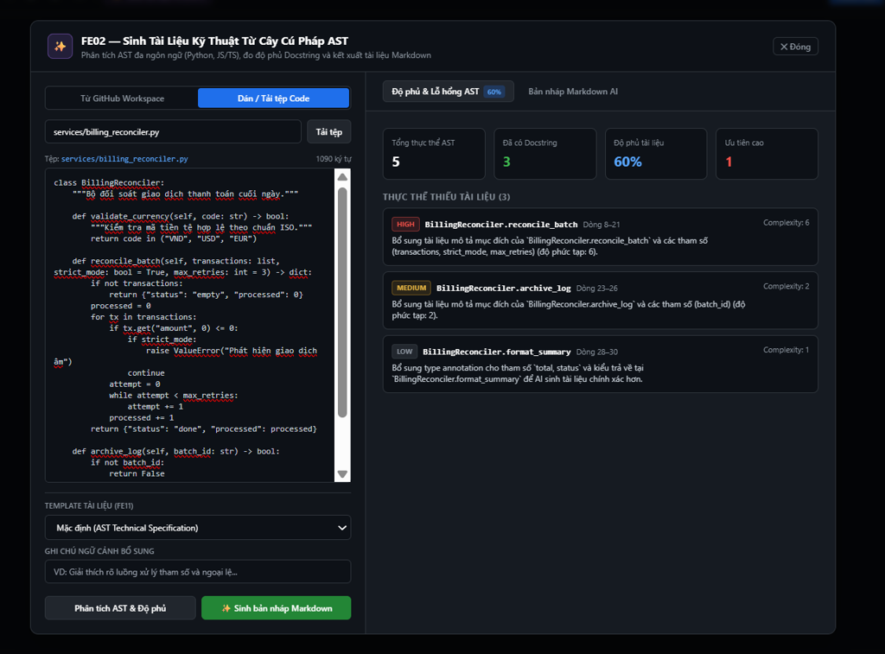
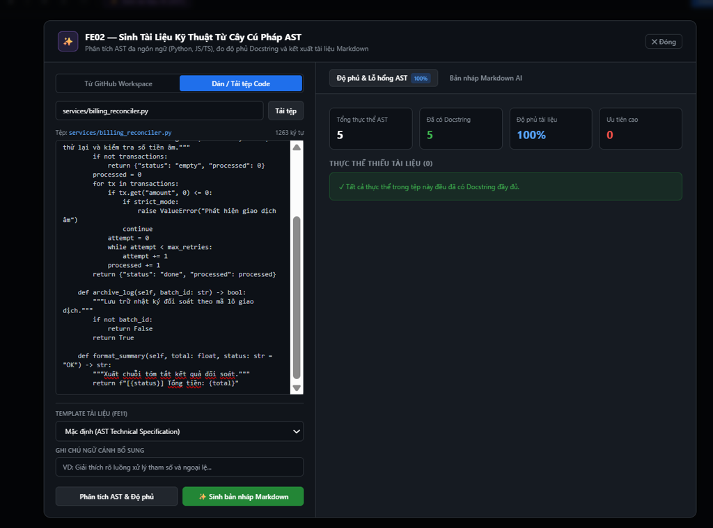

# Documentation Coverage Gap Identification Analyzer

**Documentation Coverage Gap Identification Analyzer (Module 4.2)** đóng vai trò là bộ kiểm toán chất lượng tài liệu tĩnh, tiếp nhận danh sách thực thể cú pháp từ Module 4.1 để tính tỷ lệ bao phủ, phát hiện các thành phần thiếu mô tả hoặc thiếu kiểu dữ liệu, và xếp hạng mức độ rủi ro (`HIGH` / `MEDIUM` / `LOW`) trước khi chuyển dữ liệu sang bước sinh tài liệu AI.

## 1. Ma trận quy tắc phân loại lỗ hổng (Severity Rules)

Thay vì báo lỗi dàn trải, Module 4.2 kết hợp **trạng thái tài liệu** với **độ phức tạp rẽ nhánh (Cyclomatic Complexity)** để ưu tiên những hàm dễ phát sinh lỗi nghiệp vụ nhất:

|  |  |  |
| --- | --- | --- |
| **Mức độ (Severity)** | **Điều kiện kích hoạt** | **Tác động lên chỉ số UI & Luồng AI** |
| `HIGH` (Ưu tiên cao) | **Thiếu Docstring / JSDoc** VÀ có `Complexity >= 5` (nhiều nhánh `if`, `for`, `while`, `try/catch` lồng nhau). | Cộng `+1` vào thẻ `Ưu tiên cao`, đẩy lên đầu danh sách cảnh báo và gắn cờ yêu cầu AI phân tích sâu luồng ngoại lệ. |
| `MEDIUM` (Trung bình) | **Thiếu Docstring / JSDoc** nhưng logic đơn giản (`Complexity < 5`). | Làm giảm chỉ số `Độ phủ tài liệu (%)`, yêu cầu bổ sung mô tả mục đích hàm và ý nghĩa từng tham số. |
| `LOW` (Nhẹ) | **Đã có Docstring** (hoặc hàm đơn giản) nhưng **thiếu khai báo kiểu dữ liệu** (`type annotation` cho tham số hoặc kiểu trả về). | Không làm giảm `%` độ phủ docstring, nhưng cảnh báo để tránh việc AI suy đoán sai kiểu dữ liệu đầu vào/đầu ra. |

1. Thao tác chạy kịch bản kiểm thử trên giao diện

Dán đoạn mã nguồn có đường dẫn (services/billing\_reconciler.py) vào khung soạn thảo và bấm `Phân tích AST & Độ phủ`

class BillingReconciler:
"""Bộ đối soát giao dịch thanh toán cuối ngày."""

```py
def validate_currency(self, code: str) -> bool:
    """Kiểm tra mã tiền tệ hợp lệ theo chuẩn ISO."""
    return code in ("VND", "USD", "EUR")

def reconcile_batch(self, transactions: list, strict_mode: bool = True, max_retries: int = 3) -> dict:
    if not transactions:
        return {"status": "empty", "processed": 0}
    processed = 0
    for tx in transactions:
        if tx.get("amount", 0) <= 0:
            if strict_mode:
                raise ValueError("Phát hiện giao dịch âm")
            continue
        attempt = 0
        while attempt < max_retries:
            attempt += 1
        processed += 1
    return {"status": "done", "processed": processed}

def archive_log(self, batch_id: str) -> bool:
    if not batch_id:
        return False
    return True

def format_summary(self, total, status="OK"):
    """Xuất chuỗi tóm tắt kết quả đối soát."""
    return f"[{status}] Tổng tiền: {total}"
```

1. Phân tích chi tiết từng thực thể & Cách tính điểm

Khi bấm phân tích, hệ thống quét toàn bộ 30 dòng mã, trích xuất **5 thực thể AST** (`3` đã có docstring -\> **Độ phủ: **`60%`) và sắp xếp **3 lỗ hổng** theo thứ tự ưu tiên giảm dần:
 - 

- `BillingReconciler.reconcile_batch`** (**`Dòng 8–21`**) -\> Cảnh báo **`HIGH`** (**`Complexity: 6`**)**
    - **Cách tính điểm phức tạp (**`6`**):** Điểm gốc (`1`) + `if not transactions` (`+1`) + `for tx in transactions` (`+1`) + `if tx.get(...)` (`+1`) + `if strict_mode` (`+1`) + `while attempt < max_retries` (`+1`).
    - **Lý do gắn nhãn **`HIGH`**:** Hàm có tới 5 cấu trúc điều khiển lồng nhau (`Complexity = 6 >= 5`) và có cơ chế ném ngoại lệ `ValueError`, nhưng lại hoàn toàn trống docstring. Thẻ `Ưu tiên cao` ở góc phải sẽ chuyển từ `0` sang `1` màu đỏ.
- `BillingReconciler.archive_log`** (**`Dòng 23–26`**) -\> Cảnh báo **`MEDIUM`** (**`Complexity: 2`**)**
    - **Cách tính điểm phức tạp (**`2`**):** Điểm gốc (`1`) + `if not batch_id` (`+1`).
    - **Lý do gắn nhãn **`MEDIUM`**:** Đã khai báo đủ kiểu tham số (`batch_id: str`) và kiểu trả về (`-> bool`), nhưng thiếu docstring giải thích mục đích hàm. Do logic đơn giản (`Complexity = 2 < 5`), hệ thống xếp mức trung bình.
- `BillingReconciler.format_summary`** (**`Dòng 28–30`**) -\> Cảnh báo **`LOW`** (**`Complexity: 1`**)**
    - **Lý do gắn nhãn **`LOW`**:** Hàm đã có docstring nên vẫn được tính vào tỷ lệ độ phủ `60%`. Tuy nhiên, tham số `total` không có gợi ý kiểu (`int` hay `float`) và hàm thiếu kiểu trả về `-> str`, nên bộ phân tích nhắc bổ sung để phục vụ bước sinh tài liệu AI phía sau.
- ** Hai thực thể đạt chuẩn (**`BillingReconciler`** & **`validate_currency`**):** Cả hai đều có docstring đầy đủ, riêng `validate_currency` có trọn vẹn `code: str -> bool` nên không xuất hiện trong danh sách cảnh báo.

1. Kịch bản vá lỗi để đưa độ phủ về 100% & Xóa sạch cảnh báo
2.  - 
