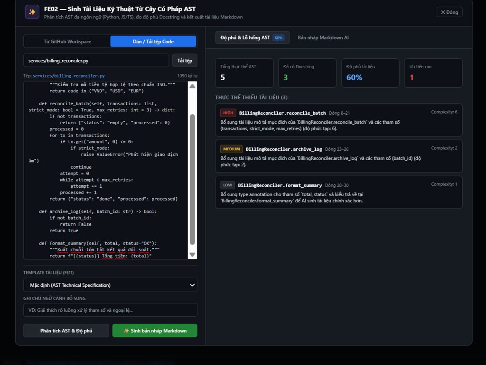

# Template\-Guided AI Draft Generation Pipeline

**Template-Guided AI Draft Generation Pipeline (Module 4.3)** là chặng xử lý cuối cùng của phân hệ **FE02**, kết hợp dữ liệu cấu trúc sạch từ cây cú pháp **AST (Module 4.1)**, danh sách lỗ hổng ưu tiên từ **Coverage Analyzer (Module 4.2)**, khuôn mẫu tài liệu (**FE11**) và cấu hình mô hình ngôn ngữ (**FE13**) để kết xuất bản nháp tài liệu kỹ thuật chuẩn Markdown trực tiếp vào trình soạn thảo LivingDocs.

## 1. Thao tác chạy Demo trực tiếp trên giao diện

Giữ nguyên đoạn mã kiểm thử `services/billing_reconciler.py` (có đủ 3 mức cảnh báo `HIGH`, `MEDIUM`, `LOW` ở bước trước) trong khung soạn thảo bên trái và thực hiện 3 thao tác sau:
 - 

- **Chọn Template tài liệu (FE11):** Tại mục `TEMPLATE TÀI LIỆU (FE11)` ở góc dưới bên trái, giữ lựa chọn `Mặc định (AST Technical Specification)` (hoặc chọn một mẫu tài liệu khác đã cấu hình trong hệ thống như *API Reference*, *Service Architecture*).
- **Nhập ngữ cảnh nghiệp vụ bổ sung:** Tại ô `GHI CHÚ NGỮ CẢNH BỔ SUNG`, nhập hướng dẫn cụ thể để định hướng AI tập trung vào các điểm trọng yếu:

**Kích hoạt Pipeline sinh tài liệu:** Bấm nút màu xanh lá `✨ Sinh bản nháp Markdown` ở góc dưới bên trái và chờ hệ thống xử lý.

**2. Kết quả hiển thị & Kiểm chứng trên tab **`Bản nháp Markdown AI`

Ngay khi API phản hồi, giao diện cột bên phải tự động chuyển từ tab `Độ phủ & Lỗ hổng AST` sang tab `Bản nháp Markdown AI` với 4 thành phần chính:

- **Nhãn trạng thái Engine (FE13):** Hiển thị nguồn tạo tài liệu thực tế — tên mô hình AI đã cấu hình trong **FE13** (ví dụ `GPT-4o` / `Gemini` / `Ollama`) hoặc nhãn chế độ dự phòng `AST Deterministic Fallback` nếu máy chủ chưa nạp API Key.
- **Khung xem trước / Mã nguồn Markdown:** Chứa tài liệu kỹ thuật hoàn chỉnh được định dạng chuẩn bảng biểu, khối mã chữ ký hàm và danh sách tham số trích xuất từ AST.
- **Mục tổng hợp đề xuất cải thiện (Coverage Action Items):** Hệ thống tự động trích xuất các cảnh báo `HIGH` (`reconcile_batch`), `MEDIUM` (`archive_log`) và `LOW` (`format_summary`) từ Module 4.2 thành danh sách việc cần bổ sung ở cuối tài liệu.
- **Nút thao tác xuất bản:** Cho phép **Sao chép Markdown** hoặc **Chèn trực tiếp vào trình soạn thảo** (đẩy thẳng nội dung vào trang tài liệu chính của LivingDocs để lưu trữ và đồng bộ).

Quy trình khép kín của phân hệ **FE02** đã hoàn tất: bản nháp tài liệu sinh từ cây cú pháp AST đã được nạp thẳng vào trình soạn thảo chính của LivingDocs và sẵn sàng đồng bộ ngược lên GitHub.

- **Khởi tạo trang tài liệu tự động:** Thanh thông báo màu xanh xác nhận *"Đã nạp bản nháp tài liệu sinh từ AST vào trình soạn thảo!"*, đồng thời tạo mới và kích hoạt mục `Tài liệu kỹ thuật - billing_reconciler` trên danh sách tài liệu ở cột bên trái.
- **Biên dịch giao diện Xem trước (**`Xem trước`**):** Toàn bộ nội dung Markdown kết hợp giữa khung mẫu FE11 và phần bóc tách `Chi tiết Thực thể AST (services/billing_reconciler.py)` được hiển thị trực quan với định dạng tiêu đề và khối mã rõ ràng.
- **Ánh xạ sẵn đường dẫn xuất bản GitHub:** Thanh trạng thái phía dưới thống kê quy mô tài liệu (`529 từ`, `3004 ký tự`) và tự động thiết lập tệp đích trên repository là `tienndq546498-beep/tmttmm/docs/billing_reconciler.md`.

Từ màn hình này, bạn có thể chuyển sang tab `Chỉnh sửa` ở góc trên bên phải để điền nội dung cho các biến giữ chỗ như `{{project.name}}` hoặc `{{module.name}}`, sau đó bấm nút xanh `Push GitHub` để đẩy trực tiếp tệp `docs/billing_reconciler.md` lên nhánh `main` và cập nhật bộ đếm tài liệu của repository `tmttmm`
