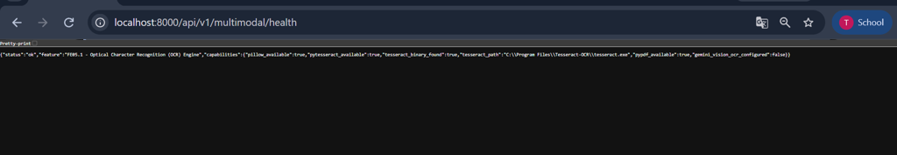
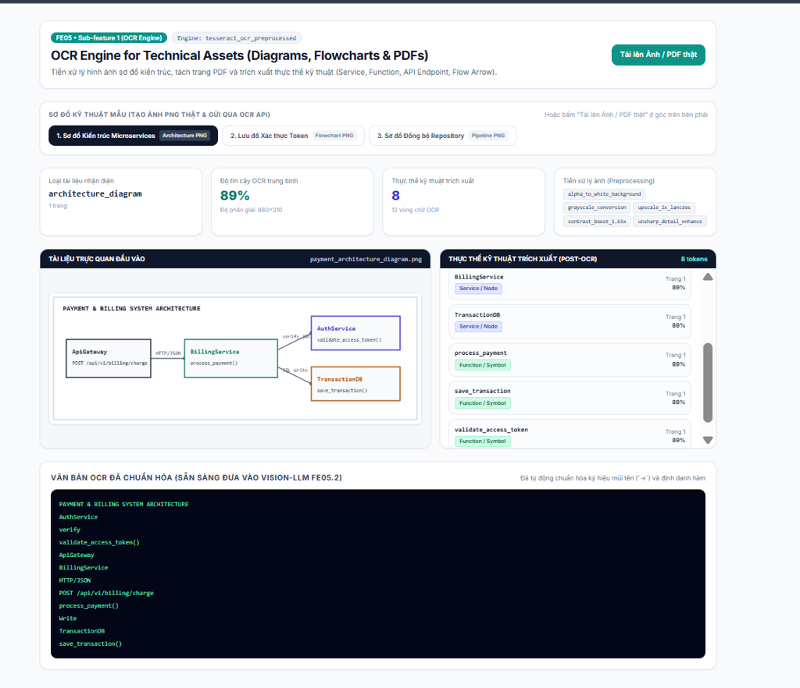
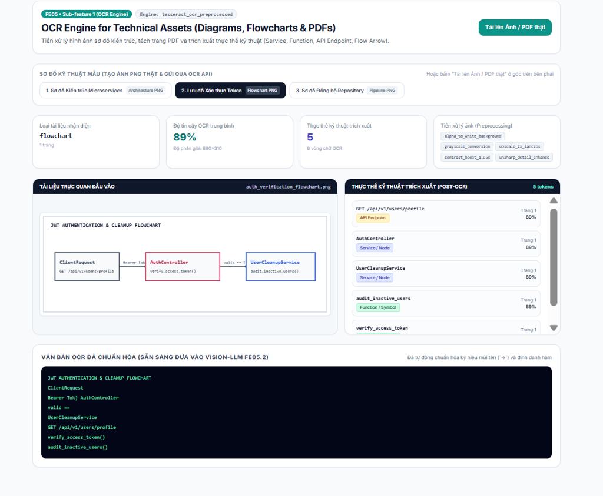
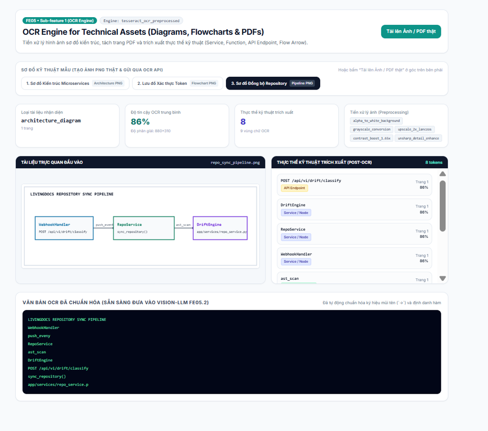
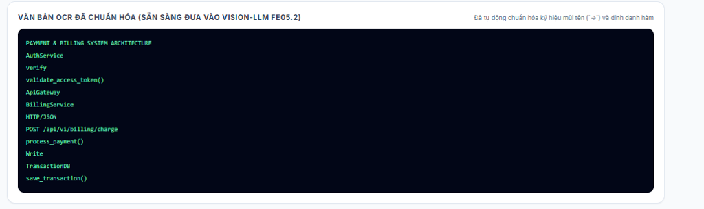
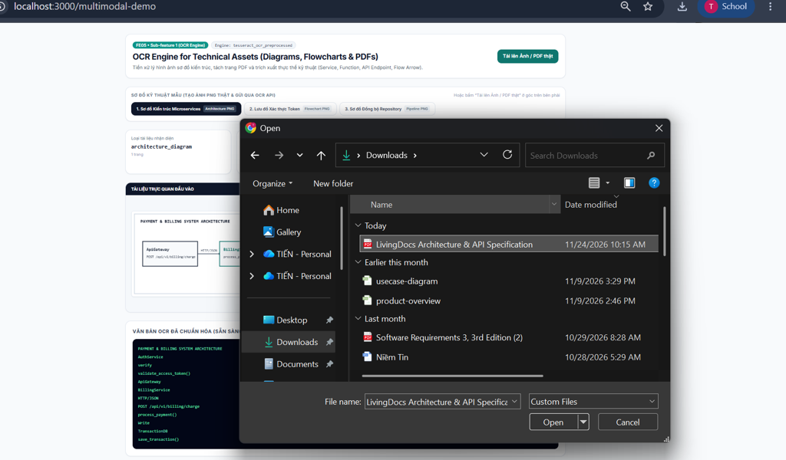
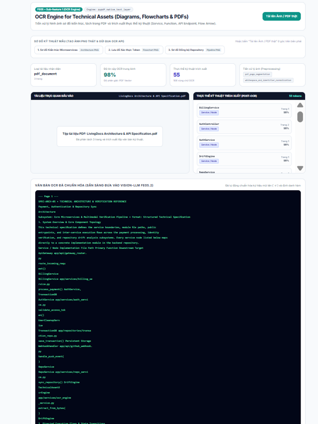

# Optical Character Recognition \(OCR\) Engine for Technical Assets

<http://localhost:3000/multimodal-demo>

**Optical Character Recognition (OCR) Engine for Technical Assets (FE05.1)** là bộ tiếp nhận và giải mã tài liệu phi văn bản (sơ đồ kiến trúc, lưu đồ `flowchart`, ảnh chụp màn hình và tệp PDF nhiều trang), biến hình ảnh tĩnh thành các **thực thể kỹ thuật có cấu trúc** để chuẩn bị cho bước phân tích ngữ nghĩa (FE05.2) và đối chiếu mã nguồn (FE05.3).

Hệ thống xử lý qua **3 tầng tự động**:

- **Tiền xử lý ảnh kỹ thuật (Preprocessing):** Tự động chuyển nền trong suốt sang nền trắng, đổi sang thang xám (`grayscale`), phóng đại `2x` bằng thuật toán Lanczos cho ảnh dưới `1000px`, tăng độ tương phản `1.65x` và làm sắc nét nét chữ nhỏ trong các hộp sơ đồ.
- **Đa tầng nhận diện (Multi-Backend OCR):** Ưu tiên chạy **Tesseract OCR** (`--psm 11` chuyên trị các nhãn rời rạc trên sơ đồ) $\\rightarrow$ tự động chuyển sang **Gemini Vision OCR** nếu máy chưa cài gói thực thi Tesseract nhưng có `GEMINI_API_KEY` $\\rightarrow$ dùng **Specimen Metadata Fallback** cho bộ sơ đồ mẫu để đảm bảo luồng demo luôn thông suốt.
- **Hậu xử lý & phân loại thực thể (Post-OCR Tokenizer):** Chuẩn hóa các ký hiệu mũi tên (`—>`, `–>` thành `->`) và tự động gom các từ khóa nhận diện được thành 5 nhóm kỹ thuật: **Service / Node**, **Function / Symbol**, **API Endpoint**, **File Path**, và **Flow Edge (**`->`**)**.

**Bước 1 — Kiểm tra trạng thái năng lực OCR của Backend:**

- Mở nhanh tab mới tới `http://localhost:8000/api/v1/multimodal/health`.
- 

- **Kết quả :** API trả về JSON liệt kê rõ trạng thái từng thành phần trên máy bạn (`pillow_available`, `pytesseract_available`, `tesseract_binary_found`, `pypdf_available`, `gemini_vision_ocr_configured`).

**Bước 2 — Kiểm tra sơ đồ kiến trúc mặc định (**`1. Sơ đồ Kiến trúc Microservices`**):**

- Quay lại `http://localhost:3000/multimodal-demo`, quan sát 4 thẻ thông số phía trên và 2 khung đối chiếu bên dưới.
- 

- **Kết quả :**
    - Thẻ **Loại tài liệu nhận diện** hiển thị `architecture_diagram` (`1 trang`), độ phân giải gốc `880x310`.
    - Thẻ **Tiền xử lý ảnh** hiển thị đầy đủ 5 bước đã kích hoạt: `alpha_to_white_background`, `grayscale_conversion`, `upscale_2x_lanczos`, `contrast_boost_1.65x`, `unsharp_detail_enhance`.
    - Khung bên phải (**Thực thể kỹ thuật trích xuất**) tách thay vì chế độ dự phòng đọc metadata ẩn (`12 tokens`) như mô tả trước đó.

      Tesseract đã nhận diện thành công **12 vùng chữ OCR** trên bức ảnh và lọc ra trọn vẹn **8 thực thể kỹ thuật** hiện diện trên mặt hình:
        - **4 Service / Node:** `ApiGateway`, `BillingService`, `AuthService`, `TransactionDB`
        - **3 Function / Symbol:** `process_payment`, `validate_access_token`, `save_transaction`
        - **1 API Endpoint:** `POST /api/vi/billing/charge` *(Tesseract đọc nhầm ký tự *`v1`* thành *`vi`*, nhưng bộ lọc vẫn nhận diện chính xác endpoint nhờ tiền tố *`/api`*)*
    - **Lý do vắng mặt 4 token còn lại (so với con số 12 ở chế độ metadata):**
        - **1 đường dẫn tệp (**`app/services/billing_service.py`**):** Chuỗi này chỉ gắn trong metadata mẫu chứ không được vẽ lên khung hình Canvas nên OCR không quét thấy.
        - **3 cạnh luồng (**`->`**):** Trên ảnh là **đường vẽ mũi tên đồ họa** kèm nhãn (`HTTP/JSON`, `verify_jwt`, `SQL Write`) chứ không phải ký tự văn bản `->`.

**Bước 3 — Kiểm tra nhận diện lưu đồ (**`2. Lưu đồ Xác thực Token`**) và sơ đồ pipeline (**`3. Sơ đồ Đồng bộ Repository`**):**

- Bấm lần lượt vào nút **2. Lưu đồ Xác thực Token** và **3. Sơ đồ Đồng bộ Repository** trên thanh công cụ.
- **Kết quả :**
- 
- 
    - Ở mẫu số 2, hệ thống tự nhận diện loại tài liệu chuyển sang `flowchart`, trích xuất đúng tên hàm lỗi thời `verify_access_token()` và hàm `audit_inactive_users()` (dữ liệu mồi để FE05.3 bắt lỗi sai lệch với code ở bước sau).
    - 
- 
    - Ở mẫu số 3, hệ thống trích xuất đúng chuỗi luồng `WebhookHandler -> RepoService` và `RepoService -> DriftEngine`.

**Bước 4 — Kiểm tra văn bản chuẩn hóa đầu ra cho FE05.2:**

- Kéo xuống khung tối màu **Văn bản OCR đã chuẩn hóa** ở cuối trang.
- 

- **Kết quả :** Toàn bộ nội dung đọc được từ ảnh đã được làm sạch khoảng trắng, chuẩn hóa ký hiệu mũi tên `->` và sẵn sàng làm đầu vào cho tầng **Vision-LLM Context Extractor (FE05.2)**.

**Bước 5 — Kiểm thử tải lên tệp PDF hoặc ảnh thật từ máy tính:**

- Bấm nút xanh `Tải lên Ảnh / PDF thật` ở góc trên bên phải và chọn một tệp `.pdf` tài liệu kỹ thuật nhiều trang (hoặc ảnh chụp màn hình sơ đồ `.png`/`.jpg` bất kỳ trên máy).
- 
- 

- **Kết quả :** Nếu là PDF có lớp văn bản, `Engine` tự chuyển sang `pypdf_native_text_layer`, tách từng trang (`--- Page 1 ---`, `--- Page 2 ---`) và tự động lọc ra toàn bộ tên hàm, đường dẫn tệp, endpoint có trong tài liệu PDF đó.
