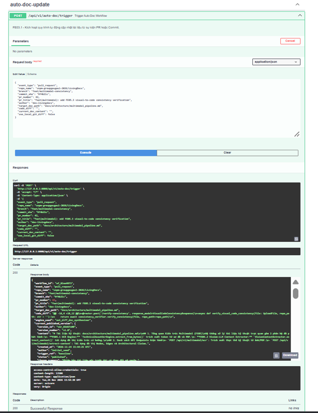
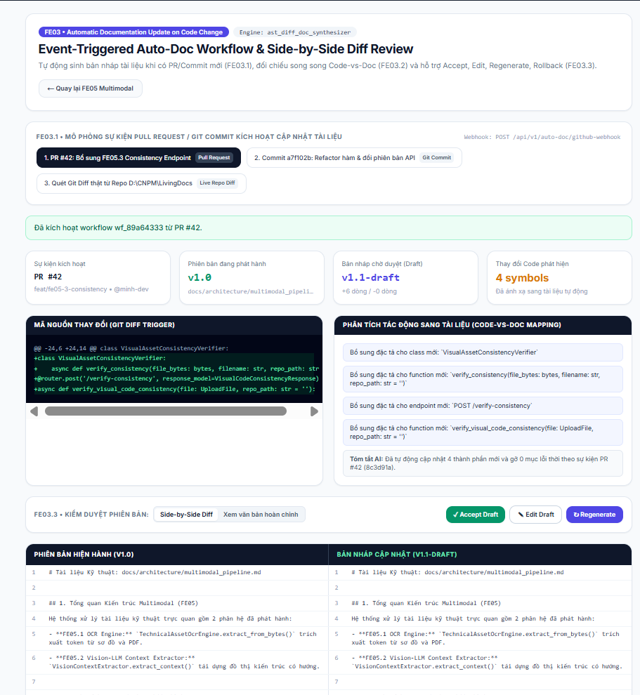
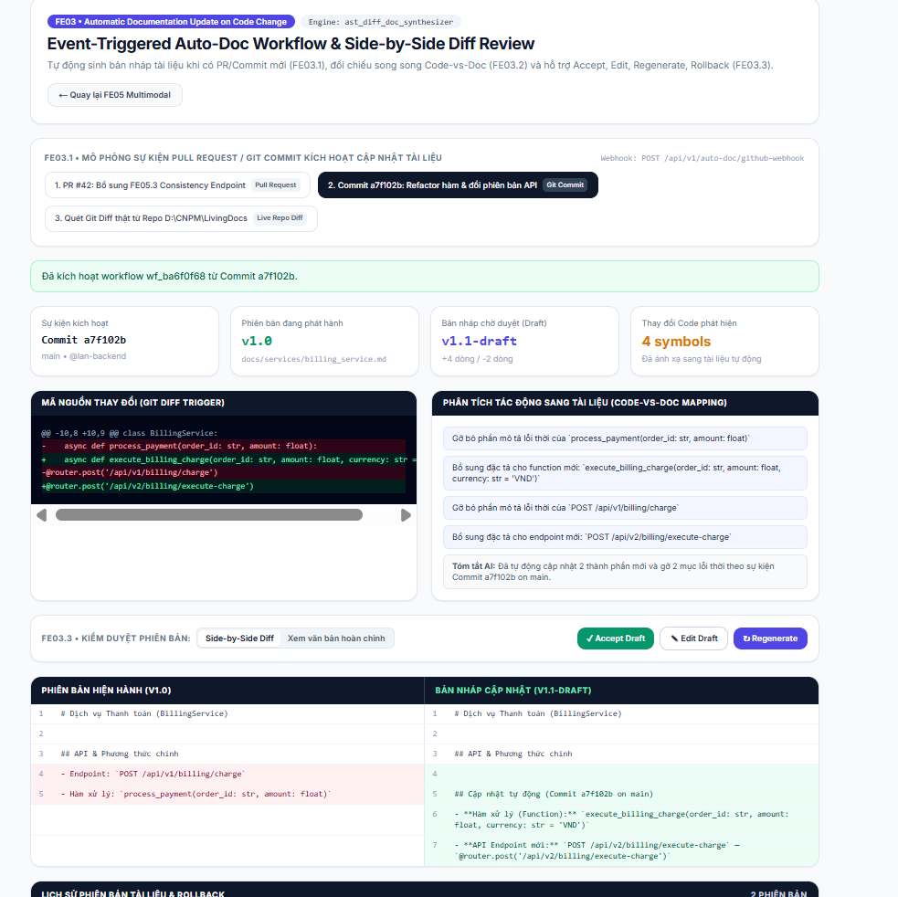
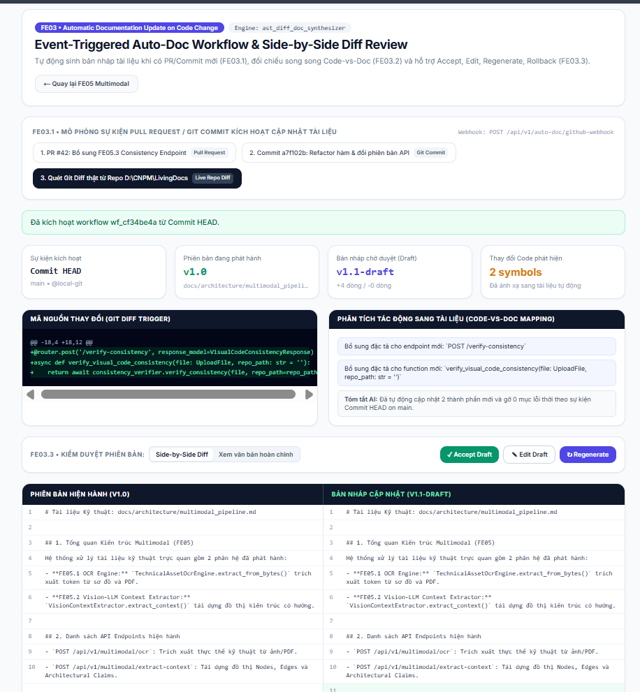
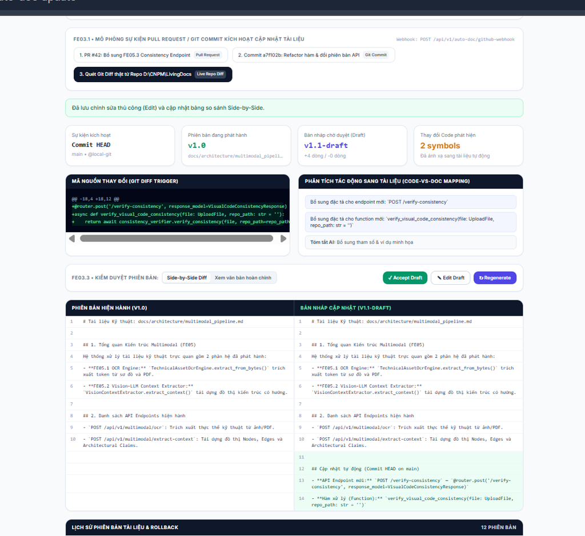
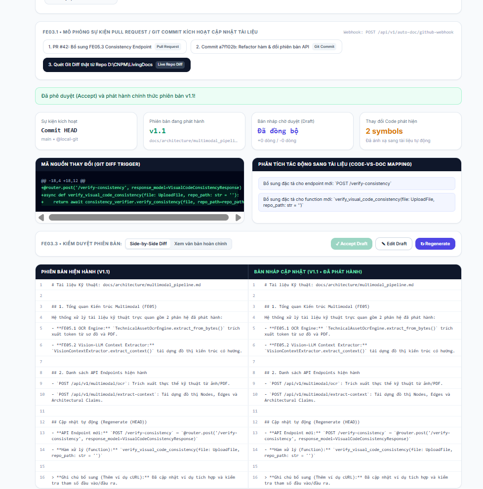
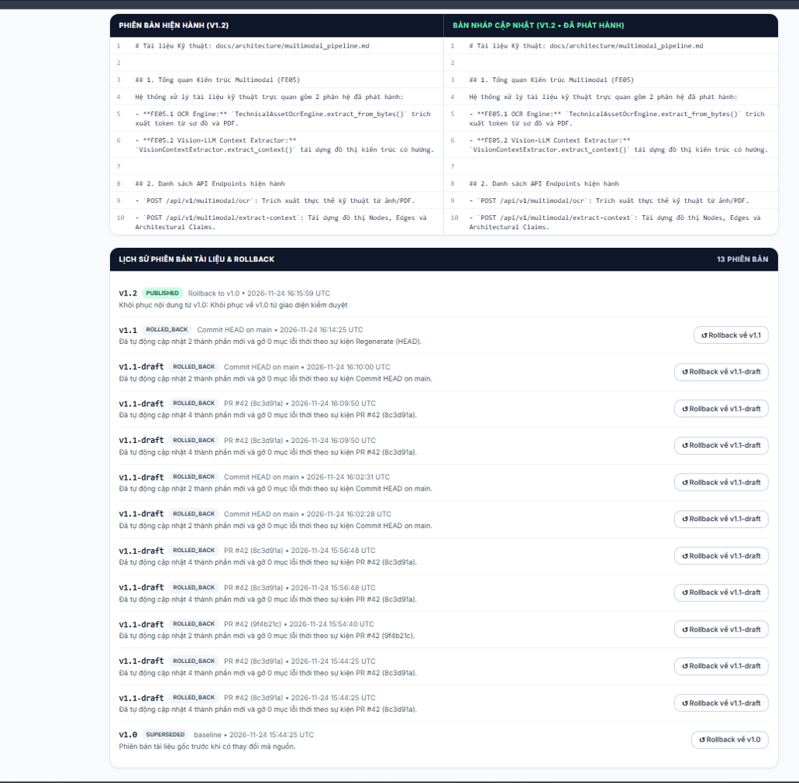
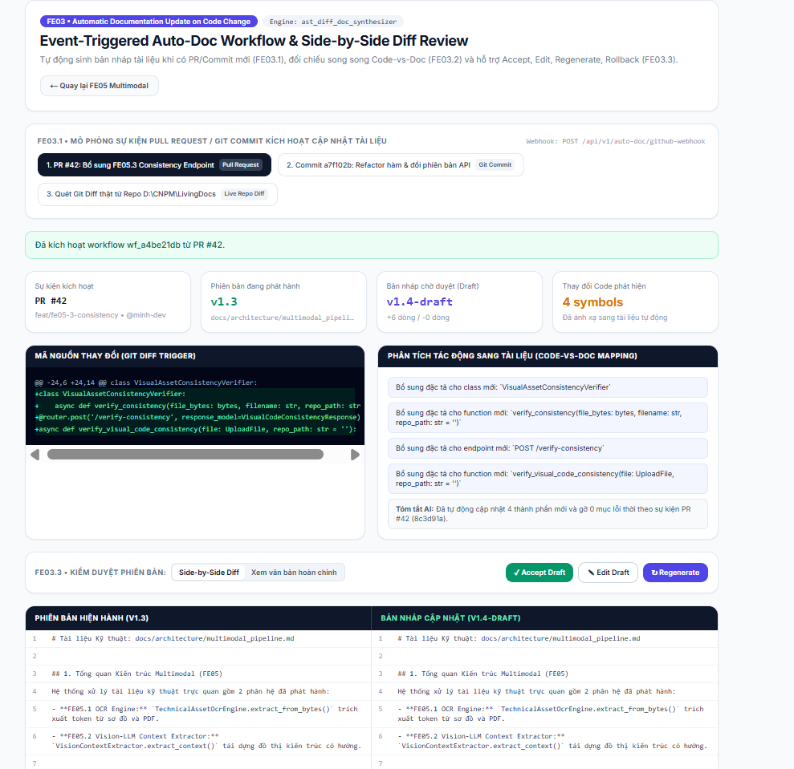

# Event\-Triggered Auto\-Update Workflow \(PR\.Commit\),	 Code\-vs\-Doc Side\-by\-Side Version Comparison Logic ,	 Action Handlers \(Accept, Edit, Regenerate, Rollback\)

<http://localhost:3000/auto-doc-update>

**Event-Triggered Auto-Update Workflow (FE03.1)** kết hợp cùng **Code-vs-Doc Side-by-Side Comparison (FE03.2)** và **Action Handlers (FE03.3)** tự động hóa toàn bộ vòng đời cập nhật tài liệu kỹ thuật ngay khi mã nguồn thay đổi qua Pull Request, Git Commit hoặc GitHub Webhook.

### Cơ chế vận hành 3 tầng của FE03

- **Tiếp nhận sự kiện & bóc tách Git Diff (FE03.1 Event Trigger):** Lắng nghe sự kiện từ Pull Request, Commit hoặc Webhook (`X-GitHub-Event: push | pull_request`), tự động đọc diff cục bộ (`git diff HEAD~1 -- backend/app`) hoặc payload gửi lên để trích xuất danh sách thay đổi về `endpoint`, `class`, và `function`.
- **Sinh bản nháp & đối chiếu song song (FE03.2 Code-vs-Doc Diff Engine):** Kết hợp **Gemini 2.5 Flash** (hoặc bộ tổng hợp cục bộ `ast_diff_doc_synthesizer` khi chạy offline) để cập nhật nội dung Markdown, sau đó dùng thuật toán so khớp từng dòng (`SequenceMatcher`) tạo bảng **Side-by-Side Diff** làm nổi bật dòng thêm mới (`added`), xóa bỏ (`removed`) và chỉnh sửa (`modified`).
- **Kiểm duyệt & quản lý vòng đời phiên bản (FE03.3 Version Lifecycle):** Lưu trữ bền vững toàn bộ lịch sử phiên bản tại `backend/data/fe03_doc_workflows.json`, cho phép developer **Accept Draft** (phát hành chính thức), **Edit Draft** (sửa trực tiếp), **Regenerate** (sinh lại kèm chỉ dẫn mới) hoặc **Rollback** về bất kỳ mốc ổn định nào.

- **Bước 1 — Kiểm tra Endpoint Backend trên Swagger UI (**`http://localhost:8000/docs`**):**
    - Mở nhóm `auto-doc-update` -\> chọn `POST /api/v1/auto-doc/trigger` -\> bấm **Try it out** -\> giữ nguyên payload mặc định và bấm **Execute**.
- 
    - **Kết quả :** API trả về mã `200 OK` với JSON `AutoDocWorkflowResponse` chứa `workflow_id`, `engine_used`, `current_published_version` (`v1.0`), `active_draft_version` (`v1.1-draft`), mảng `side_by_side_diff` và `version_history`.
- **Bước 2 — Kiểm thử sự kiện Pull Request (**`1. PR #42: Bổ sung FE05.3 Consistency Endpoint`**):**
    - Trên trang `http://localhost:3000/auto-doc-update`, quan sát kết quả mặc định của mẫu số 1 (hoặc bấm lại nút `1. PR #42`).
- 
    - **Kết quả :**
        - Hàng KPI hiển thị sự kiện `PR #42` (`feat/fe05-3-consistency • @minh-dev`), phiên bản hiện hành `v1.0`, bản nháp chờ duyệt `v1.1-draft` và `3 symbols` thay đổi được phát hiện.
        - Khung **Phân tích tác động sang tài liệu** liệt kê đầy đủ 3 mục bổ sung (`VisualAssetConsistencyVerifier`, `verify_consistency(...)`, `POST /verify-consistency`).
        - Bảng **Side-by-Side Diff** tô xanh toàn bộ các dòng đặc tả mới ở cột phải (`v1.1-draft`) đối chiếu trực tiếp với cột trái (`v1.0`).
- **Bước 3 — Kiểm thử sự kiện Git Commit Refactor (**`2. Commit a7f102b: Refactor hàm & đổi phiên bản API`**):**
    - Bấm chọn nút `2. Commit a7f102b: Refactor hàm & đổi phiên bản API` trên thanh **FE03.1**.
      
- 
    - **Kết quả:**
        - Thẻ **Sự kiện kích hoạt** chuyển sang `Commit a7f102b` (`main • @lan-backend`) nhắm tới tệp `docs/services/billing_service.md`.
        - Bộ bóc tách diff nhận diện đồng thời cả chữ ký cũ bị xóa (`- POST /api/v1/billing/charge`, `- process_payment`) và chữ ký mới thêm vào (`+ POST /api/v2/billing/execute-charge`, `+ execute_billing_charge`).
        - Bảng **Side-by-Side Diff** tô đỏ các dòng API v1 lỗi thời ở cột trái và tô xanh các dòng API v2 mới ở cột phải.
- **Bước 4 — Kiểm thử quét Git Diff thật từ Repository (**`3. Quét Git Diff thật từ Repo D:\CNPM\LivingDocs`**) & GitHub Webhook:**
    - Bấm chọn nút `3. Quét Git Diff thật từ Repo D:\CNPM\LivingDocs` để kích hoạt lệnh `git diff HEAD~1 -- backend/app` trực tiếp trên mã nguồn dự án của bạn.
    - Ngoài ra, có thể thử thêm endpoint `POST /api/v1/auto-doc/github-webhook` trên Swagger UI với header `x-github-event: pull_request` để kiểm tra luồng nhận webhook chuẩn từ GitHub.
      
- 
    - **Kết quả :** Khung **Mã nguồn thay đổi (Git Diff Trigger)** hiển thị đúng đoạn diff thực tế từ commit gần nhất trong repository cục bộ và tự động sinh bản nháp cập nhật tương ứng.
- **Bước 5 — Kiểm tra tính toàn vẹn xuyên suốt quy trình (**`FE03.1 Trigger`** \<-\>**`FE03.2 Diff`** \<-\> **`FE03.3 Actions`**):**
    - Trên cùng một workflow đang mở, thao tác lần lượt thanh công cụ **FE03.3 • Kiểm duyệt phiên bản**:
      
    - 
        - Bấm `✎ Edit Draft` -\>sửa nội dung Markdown và bấm **Lưu chỉnh sửa & Cập nhật Diff** (bảng Side-by-Side tính lại diff ngay lập tức).
          
    - 
        - Bấm `↻ Regenerate` -\> nhập chỉ dẫn bổ sung (ví dụ: *"Thêm ví dụ cURL"*) và bấm **Chạy Regenerate**.
          
    - 
        - Bấm `✓ Accept Draft` -\> bản nháp `v1.1-draft` được nâng cấp thành phiên bản chính thức `v1.1`** (**`published`**)**.
          
    - 
        - Tại bảng **Lịch sử phiên bản tài liệu & Rollback** bên dưới, bấm `↺ Rollback về v1.0` -\> hệ thống tạo mốc `v1.2` khôi phục nguyên vẹn nội dung `v1.0` và ghi xuống tệp `backend/data/fe03_doc_workflows.json` (nhấn `F5` tải lại trang vẫn giữ nguyên lịch sử).
          
          
