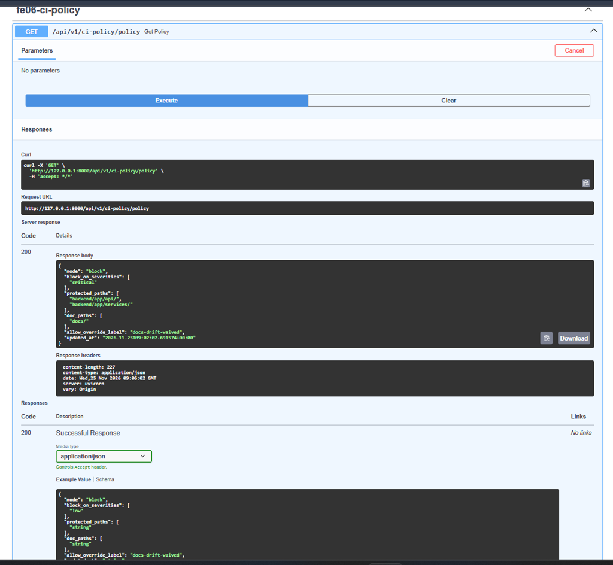
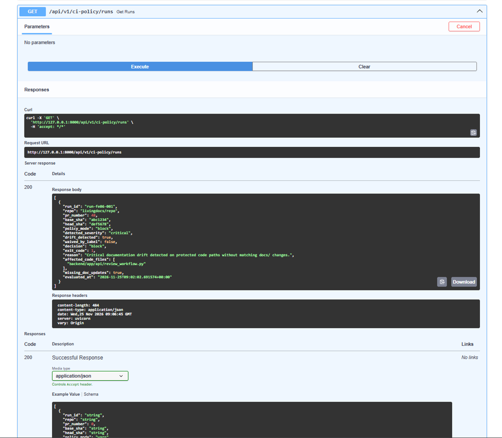
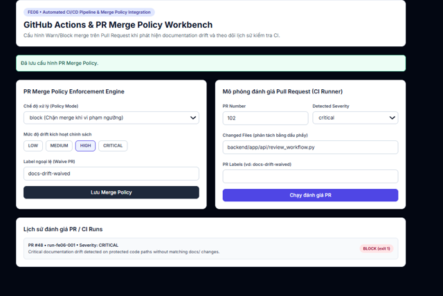
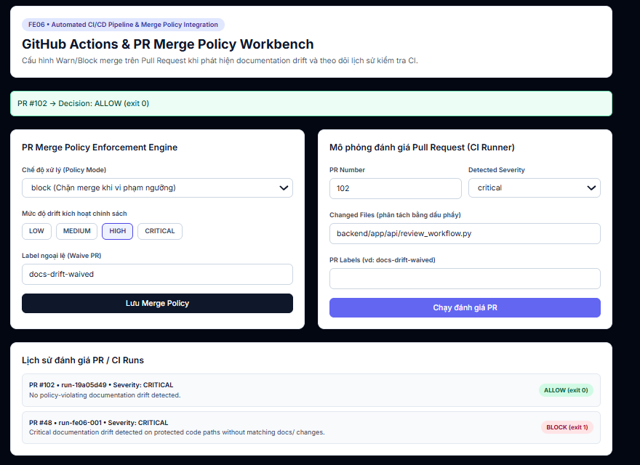
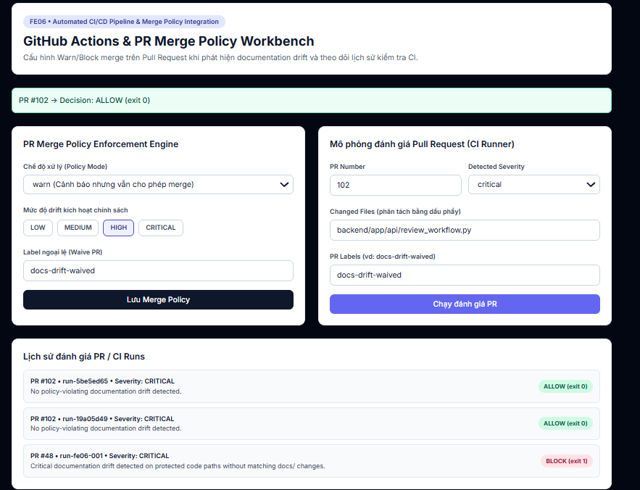
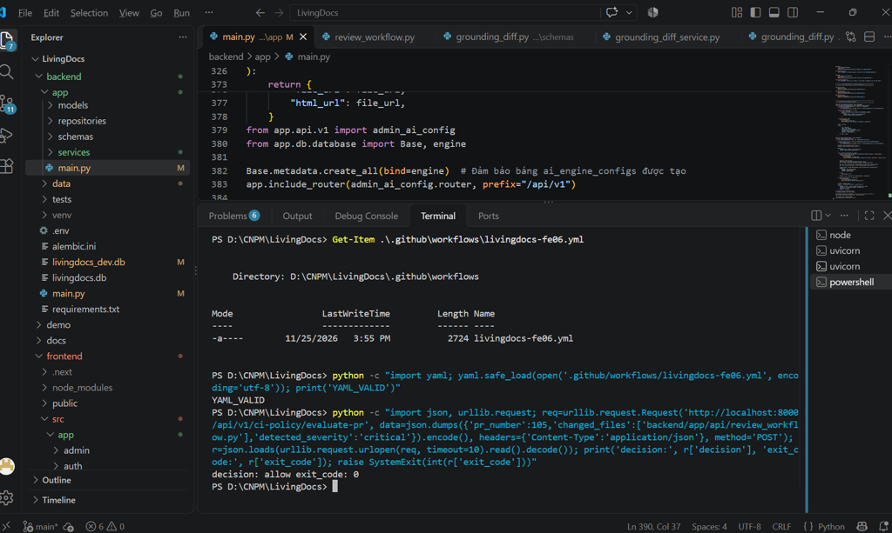

# demo chi tiết 10\.1,10\.2

<http://localhost:3000/ci-policy>

**Automated CI/CD Pipeline & Merge Policy Integration (FE06)** tích hợp việc kiểm tra độ lệch tài liệu (documentation drift) và chính sách hợp nhất Pull Request vào thẳng quy trình CI của GitHub Actions, trải dài trên hai phân hệ chính: **GitHub Actions Custom Workflow & Runner Integration** và **PR Merge Policy Enforcement Engine (Warn/Block Merge)**. Mục tiêu là tự động phát hiện thay đổi mã nguồn trên các đường dẫn được bảo vệ mà thiếu cập nhật tài liệu tương ứng, sau đó áp dụng quy tắc cảnh báo hoặc chặn merge theo cấu hình của dự án.

- **Cấp 1 — GitHub Actions Custom Workflow & Runner Integration:** Khi Pull Request nhắm vào `main` được mở hoặc cập nhật, workflow `.github/workflows/livingdocs-fe06.yml` lấy lịch sử commit (`fetch-depth: 0`), trích xuất danh sách tệp thay đổi giữa `base_sha` và `head_sha`, gửi dữ liệu tới endpoint `/api/v1/ci-policy/evaluate-pr`, ghi tóm tắt vào GitHub Step Summary và trả exit code `0` hoặc `1` theo kết quả đánh giá.
- **Cấp 2 — PR Merge Policy Enforcement Engine (Warn / Block Merge):** Bộ quy tắc kiểm tra xem PR có chạm vào `protected_paths` mà thiếu thay đổi ở `doc_paths` hoặc có mức độ drift nằm trong `block_on_severities` hay không. Nếu đạt ngưỡng kích hoạt và không có nhãn ngoại lệ (`docs-drift-waived`), chế độ `block` trả `exit_code = 1` để chặn merge, còn chế độ `warn` trả `exit_code = 0` kèm cảnh báo.

**demo kiểm thử **

- **Bước 1 — Kiểm tra Endpoint Backend & Chính sách Mặc định (**`http://localhost:8000/docs`**):** Mở nhóm `fe06-ci-policy`, gọi `GET /api/v1/ci-policy/policy` và `GET /api/v1/ci-policy/runs` bằng **Try it out** -\> **Execute**.
- 
- 

- 
    - *Kết quả mong đợi:* Trả về `200 OK` với cấu hình policy hiện tại (`mode`, `block_on_severities`, `protected_paths`, `doc_paths`, `allow_override_label`) cùng danh sách lịch sử chạy đánh giá PR.
- **Bước 2 — Cấu hình Chính sách Warn / Block trên Giao diện (**`http://localhost:3000/ci-policy`**):** Trên trang `/ci-policy`, chọn **Policy Mode** là `block` (hoặc `warn`), bật/tắt các mức severity (`LOW`, `MEDIUM`, `HIGH`, `CRITICAL`), kiểm tra nhãn ngoại lệ và bấm **Lưu Merge Policy**.
- 
- 
    - *Kết quả mong đợi:* Banner xanh xác nhận đã lưu cấu hình PR Merge Policy và `GET /api/v1/ci-policy/policy` phản ánh đúng giá trị mới.
- **Bước 3 — Mô phỏng Pull Request Vi phạm Drift ở Chế độ Block:** Ở khung **Mô phỏng đánh giá Pull Request (CI Runner)**, nhập `PR Number` (ví dụ `102`), `Changed Files` là `backend/app/api/review_workflow.py`, chọn `Detected Severity` là `critical`, để trống `PR Labels` và bấm **Chạy đánh giá PR**.
- 
- 
    - *Kết quả mong đợi:* Kết quả trả về quyết định `BLOCK (exit 1)` và mục mới xuất hiện ở đầu danh sách **Lịch sử đánh giá PR / CI Runs**.
- **Bước 4 — Kiểm thử Nhãn Ngoại lệ (Waive) & Chế độ Warn:** Nhập `docs-drift-waived` vào ô **PR Labels** rồi bấm **Chạy đánh giá PR** (hoặc chuyển **Policy Mode** sang `warn` rồi chạy lại đánh giá).
- 
- 
    - *Kết quả mong đợi:* Hệ thống chuyển quyết định sang `WARN (exit 0)` kèm lý do cho phép merge có cảnh báo thay vì chặn.
- **Bước 5 — Đối chiếu Workflow GitHub Actions (**`.github/workflows/livingdocs-fe06.yml`**):** Kiểm tra file workflow có kích hoạt trên `pull_request` tới nhánh `main`, đọc `BASE_SHA`/`HEAD_SHA`, gọi `/api/v1/ci-policy/evaluate-pr` và thoát theo `result["exit_code"]`.
- 
- 
    - *Kết quả mong đợi:* Logic chạy trên CI runner đồng nhất với kết quả mô phỏng trên giao diện `/ci-policy` (`exit 1` khi `block`, `exit 0` khi `allow` hoặc `warn`).
