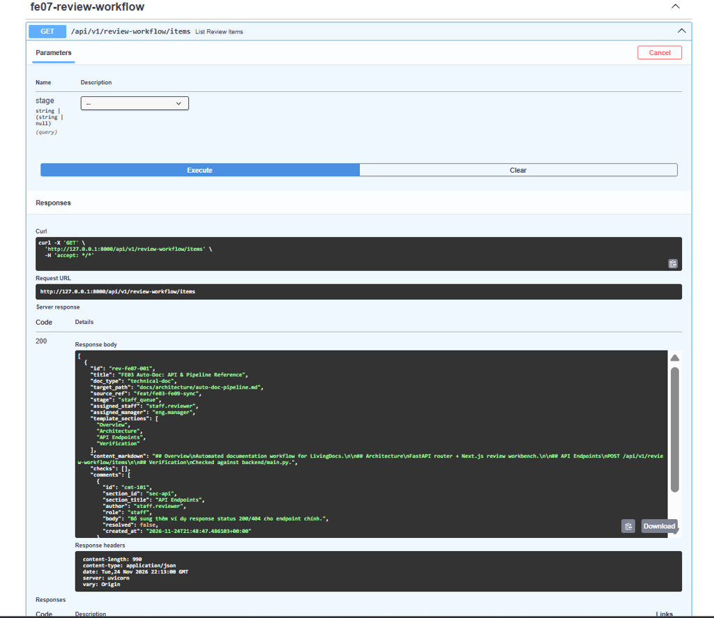
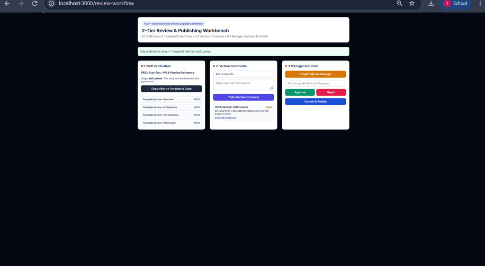
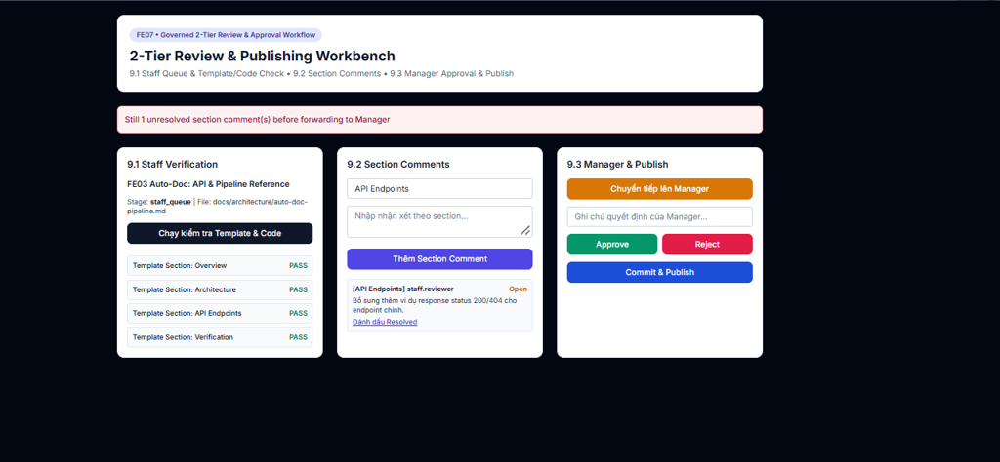
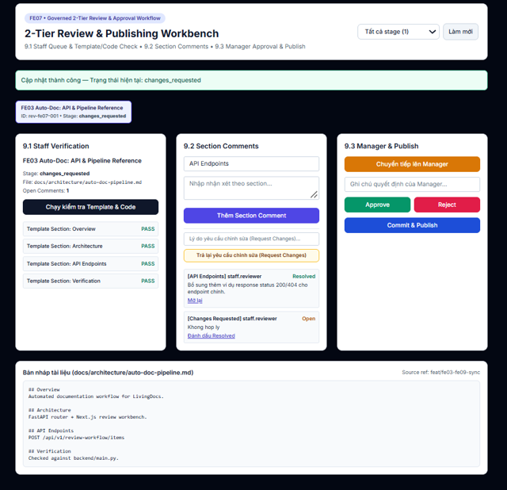
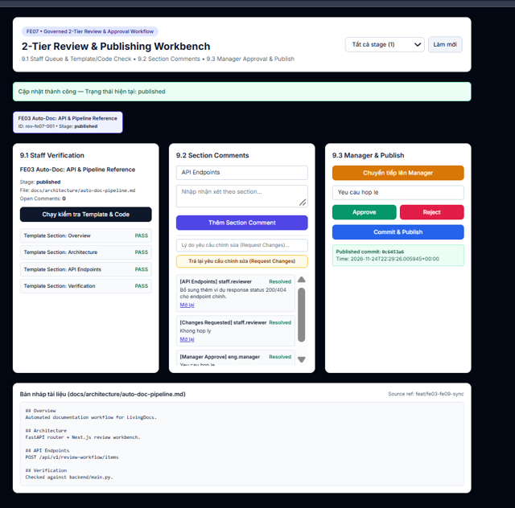

# demo chi tiet 9\.1,9\.1,9\.3

<http://localhost:3000/review-workflow>

**Governed 2-Tier Review & Approval Workflow (FE07)** tổ chức quy trình kiểm duyệt tài liệu theo 2 cấp (Staff Reviewer và Manager) trải dài qua 3 cụm chức năng: **Staff Review Queue & Code/Template Verification Engine (9.1)**, **Section-level Commenting & Feedback Pipeline (9.2)**, và **Manager Approval Workflow & Automated Commit/Publishing (9.3)**. Mục tiêu là chặn tài liệu thiếu cấu trúc hoặc còn ý kiến chưa xử lý từ sớm, sau đó mới cho phép cấp quản lý phê duyệt và xuất bản/commit.

- **Cấp 1 — Kiểm tra kỹ thuật & phản hồi theo section (9.1 & 9.2):** Staff Reviewer chọn tài liệu trong hàng chờ (`staff_queue`), chạy bộ kiểm tra đối chiếu các section template bắt buộc hoặc tham chiếu code (`PASS`/`FAIL`), đồng thời ghi chú theo từng section, đánh dấu `Resolved` hoặc trả lại (`changes_requested`) nếu cần sửa. Hệ thống kiểm soát điều kiện chuyển tiếp lên Manager để tránh bỏ sót phản hồi mở.
- **Cấp 2 — Phê duyệt cấp Manager & tự động commit/publish (9.3):** Khi hồ sơ được chuyển sang `manager_approval`, Manager xem xét và chọn `Approve` (`approved`) hoặc `Reject` (`rejected`) kèm ghi chú. Sau khi đạt trạng thái `approved`, thao tác **Commit & Publish** chuyển hồ sơ sang `published` và ghi nhận mã commit xuất bản.

**Bước 1 — Kiểm tra Endpoint Backend & Trạng thái Khởi tạo:**Swagger UI tại <http://localhost:8000/docs>.

Mở `http://localhost:8000/docs`, tìm nhóm `fe07-review-workflow`, chọn `GET /api/v1/review-workflow/items`, bấm **Try it out** rồi bấm **Execute**.

*Verification:* Phản hồi trả về `200 OK` với danh sách hồ sơ chứa item mẫu `rev-fe07-001` (`stage: "staff_queue"`, danh sách `template_sections`, `checks` và `comments`).

**Bước 2 — Kiểm thử 9.1 Staff Verification (Template & Code Check):**Cột 9.1 trên 

Trên giao diện `/review-workflow`, chọn item đang ở `staff_queue` và bấm **Chạy kiểm tra Template & Code**.

*Verification:* Các dòng kiểm tra section xuất hiện dưới nút bấm với trạng thái `PASS` (xanh) hoặc `FAIL` (đỏ), không báo lỗi kết nối tới backend `8000`.

**Bước 3 — Kiểm thử 9.2 Section Comments & Ràng buộc Resolved:**Cột 9.2 trên 

Thử bấm **Chuyển tiếp lên Manager** khi vẫn còn comment đang `Open`, sau đó nhập tên section và nội dung nhận xét mới, bấm **Thêm Section Comment**, rồi bấm **Đánh dấu Resolved** cho các comment cần đóng.

*Verification:* Khi còn comment `Open`, hệ thống báo lỗi chặn chuyển tiếp; sau khi bấm **Đánh dấu Resolved**, trạng thái comment đổi sang `Resolved` và bộ đếm `Open Comments` giảm tương ứng.

**Bước 4 — Kiểm thử Luồng Request Changes (Trả lại chỉnh sửa):**Cột 9.2 trên 

Nhập lý do vào ô **Lý do yêu cầu chỉnh sửa (Request Changes)...** và bấm **Trả lại yêu cầu chỉnh sửa (Request Changes)**.

*Verification:* `Stage` của hồ sơ chuyển sang `changes_requested` và lý do được lưu thành một comment mới trong danh sách.

**Bước 5 — Kiểm thử 9.3 Manager Approval & Automated Commit/Publishing:**Cột 9.3 trên 

Đảm bảo không còn comment `Open` và các check đạt yêu cầu, bấm **Chuyển tiếp lên Manager** (`manager_approval`), nhập ghi chú rồi bấm **Approve** (`approved`), sau đó bấm **Commit & Publish**.

*Verification:* Trạng thái đi lần lượt qua `manager_approval` -\> `approved` -\> `published`, và khung **Published commit** hiển thị mã commit cùng thời điểm xuất bản.
