# Side\-by\-Side Visual Code vs Doc Diff UI Component, Grounding Evidence Navigator \(File Path, Line, Commit Hash\)

<http://localhost:3000/grounding-diff>

**Interactive Code-vs-Doc Diff & Grounding Evidence Viewer (FE09.1)** kết hợp cùng **Grounding Evidence Navigator (FE09.2)** cung cấp không gian đối chiếu trực quan từng dòng giữa mã nguồn thay đổi và bản vá tài liệu đề xuất, đồng thời neo chặt mọi chỉnh sửa tài liệu vào bằng chứng thực tế trong kho mã nguồn (đường dẫn tệp, khoảng dòng code và mã commit hash).

### Cơ chế vận hành 2 tầng của FE09

- **Đối chiếu song song & liên kết hai chiều (FE09.1 Side-by-Side Visual Code vs Doc Diff):** Thành phần `SideBySideCodeVsDocDiffViewer` hiển thị đồng thời **Modified Source Code Diff (Git Hunk)** ở cột trái và **Suggested Documentation Patch** ở cột phải, hỗ trợ lọc theo từng tệp mã nguồn hoặc chỉ xem các dòng thêm/xóa (`+/-`), đồng thời tô sáng liên kết hai chiều mỗi khi người kiểm duyệt bấm vào nhãn bằng chứng (`EV-01`, `EV-02`, `EV-03`).
- **Điều hướng & xác minh bằng chứng mã nguồn thật (FE09.2 Grounding Evidence Navigator):** Thành phần `GroundingEvidenceNavigator` tự động đọc lịch sử `git log` cục bộ, quét trực tiếp cây thư mục `D:\CNPM\LivingDocs` để định vị tọa độ dòng thực tế (`start_line` – `end_line`), trích xuất đoạn mã gốc đang tồn tại trên ổ đĩa (`VERIFIED_IN_REPO`), và lưu bền vững trạng thái kiểm duyệt (`Verify Grounding` / `Flag Drift`) xuống tệp `backend/data/fe09_grounding_sessions.json`.

- **Bước 1 — Kiểm tra Endpoint Backend & Live Repo Grounding trên Swagger UI (**`http://localhost:8000/docs`**):**
    - Mở nhóm `grounding-diff-viewer` -\> chọn `POST /api/v1/grounding-diff/sessions` -\> bấm **Try it out** -\> giữ nguyên `"preset_id": "live_fe05_multimodal"` và bấm **Execute**.
      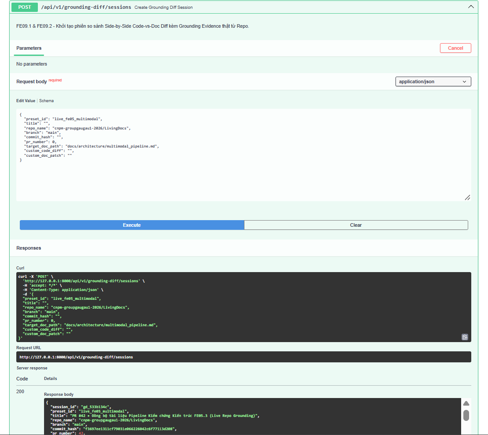
- 
    - **Kết quả :** API trả về mã `200 OK` với JSON `GroundingDiffSessionResponse` chứa `session_id` (`gd_...`), `commit_hash` lấy từ `git log -n 1` của repository cục bộ, mảng `code_diff_lines`, `doc_patch_lines`, `mapping_links` và danh sách `evidences` có trạng thái `VERIFIED_IN_REPO` kèm số dòng thật trên ổ đĩa.
- **Bước 2 — Kiểm thử FE09.1 Side-by-Side Visual Code vs Doc Diff (**`1. PR #42: FE05.3 Consistency Endpoint`**):**
    - Trên trang `http://localhost:3000/grounding-diff`, quan sát khung chia đôi giữa **Modified Source Code Diff** (cột trái) và **Suggested Documentation Patch** (cột phải).
    - Bấm trực tiếp vào dòng code có gắn nhãn `EV-01` hoặc `EV-02` ở cột trái (hoặc bấm vào dòng bản vá tài liệu tương ứng ở cột phải); thử đổi bộ lọc `Tất cả tệp code (3)` sang từng tệp riêng lẻ và bật/tắt nút `Hiển thị tất cả dòng`** / **`Đang lọc: Chỉ dòng +/-`.
      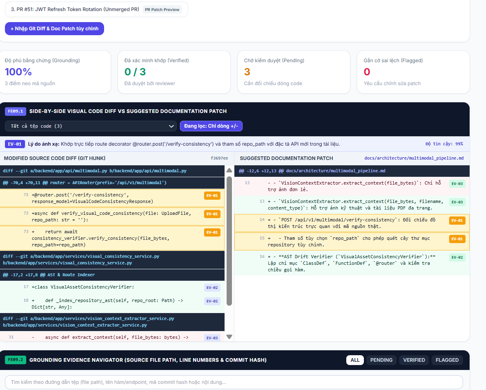
       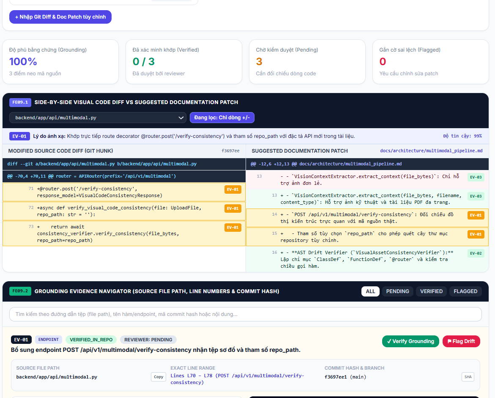
       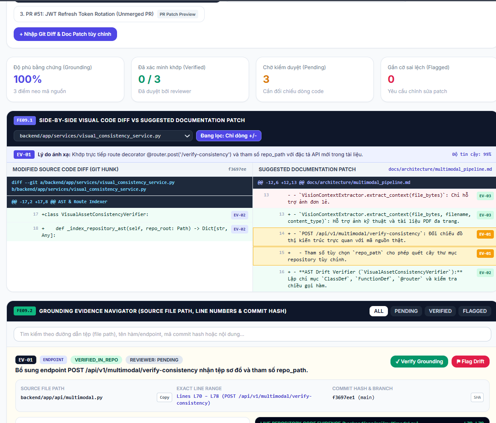
       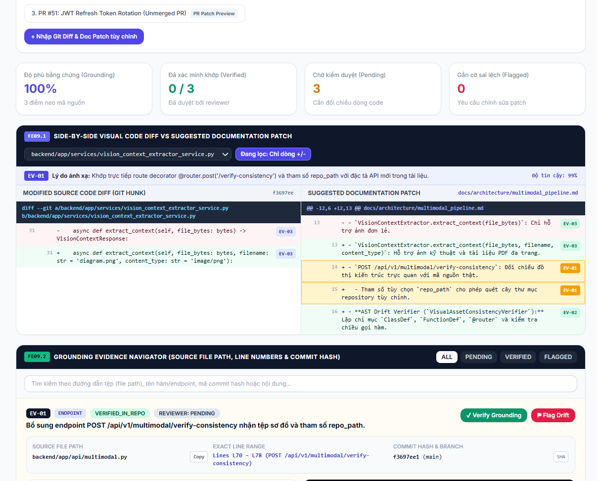
- 
    - **Kết quả :** Cả hai khung đồng loạt tô sáng viền vàng vùng liên kết tương ứng, hiển thị thanh giải thích **Lý do ánh xạ** kèm độ tin cậy (`99%`) và tự động chọn đúng thẻ bằng chứng trong Navigator bên dưới.
- **Bước 3 — Kiểm thử FE09.2 Grounding Evidence Navigator (File Path, Line Numbers, Commit Hash):**
    - Cuộn xuống phần **Grounding Evidence Navigator**, kiểm tra lần lượt từng thẻ `EV-01`, `EV-02`, `EV-03`:
       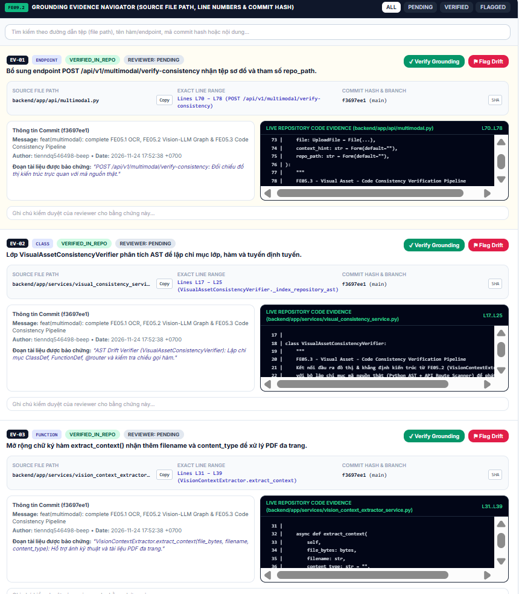
    - 
        - **Source File Path:** Hiển thị đường dẫn tệp nguồn (`backend/app/api/multimodal.py`) kèm nút `Copy` sao chép định dạng `file_path:line`.
        - **Exact Line Range:** Hiển thị khoảng dòng thật (`Lines L... – L...`) và tên symbol (`POST /api/v1/multimodal/verify-consistency`).
        - **Commit Hash & Branch:** Hiển thị mã commit rút gọn, tên nhánh (`main`) và nút `SHA` sao chép đủ 40 ký tự commit hash.
        - **Live Repository Code Evidence:** Khung nền tối hiển thị đúng số dòng và nội dung mã nguồn thực tế đang nằm trong `D:\CNPM\LivingDocs\backend\app\...`.
- **Bước 4 — Kiểm thử Luồng Kiểm duyệt Reviewer (**`Verify Grounding`** / **`Flag Drift`** & Lưu trữ bền vững):**
   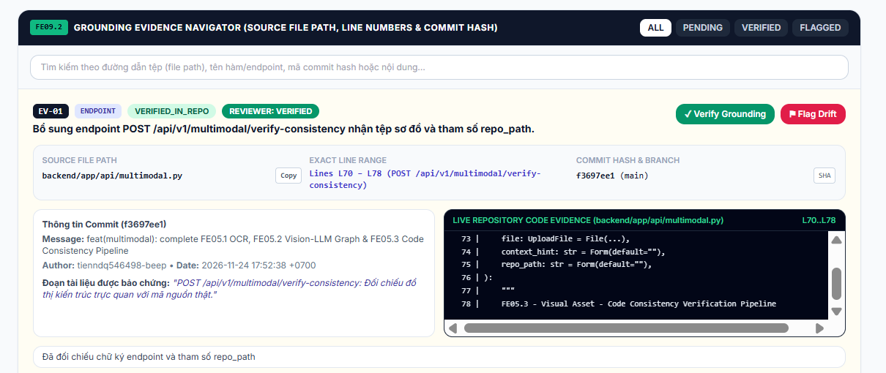
   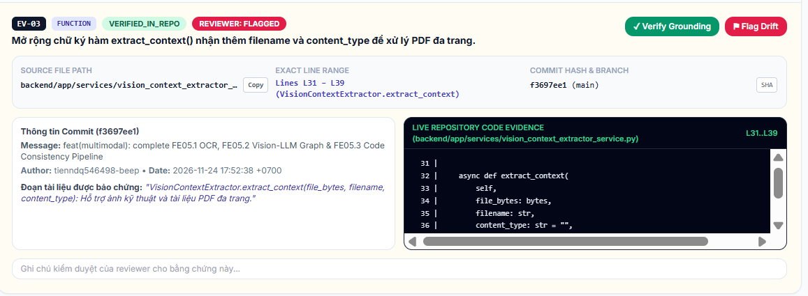
- 
    - Tại thẻ `EV-01`, nhập ghi chú vào ô *Ghi chú kiểm duyệt của reviewer...* (ví dụ: *"Đã đối chiếu chữ ký endpoint và tham số repo\_path"*) rồi bấm `✓ Verify Grounding`; tiếp tục bấm `⚑ Flag Drift` tại thẻ `EV-03`.
       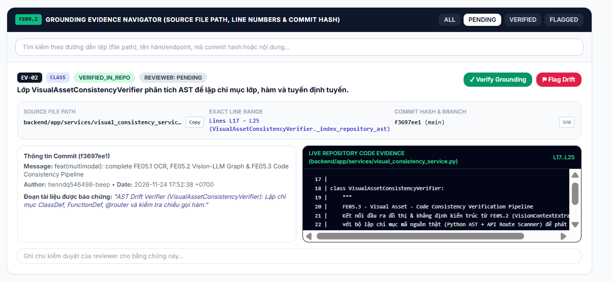
       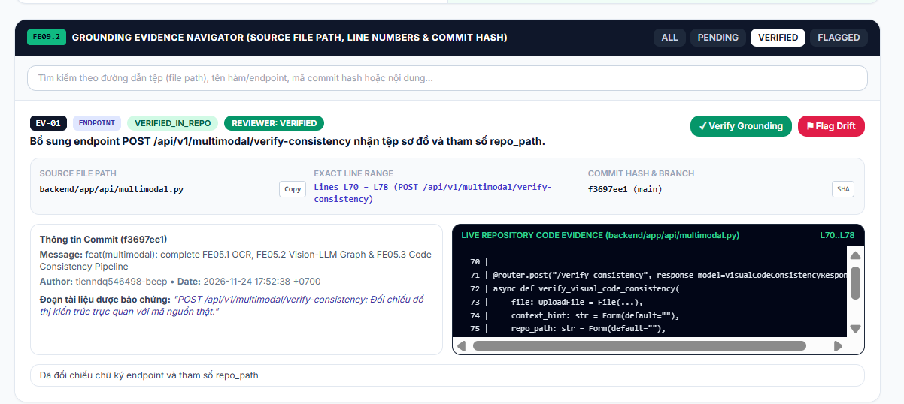
       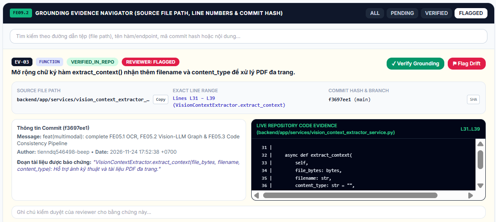
- 
    - Bấm lần lượt các nút lọc `ALL`** | **`PENDING`** | **`VERIFIED`** | **`FLAGGED` và nhập từ khóa tìm kiếm (ví dụ: `verify-consistency`).
       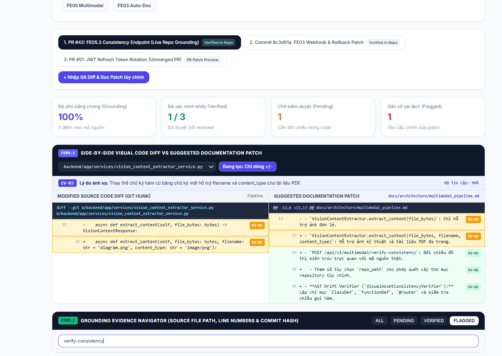
- 
    - **Kết quả :** Các thẻ KPI phía trên cập nhật ngay thành `Verified: 1 / 3`, `Pending: 1`, `Flagged: 1`, và trạng thái kiểm duyệt được ghi xuống tệp `backend/data/fe09_grounding_sessions.json`.
- **Bước 5 — Kiểm thử Chuyển đổi Kịch bản & Nhập Git Diff Tùy chỉnh:**
   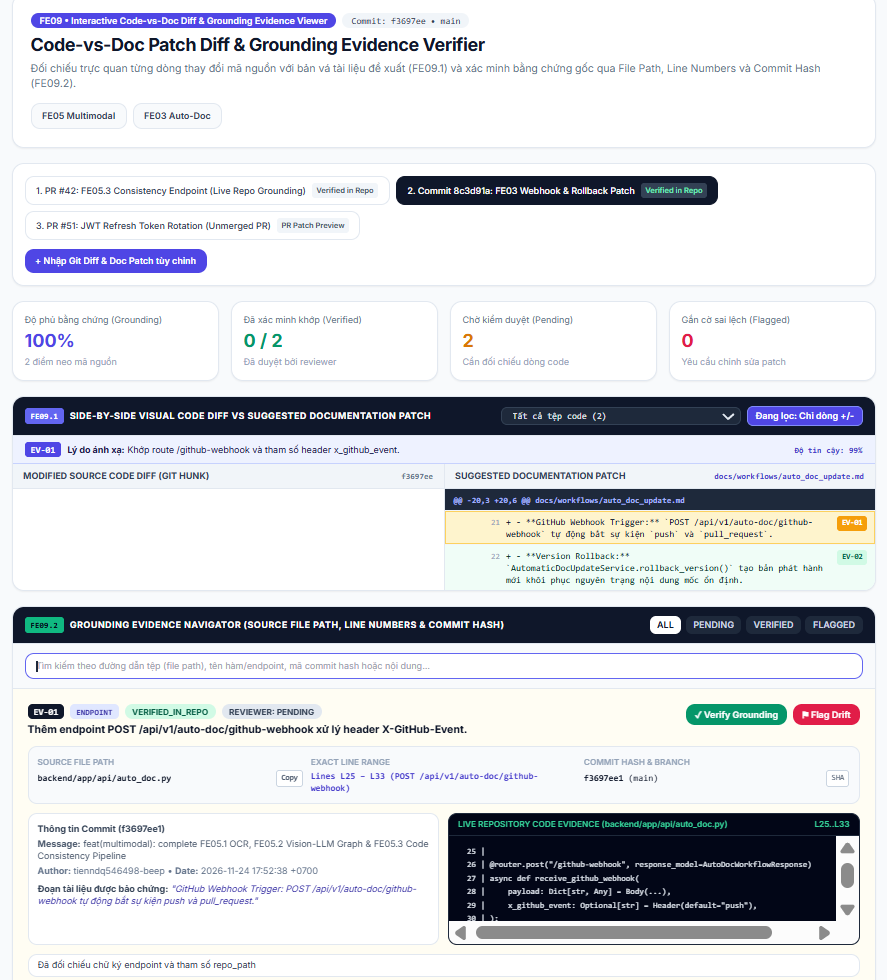
- 
    - Bấm chọn `2. Commit 8c3d91a: FE03 Webhook & Rollback Patch` để kiểm tra việc neo tọa độ dòng thật vào `backend/app/api/auto_doc.py` và `backend/app/services/auto_doc_service.py`.
       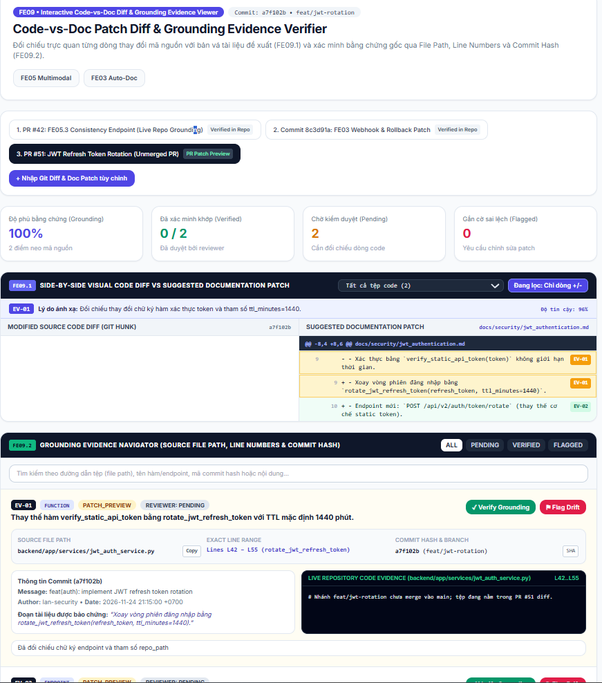
- 
    - Bấm chọn `3. PR #51: JWT Refresh Token Rotation (Unmerged PR)` để kiểm tra trạng thái `PATCH_PREVIEW` đối với các tệp nằm trên nhánh PR chưa merge vào `main`.
       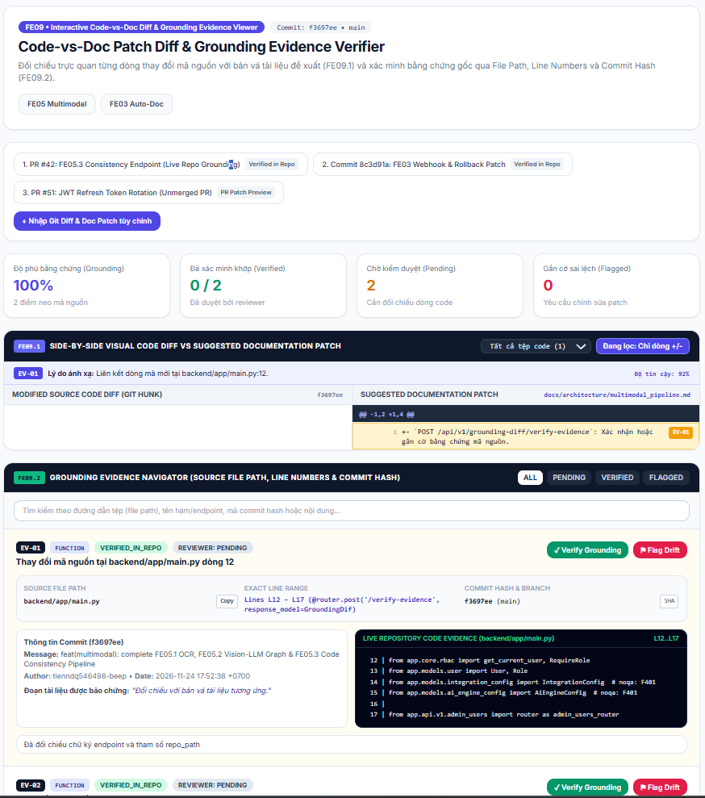
- 
    - Bấm nút `+ Nhập Git Diff & Doc Patch tùy chỉnh` ở góc phải, giữ nguyên đoạn diff mẫu (hoặc dán diff của riêng bạn) và bấm `Phân tích & Đối chiếu Grounding` để kiểm tra bộ phân tích Unified Diff tự động tạo thẻ `EV-01` và liên kết hai chiều.
