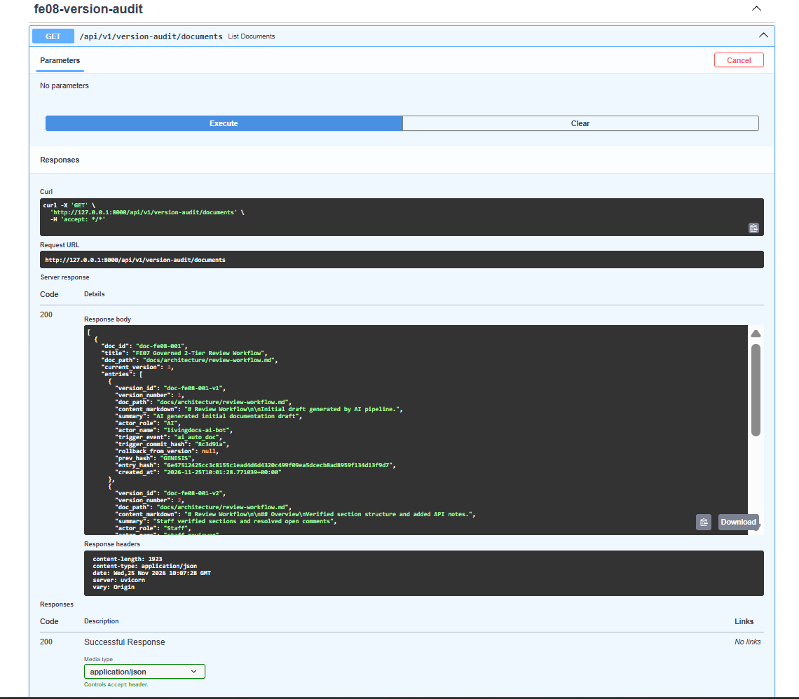
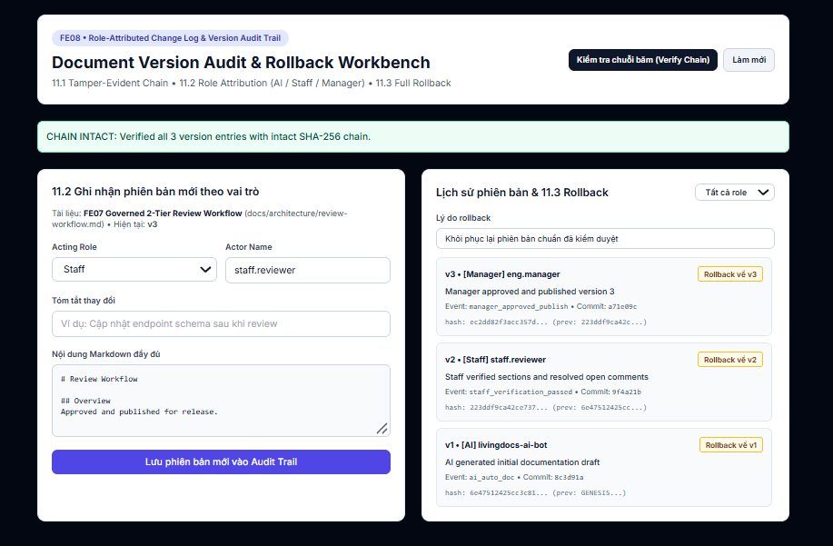
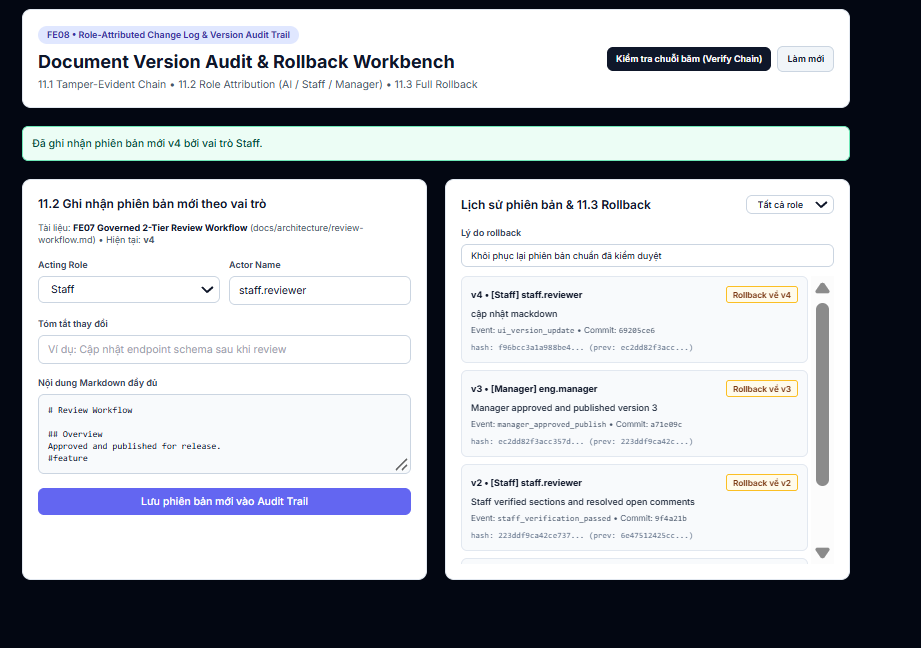
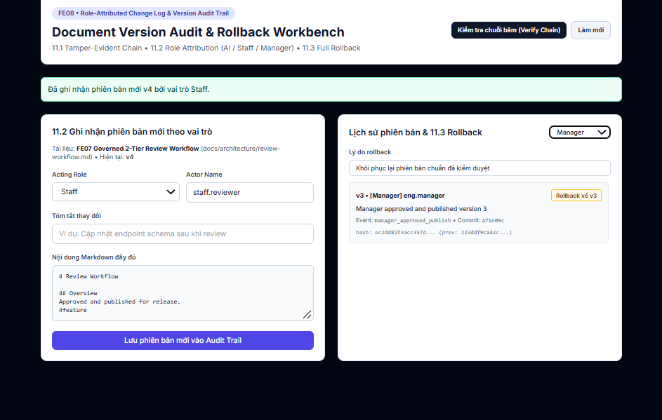
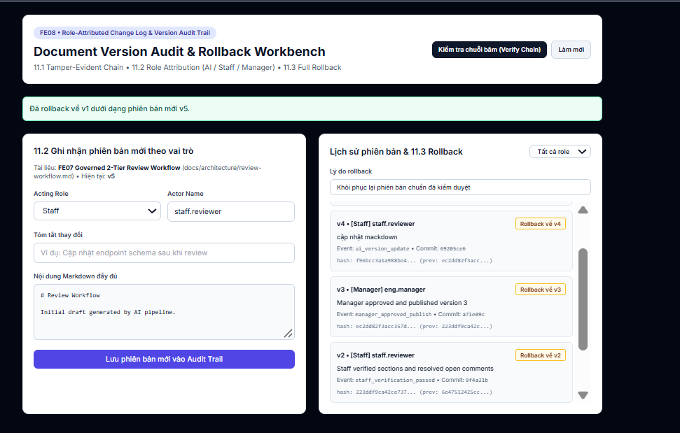

# demo 11\.1,11\.2,11\.3

<http://localhost:3000/version-audit>

**Role-Attributed Change Log & Version Audit Trail (FE08)** duy trì dòng thời gian lịch sử phiên bản chống sửa đổi âm thầm cho từng tài liệu, trải dài trên 3 phân hệ: **Tamper-Evident Version History Database & Storage (11.1)**, **Role Attribution & Trigger Event Traceability Engine (11.2)** và **Full Document Version Rollback Service (11.3)**. Mục tiêu là đảm bảo mọi thay đổi nội dung tài liệu đều được truy vết đúng vai trò (`AI`, `Staff`, `Manager`), gắn thời điểm/mã commit kích hoạt, kiểm chứng được tính toàn vẹn chuỗi băm SHA-256 và khôi phục phiên bản an toàn mà không làm mất lịch sử.

- **11.1 Tamper-Evident Chain & Storage:** Mỗi phiên bản (`v1`, `v2`, `v3`...) lưu snapshot nội dung đầy đủ, liên kết `prev_hash` với `entry_hash` của phiên bản trước và tự tính SHA-256 cho bản ghi hiện tại; khi kiểm tra chuỗi (`verify-chain`), hệ thống tính lại hash từng bản ghi để phát hiện mọi dấu hiệu sửa đổi trái phép.
- **11.2 Role Attribution & Trigger Traceability:** Mọi bản ghi đều gắn `actor_role` (`AI`, `Staff`, hoặc `Manager`), `actor_name`, `trigger_event` và `trigger_commit_hash` để đối chiếu rõ ai hoặc luồng nào đã tạo ra phiên bản đó.
- **11.3 Full Version Rollback:** Khi bấm rollback về một phiên bản cũ (ví dụ `v1`), hệ thống không xóa các phiên bản trung gian mà tạo thêm một phiên bản mới (`v4`) sao chép trọn vẹn nội dung của `v1`, nối vào chuỗi hash và ghi nhận `rollback_from_version = 1`.

### bản demo kiểm thử FE08

- **Bước 1 — Kiểm tra API & Dữ liệu Khởi tạo (11.1):** Mở `http://localhost:8000/docs` (nhóm `fe08-version-audit`) gọi `GET /api/v1/version-audit/documents` hoặc mở `http://localhost:3000/version-audit`.
  
  
    - *Kết quả mong đợi:* Trả về `200 OK` với tài liệu mẫu `doc-fe08-001` có sẵn các phiên bản `v1` (`AI`), `v2` (`Staff`), `v3` (`Manager`), và giao diện `/version-audit` hiển thị đầy đủ lịch sử phiên bản.
- **Bước 2 — Kiểm tra Tính Toàn Vẹn Chuỗi Băm (11.1):** Trên trang `/version-audit`, bấm nút **Kiểm tra chuỗi băm (Verify Chain)** ở góc trên bên phải.
   
  
    - *Kết quả mong đợi:* Xuất hiện banner xanh `CHAIN INTACT` báo đã kiểm tra thành công toàn bộ các phiên bản với chuỗi SHA-256 nguyên vẹn.
- **Bước 3 — Ghi Nhận Phiên Bản Mới Theo Vai Trò (11.2):** Ở khung **11.2 Ghi nhận phiên bản mới theo vai trò**, chọn **Acting Role** (ví dụ `Staff` hoặc `Manager`), nhập **Tóm tắt thay đổi** và chỉnh sửa **Nội dung Markdown đầy đủ**, sau đó bấm **Lưu phiên bản mới vào Audit Trail**.
   
  
    - *Kết quả mong đợi:* Banner xanh xác nhận tạo phiên bản mới (ví dụ `v4`) kèm đúng vai trò đã chọn, đồng thời phiên bản mới xuất hiện ở đầu danh sách kèm `trigger_event`, `trigger_commit_hash` và `entry_hash`.
- **Bước 4 — Lọc Lịch Sử Theo Vai Trò (11.2):** Tại khung **Lịch sử phiên bản & 11.3 Rollback**, đổi bộ lọc vai trò ở góc trên bên phải từ `Tất cả role` sang `AI`, `Staff`, hoặc `Manager`.
   
- 
    - *Kết quả mong đợi:* Danh sách phiên bản lọc chính xác theo vai trò đã chọn mà không làm mất dữ liệu trong kho lưu trữ.
- **Bước 5 — Thực Hiện Rollback Toàn Bộ Về Phiên Bản Cũ (11.3):** Nhập **Lý do rollback**, chọn một phiên bản cũ trong danh sách (ví dụ `v1`) và bấm **Rollback về v1**.
   
- 
    - *Kết quả mong đợi:* Hệ thống tạo thêm phiên bản kế tiếp (ví dụ `v5`) mang nội dung của `v1`, hiển thị thông tin `Rolled back from v1`, giữ nguyên các bản ghi cũ và bấm **Kiểm tra chuỗi băm (Verify Chain)** vẫn báo `CHAIN INTACT`.
