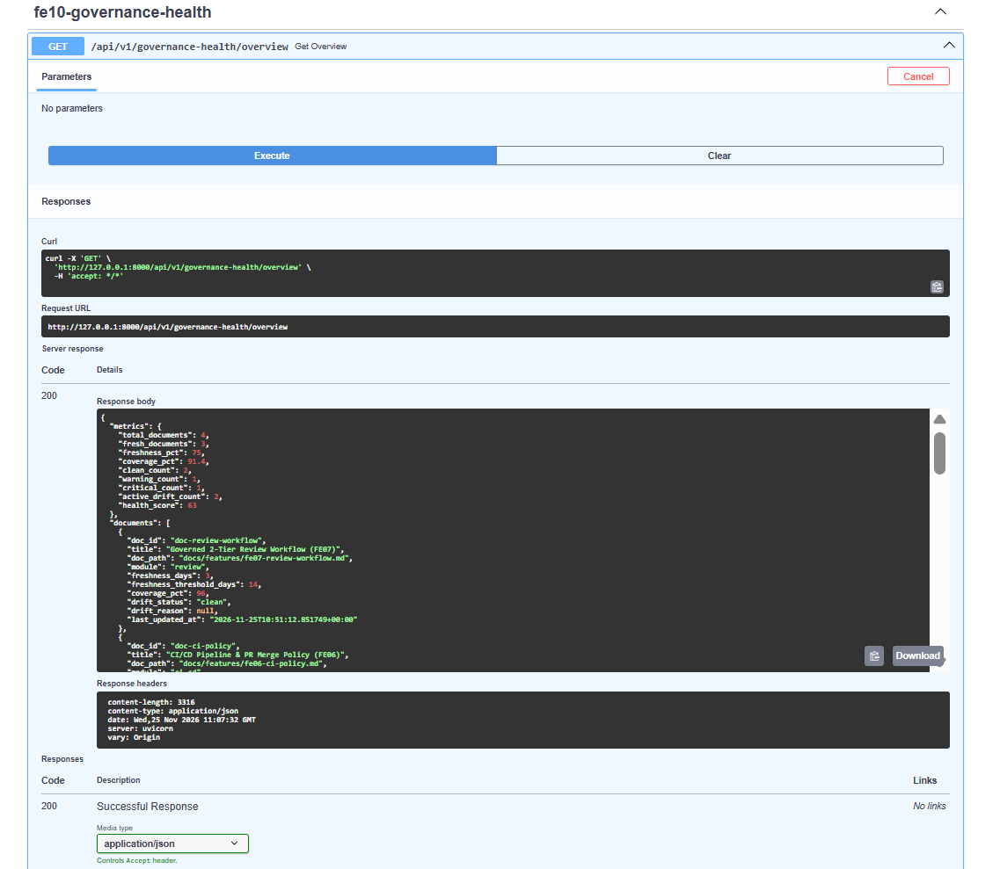
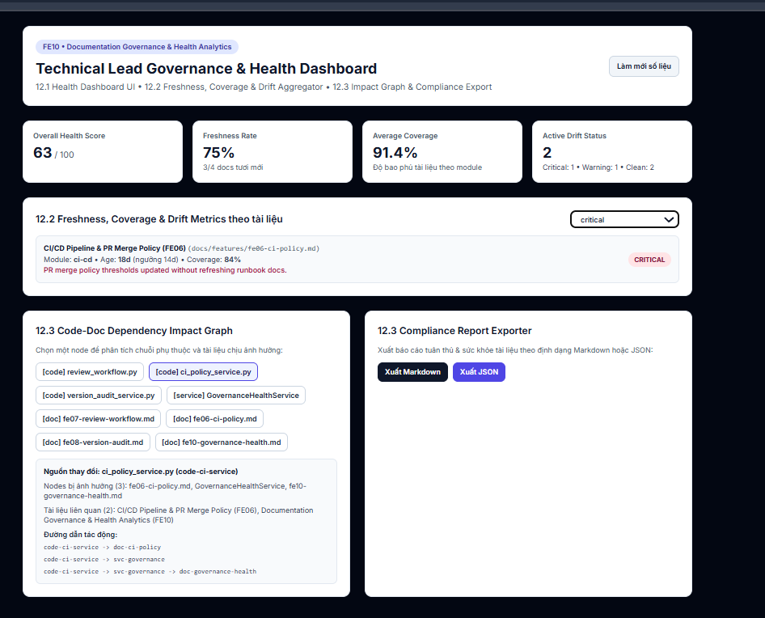
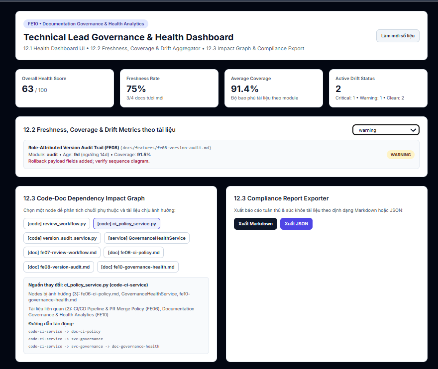
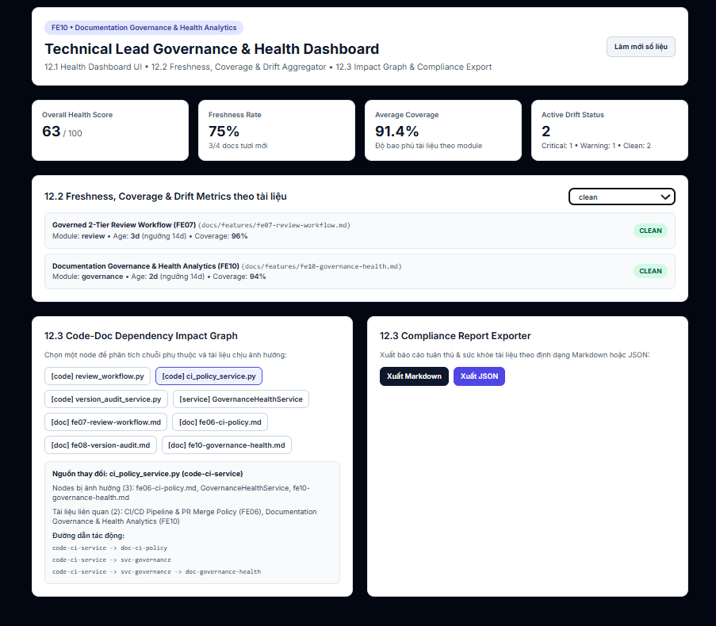
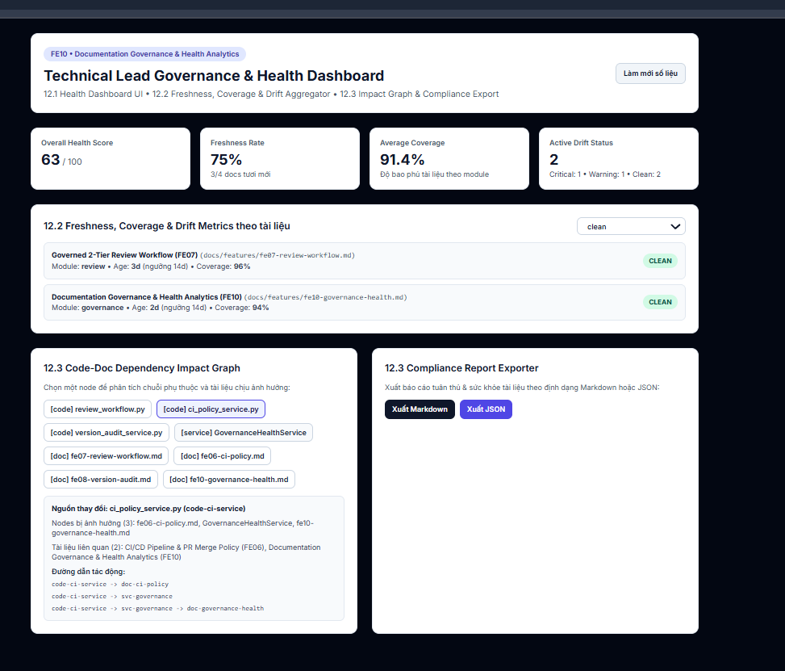
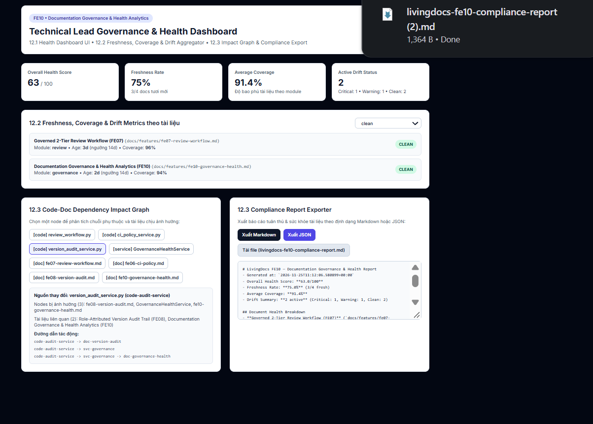
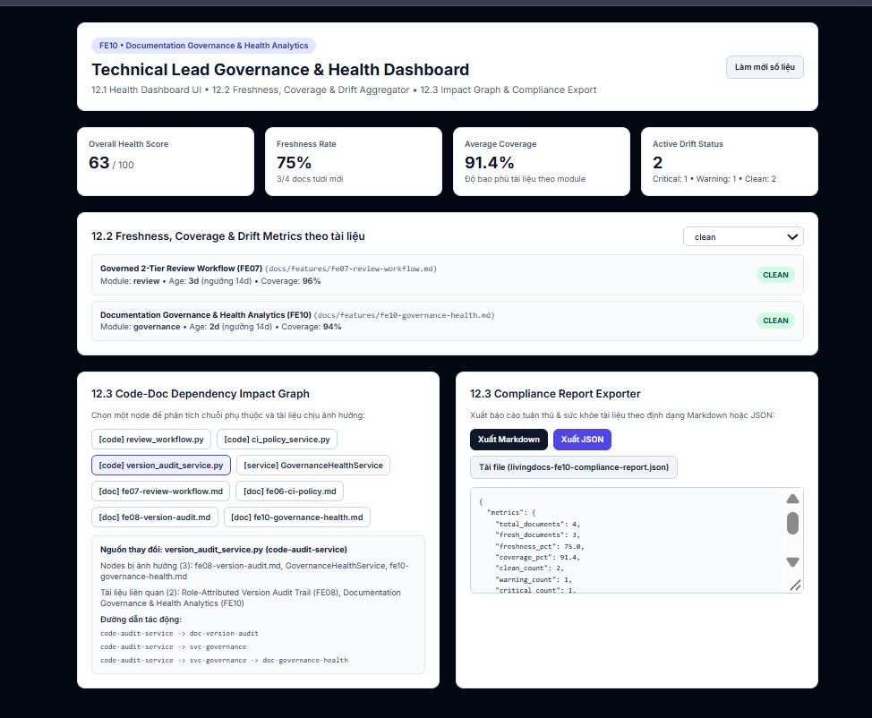

# demo 12\.1,12\.2,12\.3

<http://localhost:3000/governance-health>

**Documentation Governance & Health Analytics (FE10)** cung cấp cho Technical Lead một trung tâm điều hành và phân tích sức khỏe tài liệu toàn hệ thống, trải dài trên 3 phân hệ: **Centralized Documentation Health Dashboard UI (12.1)**, **Freshness, Coverage & Drift Metrics Aggregator (12.2)** và **Code-Doc Dependency Impact Graph & Compliance Exporter (12.3)**. Mục tiêu là giúp theo dõi mức độ cập nhật, độ bao phủ và trạng thái lệch chuẩn của tài liệu, phân tích chuỗi ảnh hưởng khi mã nguồn/dịch vụ thay đổi, và xuất báo cáo tuân thủ phục vụ đánh giá chất lượng.

- **12.2 Freshness, Coverage & Drift Metrics Aggregator:** Tổng hợp điểm sức khỏe tổng thể (`health_score`), tỷ lệ tài liệu tươi mới theo ngưỡng ngày (`freshness_pct`), tỷ lệ độ bao phủ trung bình (`coverage_pct`), và số lượng tài liệu đang ở trạng thái `clean`, `warning`, `critical`.
- **12.3 Code-Doc Dependency Impact Graph & Compliance Exporter:** Duyệt đồ thị phụ thuộc (`nodes` và `edges`) để tìm các node và tài liệu bị ảnh hưởng khi một thành phần thay đổi, đồng thời sinh báo cáo tuân thủ ở định dạng **Markdown** hoặc **JSON**.
- **12.1 Centralized Documentation Health Dashboard UI:** Hiển thị tập trung 4 thẻ KPI, danh sách tài liệu kèm bộ lọc trạng thái drift, bảng tương tác đồ thị phụ thuộc và khu vực xem trước/tải báo cáo tuân thủ.

### bản demo kiểm thử FE10

- **Bước 1 — Kiểm tra Endpoint & Tổng Quan Dữ Liệu Khởi Tạo (12.2):** Mở `http://localhost:8000/docs` (nhóm `fe10-governance-health`) gọi `GET /api/v1/governance-health/overview` hoặc truy cập `http://localhost:3000/governance-health`.
 

    - *Kết quả mong đợi:* Trả về `200 OK` với `metrics`, `documents`, `nodes`, `edges`, và giao diện `/governance-health` hiển thị 4 thẻ chỉ số tổng hợp cùng danh sách tài liệu.
- **Bước 2 — Lọc Trạng Thái Drift & Đối Chiếu Chỉ Số (12.1 & 12.2):** Trên trang `/governance-health`, tại mục **12.2 Freshness, Coverage & Drift Metrics theo tài liệu**, đổi bộ lọc từ `Tất cả trạng thái drift` sang `critical`, `warning`, hoặc `clean`.
   
   
   
  
    - *Kết quả mong đợi:* Danh sách tài liệu lọc đúng theo trạng thái được chọn, hiển thị rõ `module`, `age`, ngưỡng ngày, `coverage` và lý do drift (nếu có).
- **Bước 3 — Phân Tích Tác Động Trên Dependency Graph (12.3):** Tại khung **12.3 Code-Doc Dependency Impact Graph**, bấm chọn các node khác nhau (ví dụ `code-ci-service`, `code-audit-service`, hoặc `doc-governance-health`).
   
  
    - *Kết quả mong đợi:* Khung phân tích cập nhật tương ứng với node được chọn, liệt kê các node bị ảnh hưởng, tài liệu liên quan và đường dẫn tác động (`->`).
- **Bước 4 — Xuất Báo Cáo Tuân Thủ Markdown & JSON (12.3):** Tại khung **12.3 Compliance Report Exporter**, bấm **Xuất Markdown**, kiểm tra nội dung xem trước, bấm **Tải file**, sau đó bấm **Xuất JSON** để đối chiếu.
   
   
  
    - *Kết quả mong đợi:* Vùng xem trước hiển thị đầy đủ báo cáo tuân thủ theo đúng định dạng `markdown` hoặc `json` và tải xuống tệp tương ứng (`livingdocs-fe10-compliance-report.md` hoặc `.json`).
