# 3\. Functional Requirements

### 3.1 System Functional Overview

### 3.1.1 Web Application Developer Screen Flow

### 3.1.2 Web Application Developer Screen Description

|  |  |  |  |
| --- | --- | --- | --- |
| **#** | **Feature** | **Screen** | **Description** |
| **1** | General | Home Page | The landing page of LivingDocs, providing general product information, key feature overviews, and navigation to the authentication portal. |
| **2** | General | SCR-01 Login via GitHub OAuth2 | Authentication screen allowing developers to log in securely using their GitHub account credentials and initialize JWT sessions. |
| **3** | Dashboard | SCR-02 Workspace Dashboard | The central hub displaying workspace summary metrics, connected repositories, active drift alerts, and navigation shortcuts. |
| **4** | Repository Management | SCR-03 Repository List | Displays all GitHub repositories connected to the active workspace along with sync status indicators and management options. |
| **5** | Repository Management | SCR-04 Connect Repository Modal | Dialog form allowing developers to select, authorize, and link new GitHub repositories and set target tracking branches. |
| **6** | Repository Management | SCR-03 Webhook Configuration Modal | Interface to configure, test, and manage GitHub Webhook event listeners (`push`, `pull_request`) for automated sync. |
| **7** | Repository Management | SCR-03 AST Indexing Progress | Displays the real-time progress and background status of Tree-sitter AST parsing and code entity indexing. |
| **8** | AI Documentation Studio | SCR-05 Select Source Code & Template | Interface to browse codebase file trees, select target source files/modules, and pick documentation templates. |
| **9** | AI Documentation Studio | SCR-05 AI Generator Canvas | Workspace displaying the AI-generated documentation draft along with status logs and token usage metrics. |
| **10** | AI Documentation Studio | SCR-05 Markdown WYSIWYG Editor | Interactive Markdown editor allowing developers to manually review, edit, format, and polish AI-generated documentation drafts. |
| **11** | AI Documentation Studio | SCR-06 Multimodal OCR / Mermaid Modal | Upload modal allowing developers to convert uploaded architecture diagrams/PDFs into editable Mermaid.js code via Vision-LLM. |
| **12** | Drift Management | SCR-08 Active Drift List | Central view listing all detected code-doc semantic drifts filtered by severity levels (`Critical`, `High`, `Medium`, `Low`). |
| **13** | Drift Management | SCR-07 Interactive Visual Diff Viewer | Side-by-side 2-column comparative view highlighting changes between modified source code and proposed documentation updates. |
| **14** | Drift Management | SCR-07 Contextual Evidence Panel | Slide-out side panel rendering exact source code lines, commit details, and AST references supporting document claims. |
| **15** | Drift Management | SCR-08 Dismiss / Patch Proposal Modal | Dialog interface allowing developers to dismiss false-positive drift alerts or convert detected drifts into actionable doc patch proposals. |
| **16** | Review Center | SCR-09 My Submitted Drafts | Lists documentation drafts submitted by the developer along with their multi-tier approval statuses (`Pending Tier-1`, `Needs Revision`). |
| **17** | Review Center | SCR-09 Inline Feedback & Comments | View allowing developers to inspect section-specific review comments, requested revisions, and feedback left by Staff/Managers. |
| **18** | Knowledge Base | SCR-02 Global Natural Language Search | Search modal enabling developers to query the workspace codebase and documentation using natural language RAG. |
| **19** | Knowledge Base | SCR-02 Code-Doc Dependency Graph | Interactive graph view visualizing structural relationships and dependency links between source code entities and documentation sections. |

### 3.1.3 Web Application Staff Screen Flow

### 3.1.4 Web Application Staff Screen Description

|  |  |  |  |
| --- | --- | --- | --- |
| **#** | **Feature** | **Screen** | **Description** |
| **1** | General | Home Page | The landing page of LivingDocs, providing project overview and navigation to the authentication portal. |
| **2** | General | SCR-01 Login via GitHub OAuth2 | Authentication screen allowing Staff members to log in securely using their GitHub credentials and access their assigned workspace. |
| **3** | Dashboard | SCR-02 Workspace Dashboard - Staff View | Staff-tailored central dashboard displaying pending Tier-1 review tasks, assigned drift alerts, and workspace health metrics. |
| **4** | Tier-1 Review Management | SCR-09 Tier-1 Pending Review List | Queue listing all documentation drafts submitted by Developers awaiting technical verification and Tier-1 approval. |
| **5** | Tier-1 Review Management | SCR-09 Inline Feedback & Commenting Canvas | Review interface allowing Staff to read draft content, highlight specific sections, and insert inline comments or revision requests. |
| **6** | Tier-1 Review Management | SCR-09 Review Decision Modal Approve / Request Revision | Dialog interface to record the final Tier-1 decision: Approve and elevate to Tier-2 (Manager) or Request Revisions from Developer. |
| **7** | Drift Inspection Center | SCR-08 Active Drift List | View displaying active code-doc semantic drift alerts assigned for technical inspection and impact assessment. |
| **8** | Drift Inspection Center | SCR-07 Interactive Visual Diff Viewer | Side-by-side 2-column comparison tool contrasting modified codebase logic against current documentation statements. |
| **9** | Drift Inspection Center | SCR-07 Contextual Evidence Panel | Side panel rendering exact source code snippets, commit history, and AST node links supporting or invalidating document accuracy. |
| **10** | Knowledge Base & Search | SCR-02 Global Natural Language Search | Hybrid search interface (BM25 + RAG) enabling Staff to query codebase entities and documentation packages in natural language. |
| **11** | Knowledge Base & Search | SCR-02 Code-Doc Dependency Graph | Interactive graph view visualizing structural linkages between modified code files and dependent documentation chapters. |
| **12** | Audit & Compliance | SCR-13 Audit Log Viewer Read-only | Read-only access to system audit trails for verifying historical edit timelines, approval stamps, and past review decisions. |

### 3.1.6 Web Application Manager Screen Description

|  |  |  |  |
| --- | --- | --- | --- |
| **#** | **Feature** | **Screen** | **Description** |
| **1** | General | Home Page | The landing page of LivingDocs, providing project overview and navigation to the authentication portal. |
| **2** | General | SCR-01 Login via GitHub OAuth2 | Authentication screen allowing Managers to log in securely using their GitHub organization account credentials and initialize authorized executive sessions. |
| **3** | Dashboard | SCR-02 Workspace Dashboard - Manager View | Executive dashboard displaying overall documentation coverage metrics, pending Tier-2 review counts, critical drift alerts, and team velocity KPIs. |
| **4** | Tier-2 Approval Management | SCR-09 Tier-2 Pending Approval List | Queue listing all documentation drafts that have successfully passed Staff Tier-1 technical review and await final Manager sign-off before release. |
| **5** | Tier-2 Approval Management | SCR-09 Inline Feedback & Review Viewer | Detailed review interface allowing Managers to inspect proposed draft content, review Staff Tier-1 comments, and attach final executive notes. |
| **6** | Tier-2 Approval Management | SCR-10 Final Sign-Off & GitHub Auto-Commit Modal | Confirmation modal enabling Managers to execute Tier-2 approval, triggering automated GitHub commits/PRs, or reject drafts back for further revision. |
| **7** | Analytics & Executive Hub | SCR-10 Documentation Coverage & Drift Analytics | High-level reporting workspace visualizing doc-to-code coverage ratios, historical drift resolution timelines, and overall project documentation health. |
| **8** | Drift Escalation Center | SCR-08 Active Drift List | Management view listing active code-doc semantic drift alerts, enabling Managers to track unresolved items, assess project impact, and assign priority. |
| **9** | Drift Escalation Center | SCR-07 Interactive Visual Diff Viewer | Side-by-side comparative viewer allowing Managers to inspect code logic modifications against documentation text prior to authorizing patch deployments. |
| **10** | Audit & Compliance | SCR-13 Audit Log Viewer | Read-only compliance interface enabling Managers to inspect system-wide historical edit trails, approval timestamps, and release logs. |

### 3.1.7 Web Application Technical Lead Screen Flow

### 3.1.8 Web Application Technical Lead Screen Description

|  |  |  |  |
| --- | --- | --- | --- |
| **#** | **Feature** | **Screen** | **Description** |
| **1** | General | Home Page | The landing page of LivingDocs, providing project overview and navigation to the authentication portal. |
| **2** | General | SCR-01 Login via GitHub OAuth2 | Authentication screen allowing Technical Leads to log in securely using GitHub OAuth2 credentials and initialize authorized technical management sessions. |
| **3** | Dashboard | SCR-02 Workspace Dashboard - Tech Lead View | Comprehensive engineering dashboard displaying repository AST indexing status, active template/prompt configurations, overall semantic drift metrics, and code-doc dependency health. |
| **4** | Repository Architecture Management | SCR-03 Repository List | Displays connected GitHub repositories along with Webhook status toggles, AST indexing progress bars, and sync status controls. |
| **5** | Repository Architecture Management | SCR-04 Connect Repository Modal | Dialog form allowing Technical Leads to authorize, link new GitHub organization repositories, and set target branch tracking rules. |
| **6** | Template & Prompt Governance | SCR-11 Template & Prompt Management | Dedicated workspace allowing Technical Leads to construct standardized document templates (e.g., Architecture Spec, API Spec, Database Schema), map placeholder tags, and tune system prompts for AI generation. |
| **7** | AI Documentation Studio | SCR-05 AI Documentation Studio | Authoring workspace to select source code files, apply system templates, generate AI documentation drafts, and refine technical text via a WYSIWYG editor. |
| **8** | AI Documentation Studio | SCR-06 Multimodal OCR / Mermaid Modal | Upload modal allowing Technical Leads to convert uploaded architecture diagrams/PDFs into editable Mermaid.js diagram code via Vision-LLM. |
| **9** | Drift & Quality Monitoring | SCR-08 Active Drift Alert Center | Central view listing active code-doc semantic drift alerts by severity, allowing Technical Leads to assess system-wide impact and coordinate technical remediation. |
| **10** | Drift & Quality Monitoring | SCR-07 Interactive Visual Diff Viewer | Side-by-side comparative viewer highlighting changes between modified code and proposed document updates with contextual AST code evidence. |

### 3.1.9 Web Application Administrator Screen Flow

### 3.1.10 Web Application Administrator Screen Description

| **#** | **Feature** | **Screen** | **Description** |
| --- | --- | --- | --- |
| 1 | General | Home Page | The landing page of LivingDocs, providing project overview and navigation to the authentication portal. |
| 2 | General | SCR-01 Login via GitHub OAuth2 | Authentication screen allowing Administrators to log in securely using GitHub OAuth2 organization credentials and initialize authorized system administration sessions. |
| 3 | Dashboard | SCR-02 Workspace Dashboard - Admin View | Executive administration dashboard displaying active user counts, organization member sync status, RBAC role distribution, system health status, and security alert summaries. |
| 4 | User & Access Governance | SCR-12 User & Access Control Managemen | Central user management interface allowing Administrators to invite team members, assign RBAC roles (Developer, Staff, Manager, Tech Lead, Admin), modify workspace permissions, manage GitHub OAuth integrations, and revoke access tokens. |
| 5 | System Audit & Compliance | SCR-13 Audit Log Viewer | Comprehensive security and audit monitoring workspace enabling Administrators to search, filter, inspect, and export system-wide transaction logs, permission changes, publish activity, and security compliance events. |

### 3.1.11 Consolidated Screen Authorization Matrix

This section defines the access permissions and detailed operation privileges for each user role (Developer, Staff, Manager, Technical Lead, Administrator) across all 13 standard screens in the LivingDocs system.

 **3.1.11.1. Access Level Legend**

- `F`** (Full Access):** Complete operational rights (Create, Edit, Delete, Execute, Approve, Configure).
- `V`** (View Only):** Read-only access; cannot modify data or alter system state.
- `N`** (No Access):** Access restricted (screen hidden or access denied/redirected).

 **3.1.11.2. Screen Authorization Matrix**

 

|  |  |  |  |  |  |  |
| --- | --- | --- | --- | --- | --- | --- |
| **Screen ID** | **Screen Name** | **Developer** | **Staff** | **Manager** | **Tech Lead** | **Admin** |
| **SCR-01** | Login via GitHub OAuth2 | **F** | **F** | **F** | **F** | **F** |
| **SCR-02** | Workspace Dashboard *(Role-specific View)* | **V** | **V** | **V** | **V** | **V** |
| **SCR-03** | Repository List | **V** | **V** | **V** | **F** | **F** |
| **SCR-04** | Connect Repository Modal | **N** | **N** | **N** | **F** | **F** |
| **SCR-05** | AI Documentation Studio | **F** | **F** | **V** | **F** | **V** |
| **SCR-06** | Multimodal OCR / Mermaid Modal | **F** | **F** | **V** | **F** | **V** |
| **SCR-07** | Interactive Visual Diff Viewer | **V** | **V** | **V** | **V** | **V** |
| **SCR-08** | Active Drift Alert Center | **V** | **F** | **V** | **F** | **V** |
| **SCR-09** | Pending Approval List & Review Viewer | **N** | **F** *(Tier-1)* | **F** *(Tier-2)* | **V** | **V** |
| **SCR-10** | Final Sign-Off & Analytics Hub | **N** | **V** | **F** | **V** | **V** |
| **SCR-11** | Template & Prompt Management | **N** | **N** | **N** | **F** | **V** |
| **SCR-12** | User & Access Control Management | **N** | **N** | **N** | **N** | **F** |
| **SCR-13** | Audit Log Viewer | **N** | **N** | **V** | **V** | **F** |

 **3.1.11.3. Authorization Rules & Business Constraints**

1. **Personalized Dashboard Interface (**`SCR-02`**):** Under the unified screen ID `SCR-02`, the system automatically renders the appropriate interface layout and KPI metrics corresponding to the authenticated user's role.
2. **Two-Tier Approval Policy:**
    - **Staff (**`SCR-09`**):** Holds **Tier-1** technical review privileges (inspecting draft content, attaching feedback notes, and escalating to the Tier-2 approval queue).
    - **Manager (**`SCR-09`** & **`SCR-10`**):** Holds **Tier-2** executive sign-off authority (granting final approval to trigger automated GitHub commits/PRs, or rejecting drafts for further revision).
3. **Core Technical Governance (**`SCR-04`** & **`SCR-11`**):** Repository linkage, AST indexing rules, and template/AI prompt tuning are strictly restricted to **Technical Leads** and **Administrators** to maintain documentation quality standards.
4. **Security & RBAC Management (**`SCR-12`** & **`SCR-13`**):** Only **Administrators** hold full access to user onboarding, RBAC role management, and system-wide transaction logging. Managers and Tech Leads are granted read-only access to audit logs for compliance oversight.

### 3.1.12. Non-screen Functions

|  |  |  |  |
| --- | --- | --- | --- |
| **#** | **Feature** | **System Function** | **Description** |
| 1 | Webhook & Code Indexing | GitHub Webhook & AST Parsing | Capture GitHub `push` and `pull_request` events automatically.Parse modified source code into Abstract Syntax Trees (AST) and generate vector embeddings in the background. |
| 2 | Drift Detection | Continuous Semantic Drift Engine | Compare new AST code embeddings against existing documentation chunks.Notify **Staff** and **Tech Lead** immediately when semantic drift is detected. |
| 3 | Repository Sync | Auto-Commit & PR Publisher | Push approved documentation updates to GitHub automatically upon **Manager** Tier-2 sign-off.Create direct commits or open Pull Requests based on repository workflow rules. |
| 4 | Diagram Processing | Multimodal OCR Engine | Process uploaded architecture diagram images/PDFs using Vision-LLM background workers.Convert visual diagrams into valid, editable Mermaid.js code. |
| 5 | System Maintenance | Scheduled Cron Job | System automatically scans daily at 02:00 UTC to recalculate documentation freshness and coverage metrics.Purge expired session tokens and temporary draft files older than 30 days. |
| 6 | Audit & Security | Asynchronous Audit Logger | Asynchronously log all user transactions, role modifications, and system API calls.Persist immutable logs for **Administrator** review. |

### 3.1.13. Entity Relationship Diagrams

### 3.2 Web Application

### 3.2.1 Authenticate & User Session

 **3.2.1.1 Log in via GitHub OAuth2**
 
 **Function trigger:** When a user accesses the Web URL, the login screen (`SCR-01`) is displayed by default if the account has not been authenticated or the session token has expired.
 
 - **Function description:**
     - **Actors/roles:** Developer, Staff, Manager, Technical Lead, Administrator.
     - **Purpose:**
         1. To verify the user's identity securely via GitHub OAuth2 Single Sign-On (SSO) as the primary authentication method.
         2. To identify their specific system Role (`DEV`, `STAFF`, `MGR`, `TL`, `ADMIN`) based on account role mappings and organization memberships (`BR-AUTH-01`).
         3. To grant access to functions, workspace repositories, and navigation menus authorized for their specific Role (`BR-RBAC-01`).
     - **Data processing:**
         1. The user selects **"Sign in with GitHub"** on the login interface (`SCR-01`) (or inputs enterprise work credentials as an alternative).
         2. The system redirects the user to the GitHub OAuth2 authorization endpoint with required scopes (`read:user`, `user:email`, `read:org`).
         3. The user authorizes LivingDocs on GitHub, and GitHub redirects back to the system callback endpoint (`/api/v1/auth/github/callback`) with an authorization code.
         4. The authentication backend exchanges the authorization code for a GitHub Access Token, validates user credentials, and retrieves the associated system Role.
         5. If valid, the system creates a secure JWT login session (invalidating any previous sessions on other devices — `BR-AUTH-02`) and redirects the user to the specific Workspace Dashboard (`SCR-02`) corresponding to their role.
 - **Business rules:** BR-AUTH-01 (OAuth Scope & Org Verification), BR-AUTH-02 (Single Session Enforcement), BR-RBAC-01 (Role Access Rights).
 - **Screen layout:**
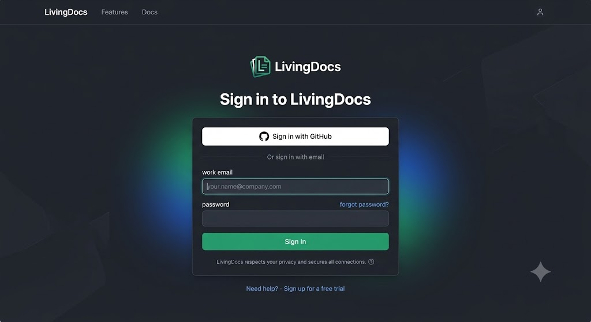

**3.2.1.2 Manage User Profile & Session**

- **Function trigger:** When an authenticated user clicks on their profile avatar in the top navigation header (`SCR-02`) and selects **"Profile & Account Settings"**, or when managing active login sessions and personal access tokens.
- **Function description:**
    - **Actors/roles:** Developer, Staff, Manager, Technical Lead, Administrator (All authenticated system roles).
    - **Purpose:**
        1. To allow users to view and manage personal account information synchronized from GitHub OAuth2.
        2. To inspect active login sessions (device type, IP address, location, active JWT status) and remotely terminate unauthorized sessions (`BR-AUTH-02`).
        3. To generate and revoke Personal Access Tokens (PATs) for programmatic API access and local CLI integration (`BR-SEC-01`).
        4. To view linked GitHub organization scopes and granted RBAC system permissions (`BR-RBAC-01`).
    - **Data processing:**
        1. The system fetches user profile metadata, active session state, and linked GitHub organization authorizations via API endpoint (`GET /api/v1/user/profile`).
        2. The web client renders the user profile management interface showing tabbed sections: **General Profile**, **Active Sessions**, **Access Tokens**, and **GitHub Integration**.
        3. If the user clicks **"Revoke Session"** for a specific device, the system issues a revocation call (`POST /api/v1/auth/revoke-session`), invalidating the target JWT refresh token and recording the event in the audit log (`NSF-07`).
        4. If the user generates a new Personal Access Token (PAT), the system generates a secure SHA-256 hashed token with an explicit expiration period (default: 30 days) and displays the plain-text secret token *once* to the user.
        5. The system confirms updates with non-intrusive toast notifications and updates local session storage state.
- **Business rules:** `BR-AUTH-02` (Single Session Enforcement & Remote Revocation), `BR-AUTH-03` (GitHub Metadata Synchronization), `BR-SEC-01` (PAT Expiration & Rate Limit Policy), `BR-RBAC-01` (Role Scope Boundaries).

- **Screen layout:**
- 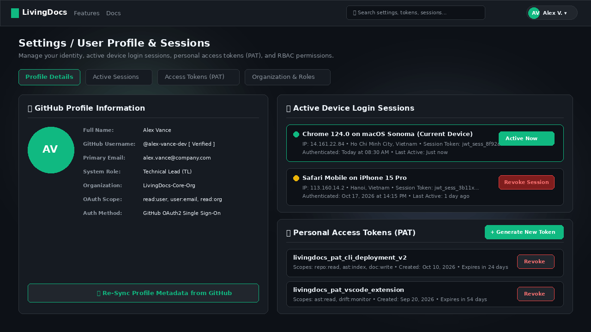

### 3.2.2 Manage Workspaces

**3.2.2.1 View Workspace List**

- **Function trigger:** When an authenticated user selects **"Workspaces"** from the primary left navigation sidebar (`SCR-02`) or navigates directly to the `/workspaces` URL.
- **Function description:**
    - **Actors/roles:** Developer, Staff, Manager, Technical Lead, Administrator (All authenticated system roles, filtered by workspace membership assignment).
    - **Purpose:**
        1. To present a comprehensive overview of all logical project workspaces that the current user has explicit permission to access (`BR-RBAC-01`).
        2. To display real-time aggregated workspace operational health metrics, including connected repository count, team member count, Abstract Syntax Tree (AST) indexing progress percentage, and semantic drift alert summaries (`BR-WS-01`).
        3. To allow searching, filtering, and sorting workspaces by activity, health status, or organization boundaries (`BR-WS-02`).
        4. To serve as the primary routing portal for navigating into specific workspace details, repository configurations, or member settings.
    - **Data processing:**
        1. The web client dispatches an authenticated HTTP request `GET /api/v1/workspaces` with pagination and search parameters.
        2. The API Gateway verifies the JWT bearer token and queries the `WORKSPACES` table, joining `WORKSPACE_MEMBERSHIPS` to restrict output strictly to authorized records for the authenticated user ID.
        3. The backend aggregates live statistics: counts connected active records in `REPOSITORY_BINDINGS`, counts active users in `WORKSPACE_MEMBERSHIPS`, calculates average AST vector completion, and counts open `DRIFT_ALERTS` grouped by severity (`HIGH`, `MEDIUM`, `LOW`).
        4. The web application renders interactive workspace cards arranged in a grid or list view with color-coded status badges:
            - **Green (Synced / Healthy):** AST index at 100% and 0 Critical/High drift alerts.
            - **Yellow (Indexing / Attention Needed):** Background AST indexing in progress or Medium drift alerts pending review.
            - **Red (Action Required):** AST sync failed or unresolved High-Severity semantic drift alerts.
- **Business rules:** `BR-RBAC-01` (Workspace Access Scope Isolation), `BR-WS-01` (Real-Time Workspace Health Aggregation), `BR-WS-02` (Membership-based Visibility Filtering).
- **Screen layout:**
- 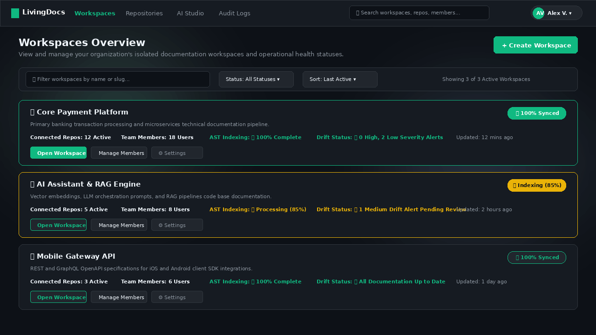

**3.2.2.2 Create New Workspace**

- **Function trigger:** When a Technical Lead or Administrator clicks the **"+ Create Workspace"** action button on the Workspaces Overview header (`SCR-02`) or accesses `/workspaces/new`.
- **Function description:**
    - **Actors/roles:** Technical Lead, Administrator.
    - **Purpose:**
        1. To create a new isolated logical workspace boundary for segregating connected GitHub code repositories, technical documentation templates, and user access scopes (`BR-WS-03`).
        2. To define initial workspace metadata including human-readable Workspace Name, unique URL Slug Identifier, Description, and target GitHub Organization context.
        3. To initialize default workspace governance policies, such as enabling automatic Abstract Syntax Tree (AST) code re-indexing on webhooks and enforcing the 2-Tier approval workflow (`BR-WS-04`).
    - **Data processing:**
        1. The web application launches an interactive step-by-step modal wizard (**1. Workspace Info** -\> **2. Connect Repositories** -\> **3. Assign Members**) overlaying the active Workspaces dashboard.
        2. The user inputs the Workspace Name (e.g., *"Analytics & BI Pipeline"*). The system dynamically generates a URL slug (e.g., `analytics-bi-pipeline`) and checks for slug availability within the organization via client-side debounce.
        3. The user selects the target GitHub Organization (`LivingDocs-Core-Org`), inputs a description, and toggles default governance checkboxes.
        4. Upon clicking **"Create & Connect Repositories →"**, the web client validates mandatory fields and issues an HTTP POST request `POST /api/v1/workspaces`.
        5. The API Gateway verifies the user's `Tech Lead` or `Admin` role claims, inserts the record into the `WORKSPACES` table, automatically assigns the creator as `Workspace Owner` (`BR-RBAC-02`), seeds default Markdown documentation templates (`SCR-11`), asynchronously records an audit event (`NSF-07`), and advances the wizard directly to Step 2 (**Connect GitHub Repositories** - `SCR-04`).
- **Business rules:** `BR-WS-03` (Workspace Slug Format & Organization Uniqueness), `BR-WS-04` (Governance Policy Default Seeding), `BR-RBAC-02` (Creator Auto-Ownership Assignment & Scope Binding).
- **Screen layout:**
- 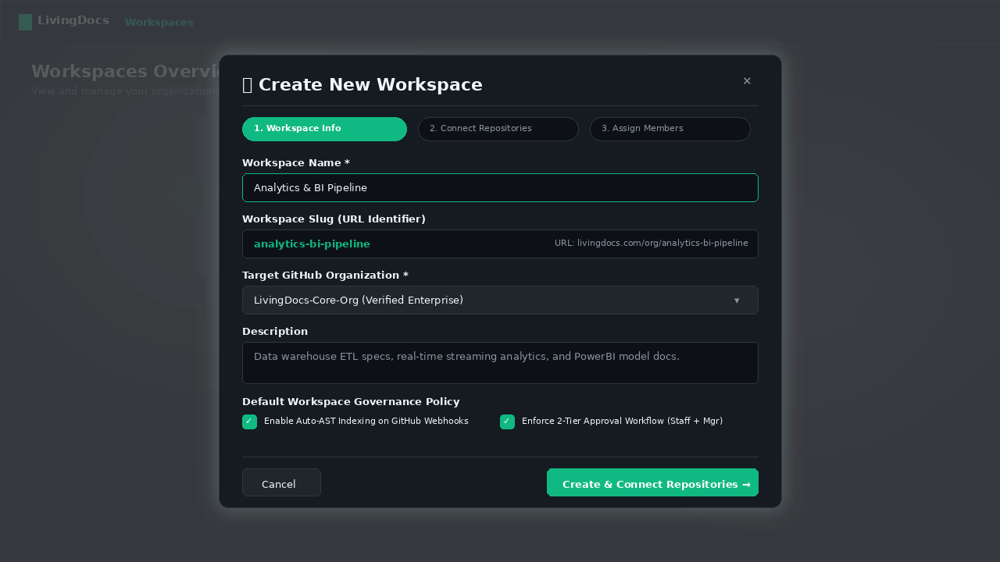

**3.2.2.3 Manage Workspace Members & Access**

- **Function trigger:** When a Workspace Owner (Technical Lead or Administrator) clicks **"Manage Members"** on a workspace card or navigates directly to `/workspaces/{workspace_id}/members` (`SCR-12`).
- **Function description:**
    - **Actors/roles:** Technical Lead, Administrator.
    - **Purpose:**
        1. To grant, update, or revoke user access permissions and role assignments within a specific workspace boundary (`BR-RBAC-01`).
        2. To bind functional responsibilities to workspace team members based on system RBAC roles (`DEV` = Content Author, `STAFF` = Tier-1 Technical Reviewer, `MGR` = Tier-2 Final Approver, `TL` = Workspace Owner & Admin) (`BR-RBAC-03`).
        3. To synchronize user permission scopes automatically with linked GitHub Organization teams and repository access policies (`BR-AUTH-01`).
        4. To configure workspace-level security policies, such as enforcing the 2-Tier approval workflow and auto-syncing GitHub permissions.
    - **Data processing:**
        1. The client sends an authenticated request `GET /api/v1/workspaces/{workspace_id}/members` to fetch the active membership roster, assigned RBAC roles, and GitHub permission mapping.
        2. The web application renders the interactive member management table displaying avatars, GitHub handles, email addresses, assigned workspace roles dropdowns, and permission summaries.
        3. **Adding a Member:** The Tech Lead clicks **"+ Add Member"**, searches organization users, selects a workspace role (`DEV`, `STAFF`, `MGR`, `TL`), and submits `POST /api/v1/workspaces/{workspace_id}/members`.
        4. **Updating Role / Permissions:** Changing a user's role in the table dispatches `PATCH /api/v1/workspaces/{workspace_id}/members/{user_id}`, updating `WORKSPACE_MEMBERSHIPS`, refreshing JWT scope claims immediately, and recording an audit trail event (`NSF-07`).
        5. **Removing a Member:** Clicking **"Remove"** issues `DELETE /api/v1/workspaces/{workspace_id}/members/{user_id}`, invalidating active session tokens for that workspace context (`BR-SEC-02`).
- **Business rules:** `BR-RBAC-01` (Workspace Access Boundaries), `BR-RBAC-03` (Role Scope Restrictions & Minimum Owner Constraint), `BR-SEC-02` (Immediate JWT Token Revocation on Access Removal).
- **Screen layout:**
- 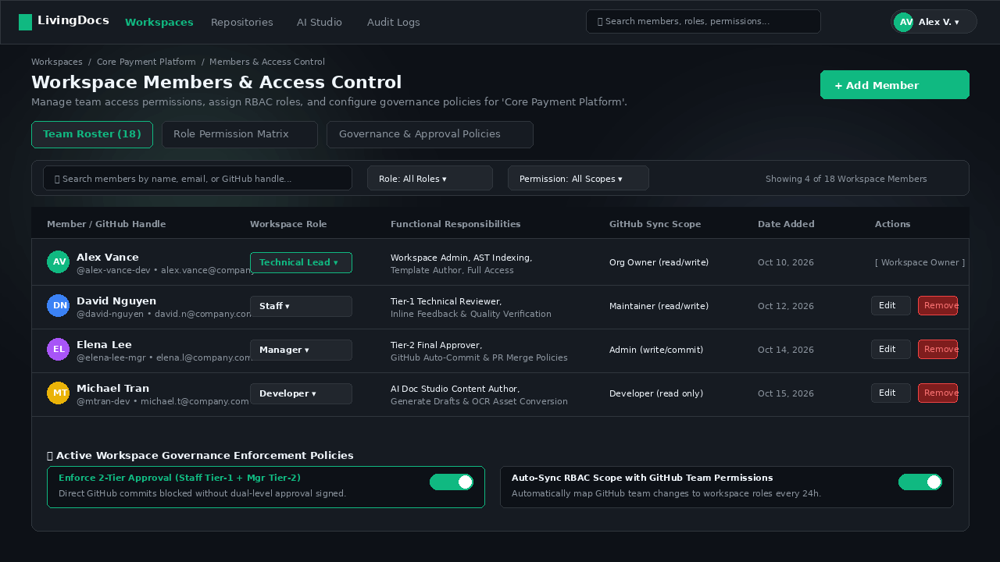

### **3.2.3 Manage GitHub Repositories**

**3.2.3.1 View Connected Repository List**

- **Function trigger:** When an authorized user selects **"Repositories"** from the top navigation header (`SCR-02`) or left sidebar, or navigates directly to `/workspaces/{workspace_id}/repositories`.
- **Function description:**
    - **Actors/roles:** Developer, Staff, Manager, Technical Lead, Administrator (All authenticated users with access to the target workspace).
    - **Purpose:**
        1. To list all GitHub code repositories currently bound to the active documentation workspace (`BR-REPO-01`).
        2. To display real-time operational health statuses for Abstract Syntax Tree (AST) code indexing (`🟢 Synced`, `🟡 Indexing`, `🔴 Failed`), active GitHub Webhook event pipelines, and assigned documentation branches (`BR-AST-01`).
        3. To provide direct action controls for triggering manual AST re-indexing, viewing build sync logs, configuring Webhook subscriptions, or connecting new GitHub repositories (`BR-REPO-02`).
    - **Data processing:**
        1. The web client issues an HTTP request `GET /api/v1/workspaces/{workspace_id}/repositories` with active JWT session credentials.
        2. The API Gateway validates user access permissions for `{workspace_id}` and queries `REPOSITORY_BINDINGS` joined with `AST_INDEX_LOGS` and `WEBHOOK_CONFIGURATIONS`.
        3. The backend calculates AST parsing statistics (parsed AST node count, AST vector store sync state, and time elapsed since last commit sync) and tests GitHub Webhook ping responsiveness.
        4. The web application renders an interactive repository table with color-coded status badges and real-time background worker pipeline health metrics.
- **Business rules:** `BR-REPO-01` (Workspace Repository Binding Scope), `BR-AST-01` (AST Index Freshness & Vector Completion), `BR-SEC-03` (GitHub App Installation Token Authorization).
- **Screen layout:**
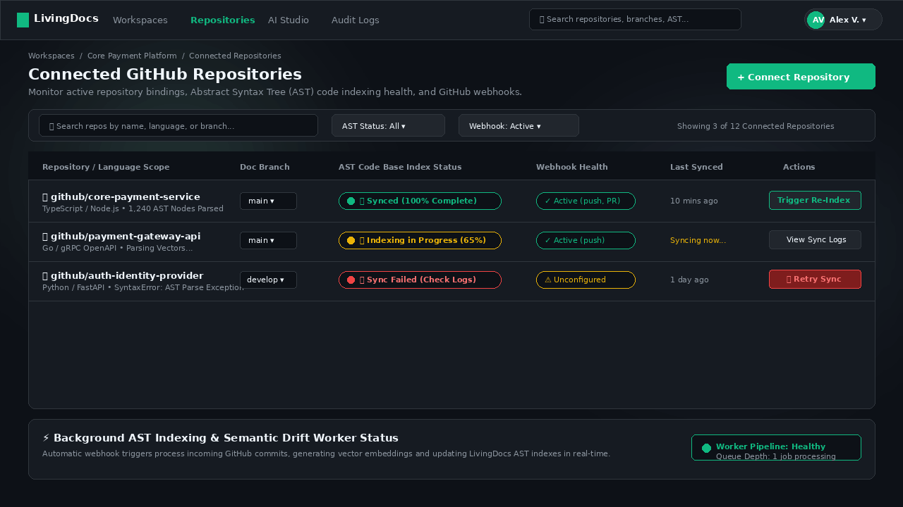
 

**3.2.3.2 Connect New GitHub Repository**

- **Function trigger:** When a Technical Lead or Administrator clicks the **"+ Connect Repository"** action button on the Connected Repositories header (`SCR-02`) or accesses `/workspaces/{workspace_id}/repositories/connect`.
- **Function description:**
    - **Actors/roles:** Technical Lead, Administrator.
    - **Purpose:**
        1. To bind an existing GitHub code repository from an authorized organization to a specific LivingDocs workspace boundary (`BR-REPO-01`).
        2. To specify the designated target documentation branch (e.g., `main`, `develop`) for code-to-doc synchronization (`BR-REPO-02`).
        3. To automatically configure GitHub Webhook subscriptions for listening to `push` and `pull_request` events (`BR-HOOK-01`).
        4. To trigger an initial background Abstract Syntax Tree (AST) parsing worker job to index the repository's code base into vector embeddings immediately upon connection (`BR-AST-01`).
    - **Data processing:**
        1. The web application opens an interactive selection modal dialog (**🔗 Connect New GitHub Repository**).
        2. The client fetches available, un-bound repositories from GitHub App OAuth installation endpoints (`GET /api/v1/github/orgs/{org_id}/repos`).
        3. The user filters available repos (e.g., selecting `github/data-streaming-pipeline`), selects the Target Workspace (`Core Payment Platform`), enters the Documentation Sync Branch (`main`), and enables automated Webhook and AST indexing options.
        4. Upon clicking **"Connect & Trigger AST Indexing →"**, the web client dispatches an HTTP request `POST /api/v1/workspaces/{workspace_id}/repositories`.
        5. The backend validates GitHub App OAuth permissions (`BR-SEC-03`), creates a new binding record in `REPOSITORY_BINDINGS`, installs a secure Webhook endpoint on GitHub using secret signing tokens, queues a background AST Indexing task in Redis/Celery (`NSF-05`), logs the action in Audit Log (`NSF-07`), and closes the modal while transitioning the repo status to `🟡 Indexing in Progress`.
- **Business rules:** `BR-REPO-01` (Workspace Repository Binding Scope), `BR-REPO-02` (Documentation Branch Mapping Rules), `BR-HOOK-01` (GitHub Webhook Automated Installation), `BR-AST-01` (Immediate AST Parsing Trigger), `BR-SEC-03` (GitHub App Installation Token Authorization).
- **Screen layout:**
- 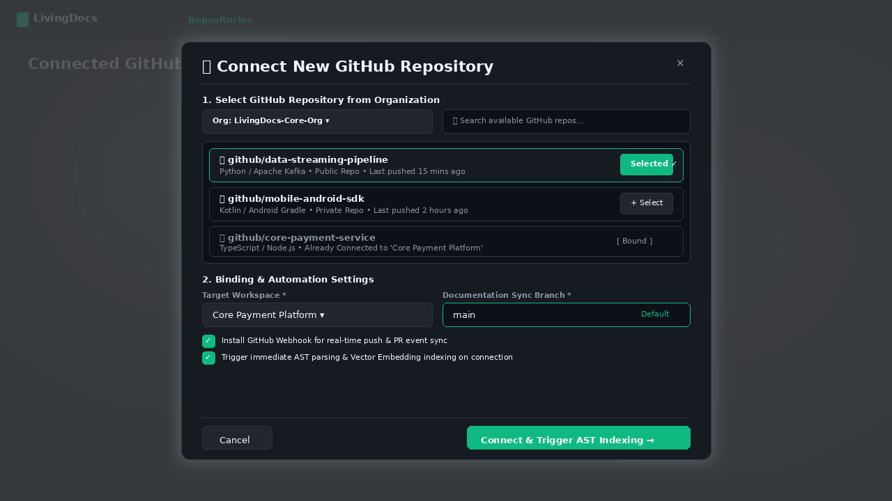

**3.2.3.3 Configure Repository Webhooks**

- **Function trigger:** When a Technical Lead or Administrator clicks **"Configure Webhooks"** or **"Webhook Settings"** on a connected repository card in `/workspaces/{workspace_id}/repositories` or navigates directly to `/workspaces/{workspace_id}/repositories/{repo_id}/webhooks`.
- **Function description:**
    - **Actors/roles:** Technical Lead, Administrator.
    - **Purpose:**
        1. To configure, manage, and verify GitHub Webhook event endpoints (`[https://api.livingdocs.com/v1/webhooks/github/receive](https://api.livingdocs.com/v1/webhooks/github/receive)`) for real-time repository tracking (`BR-HOOK-01`).
        2. To securely generate and store HMAC-SHA256 secret signing tokens for authenticating incoming GitHub payload requests and preventing signature spoofing or replay attacks (`BR-SEC-04`).
        3. To subscribe to specific GitHub webhook events (`push`, `pull_request`, `release`, `repository_dispatch`) that trigger automated AST code parsing, vector embedding indexing, and semantic drift checks (`BR-HOOK-02`).
        4. To inspect real-time webhook payload delivery logs, execution latencies, HTTP response codes (`200 OK`, `500 Error`), and trigger manual event redelivery or ping tests (`BR-HOOK-03`).
    - **Data processing:**
        1. The web application dispatches an authenticated HTTP request `GET /api/v1/workspaces/{workspace_id}/repositories/{repo_id}/webhooks` to fetch current webhook configurations and historical delivery logs.
        2. The web client renders a two-column layout: **Webhook Configuration & Secret Token Settings** on the left, and **Webhook Delivery Log & Live Payload Inspector** on the right.
        3. **Saving Webhook Configuration:** When the Tech Lead toggles subscribed events or regenerates the secret token and clicks **"Save Webhook Configuration"**, the web client dispatches `PUT /api/v1/workspaces/{workspace_id}/repositories/{repo_id}/webhooks`. The backend updates GitHub's API endpoint (`PATCH /repos/{owner}/{repo}/hooks/{hook_id}`), updates the encrypted token in `WEBHOOK_CONFIGURATIONS`, and logs an audit record (`NSF-07`).
        4. **Testing Webhook Ping:** Clicking **"⚡ Test Ping Webhook"** dispatches `POST /repos/{owner}/{repo}/hooks/{hook_id}/pings` to GitHub. GitHub sends a test `ping` event payload. LivingDocs' Webhook Gateway verifies the `X-Hub-Signature-256` HMAC digest, returns HTTP `200 OK`, and updates the health status badge to `🟢 Healthy`.
        5. **Event Redelivery:** Clicking **"Redeliver"** or **"Retry Now"** dispatches `POST /api/v1/webhooks/deliveries/{delivery_id}/redeliver`, re-processing the cached raw JSON payload through the background Celery worker queue and updating log table statuses.
- **Business rules:** `BR-HOOK-01` (Automated Endpoint Registration), `BR-HOOK-02` (Event Scope Mapping & AST Pipeline Triggering), `BR-HOOK-03` (Delivery Retries & Audit Logging), `BR-SEC-04` (HMAC SHA-256 Signature Verification).

- **Screen layout:**
- 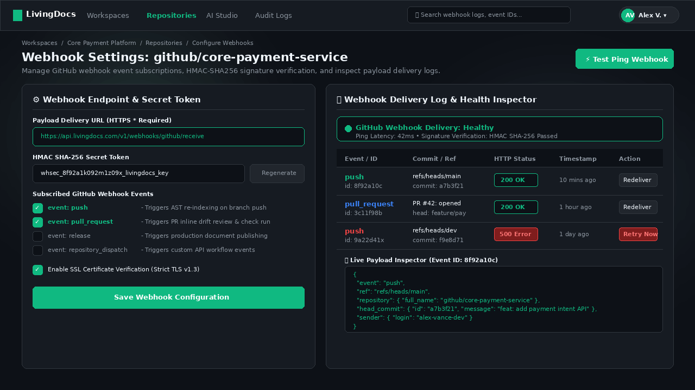

**3.2.3.4 Trigger AST Code Base Indexing**

- **Function trigger:**
    1. **Manual Action:** When an authorized user clicks **"Trigger Re-Index"** or **"⚡ Trigger Manual Re-Index"** on the repository overview table (`/workspaces/{workspace_id}/repositories`) or the repository detail view (`/workspaces/{workspace_id}/repositories/{repo_id}/indexing`).
    2. **Automated Event:** Triggered automatically in the background upon receiving a valid GitHub `push` webhook payload on monitored documentation branches (`main`/`develop`) (`BR-HOOK-02`).
- **Function description:**
    - **Actors/roles:** Developer, Staff, Manager, Technical Lead, Administrator (All authenticated system roles with access to the parent workspace).
    - **Purpose:**
        1. To execute multi-language Abstract Syntax Tree (AST) code parsing via Tree-Sitter grammars, extracting function signatures, class definitions, API routes, and structural dependency graphs (`BR-AST-01`).
        2. To compute high-dimensional vector embeddings (`text-embedding-3-large`, 1536 dimensions) for extracted AST nodes and persist them into Qdrant VectorDB for Retrieval-Augmented Generation (RAG) and Semantic Drift Detection (`BR-AST-02`).
        3. To provide a live operational monitoring dashboard featuring a 5-stage pipeline stepper, overall completion percentage, time-to-completion (ETA) estimates, and a real-time streaming terminal log console (`BR-AST-03`).
    - **Data processing:**
        1. The client issues an HTTP request `POST /api/v1/workspaces/{workspace_id}/repositories/{repo_id}/index` containing the target commit SHA and branch name.
        2. The API Gateway sets the repository status to `🟡 Indexing in Progress` and dispatches an asynchronous worker job to the Celery/Redis queue (`NSF-05`).
        3. The background worker executes sequentially across 5 stages:
            - **Stage 1 (Git Checkout):** Clones target commit SHA from the linked GitHub repository (`0.8s`).
            - **Stage 2 (Tree-Sitter Parsing):** Parses source code files across supported languages (TypeScript, Python, Go, Java), constructing raw AST node trees (`1,850 AST Nodes parsed`).
            - **Stage 3 (Semantic Code Graph):** Resolves symbol references, linking function calls, class inheritances, and API endpoints (`1.1s`).
            - **Stage 4 (Vector Embedding Generation):** Batches AST nodes to OpenAI Embedding APIs to compute 1536-dimensional vector representations (`65% progress`).
            - **Stage 5 (VectorDB Commit & Cache Invalidate):** Writes vector payloads into the target Qdrant collection and flushes obsolete semantic drift caches.
        4. Real-time pipeline status updates and raw log streams are broadcast back to the client UI using Server-Sent Events (SSE) / WebSocket protocols.
        5. Upon completion, the backend transitions the repository status to `🟢 Synced` (or `🔴 Sync Failed` if syntax/parsing errors occur), writes an entry to Audit Log (`NSF-07`), and emits a UI toast notification.
- **Business rules:** `BR-AST-01` (Incremental AST Node Parsing & Scope Freshness), `BR-AST-02` (Concurrent Indexing Lock & Rate Limit Policy), `BR-AST-03` (Multi-Language Tree-Sitter Grammar Support), `BR-SEC-03` (GitHub App Installation Token Authorization).
- **Screen layout:**
- 

### 3.2.4 Manage AI Documentation Studio

**3.2.4.1 Select Source Code & Target Template**

- **Function trigger:** When an authorized user selects **"AI Studio"** from the top navigation header (`SCR-02`), accesses `/workspaces/{workspace_id}/studio/new`, or clicks the **"Create Document with AI"** action button from the Connected Repositories dashboard (`SCR-12`).
- **Function description:**
    - **Actors/roles:** Developer, Staff, Manager, Technical Lead, Administrator (All authenticated users with access to the target workspace).
    - **Purpose:**
        1. To select an AST-indexed GitHub code repository and target documentation branch (`main`/`develop`) to serve as the Retrieval-Augmented Generation (RAG) knowledge source (`BR-AI-01`).
        2. To browse and tree-select granular source code nodes (File Scope, Class, Function/Method) to optimize Context Window token utilization for the Large Language Model (`BR-AI-02`).
        3. To choose a standardized document template (Microservice API Spec, C4 System Architecture, Database ERD Schema) and configure AI orchestration options including LLM model selection (`GPT-4o`), output language, and automated Mermaid.js diagram generation (`BR-TEMPLATE-01`).
    - **Data processing:**
        1. The web client dispatches an HTTP request `GET /api/v1/workspaces/{workspace_id}/repositories/{repo_id}/ast-nodes` to retrieve the indexed AST node hierarchy from Qdrant VectorDB.
        2. The user interacts with the tree view to select target AST nodes (e.g., `payment.controller.ts`, `StripeGatewayAdapter`). The client-side *Context Token Estimator* dynamically computes token usage (e.g., `~4,250 Tokens` representing `3.3%` of the 128k LLM context window limit).
        3. The user selects a target document template (*Microservice API Specification - OpenAPI 3.0 + MD*), LLM Engine (*GPT-4o*), document language (*English US Technical*), and toggles *Auto-generate Mermaid.js Sequence Diagrams*.
        4. Upon clicking **"Generate AI Document Draft →"**, the client packages the configuration payload (`ast_node_ids`, `template_id`, `llm_model`, `options`) and initiates the transition to the generation phase (`3.2.4.2`).
- **Business rules:** `BR-AI-01` (RAG AST Context Scope Boundary), `BR-AI-02` (LLM Context Window Limit & Token Budgeting), `BR-TEMPLATE-01` (Standard Markdown & OpenAPI Compliance).

- **Screen layout:**
- 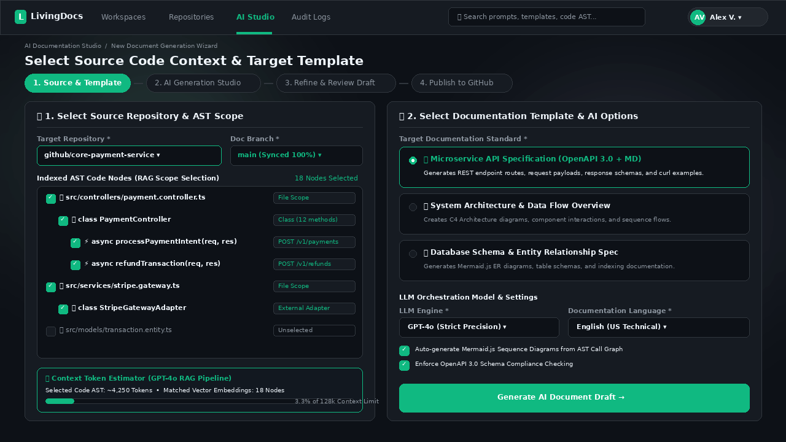

**3.2.4.2 Generate AI Documentation Draft**

- **Function trigger:**
    1. **User Action:** When an authorized user clicks **"Generate AI Document Draft →"** upon completing Step 1 (`3.2.4.1`) in the AI Documentation Studio Wizard.
    2. **Direct Route:** Accessing `/workspaces/{workspace_id}/studio/generate` with an active generation payload stored in the session context (`SCR-14`).
- **Function description:**
    - **Actors/roles:** Developer, Staff, Manager, Technical Lead, Administrator.
    - **Purpose:**
        1. To execute the multi-stage LLM Retrieval-Augmented Generation (RAG) pipeline, fetching relevant vector embeddings from Qdrant for selected AST nodes (`BR-AI-03`).
        2. To stream live Markdown token output into an interactive Document Canvas via Server-Sent Events (SSE) / WebSockets, displaying real-time generation metrics (`42 tokens/sec`, `180ms latency`) (`BR-AI-04`).
        3. To automatically synthesize architectural sequence diagrams and call graphs using Mermaid.js syntax parsed directly from source code AST representations (`BR-GEN-01`).
        4. To provide real-time stream execution controls (Pause, Stop & Regenerate) and auto-save draft snapshots into PostgreSQL with a initial status of `🟡 Draft Generated`.
    - **Data processing:**
        1. The client issues an HTTP request `POST /api/v1/workspaces/{workspace_id}/studio/generate` with payload parameters: `ast_node_ids`, `template_id`, `llm_model` (`GPT-4o`), and `options`.
        2. The AI Orchestration Gateway constructs the prompt context window by fetching code snippets and vector embeddings from Qdrant VectorDB (`Stage 1: 0.4s`).
        3. The gateway initiates an SSE streaming pipe (`Stage 3`), streaming generated Markdown tokens to the client UI in real time.
        4. The client Markdown editor renders live syntax highlighting, Markdown tables, and parses Mermaid.js code blocks dynamically (`Stage 4`).
        5. Upon stream completion (or when manually paused/stopped), the document draft is auto-saved to session cache (`Stage 5`), and the primary CTA button **"Proceed to Refine & Review →"** (Step 3 - `3.2.4.3`) is enabled.
- **Business rules:** `BR-AI-03` (RAG Vector Context Assembly & Prompt Guardrail), `BR-AI-04` (Live SSE Token Streaming & Session Auto-Save), `BR-GEN-01` (Mermaid.js Call Graph Synthesizer), `BR-SEC-05` (Prompt Injection & Code Exfiltration Safeguards).

- **Screen layout:**
- 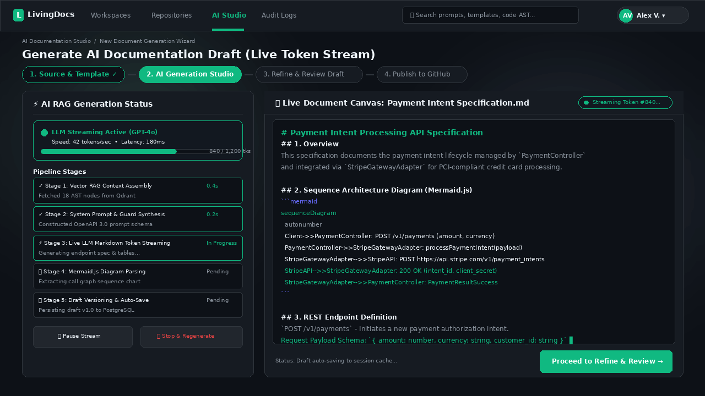

**3.2.4.3 Refine & Edit Document Draft**

- **Function trigger:**
    1. **User Navigation:** When an authorized user clicks **"Proceed to Refine & Review →"** upon completing Step 2 (`3.2.4.2`) in the AI Documentation Studio Wizard.
    2. **Direct Route:** Accessing `/workspaces/{workspace_id}/studio/editor/{draft_id}` to open an existing saved draft snapshot (`SCR-15`).
- **Function description:**
    - **Actors/roles:** Developer, Staff, Technical Lead, Administrator (Requires Staff-level authorization or higher for Tier-1 technical review sign-off `BR-WS-04`).
    - **Purpose:**
        1. To provide an interactive split-pane Markdown editor (Raw Markdown Code on the left, Live Rendered HTML/Mermaid.js Preview on the right) with instant syntax highlighting and auto-save capabilities (`BR-EDIT-01`).
        2. To calculate and display real-time **Semantic Drift Scores** by comparing updated draft sections against source AST vector embeddings, flagging code/documentation mismatches (`BR-DRIFT-01`).
        3. To enable prompt-driven AI refinement (e.g., *"Add cURL request examples"*, *"Expand HTTP 402 payment failure handling"*), re-querying the LLM orchestration engine for targeted section rewrites (`BR-AI-05`).
        4. To facilitate collaborative feedback threads, inline review comments, and execute **Tier-1 Staff Technical Approval Sign-off** before committing changes (`BR-GOV-01`).
    - **Data processing:**
        1. The client issues `GET /api/v1/workspaces/{workspace_id}/studio/drafts/{draft_id}` to load raw Markdown content, version history, and existing comment threads.
        2. As the user edits Markdown text in the left pane, the client dynamically re-renders the preview in the right pane and sends throttled delta updates (`PATCH /api/v1/studio/drafts/{draft_id}`) to update draft snapshot `v1.1`.
        3. The backend recalculates cosine similarity between updated document paragraphs and indexed AST vectors, returning a **Semantic Alignment Score** (e.g., `98.5% Alignment`, `Drift Score: 0.015 - Verified`).
        4. When a user submits an AI Refinement prompt, the backend dispatches a targeted LLM patch request and applies diff highlights to the editor.
        5. When a Staff member checks **"Tier-1 Staff Technical Approval Signed Off"**, the system records a cryptographic sign-off metadata tag and enables the CTA button **"Proceed to Publish & Commit →"** (Step 4 - `3.2.4.4`).
- **Business rules:** `BR-EDIT-01` (Split-Pane Live Markdown Synchronization), `BR-DRIFT-01` (Semantic Drift Cosine Thresholds & Warning Badges), `BR-AI-05` (In-Place AI Prompt Refinement), `BR-GOV-01` (Tier-1 Staff Approval Sign-off & Audit Logging).

- **Screen layout:**
- 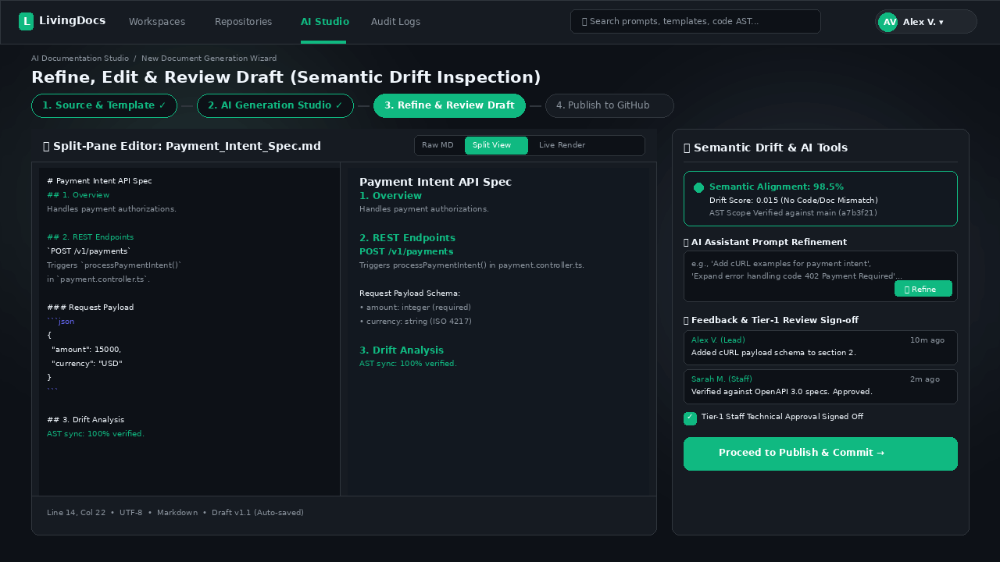

**3.2.4.4 Publish & Commit Documentation to GitHub**

Dưới đây là đặc tả SRS hoàn chỉnh cho bước cuối cùng: **3.2.4.4 Publish & Commit Documentation to GitHub** thuộc phân hệ **3.2.4 Manage AI Documentation Studio**.

Toàn bộ tài liệu được chuẩn hóa bằng tiếng Anh kỹ thuật và đồng bộ 100% với giao diện **Screen Layout Dark Mode** đã hoàn thiện:

### 3.2.4 Manage AI Documentation Studio

#### 3.2.4.4 Publish & Commit Documentation to GitHub

- **Function trigger:**
    1. **User Navigation:** When an authorized user clicks **"Proceed to Publish & Commit →"** upon completing Step 3 (`3.2.4.3`) in the AI Documentation Studio Wizard.
    2. **Direct Route:** Accessing `/workspaces/{workspace_id}/studio/publish/{draft_id}` with an approved draft status (`SCR-16`).
- **Function description:**
    - **Actors/roles:** Manager, Technical Lead, Administrator (Requires Manager-level authorization for Tier-2 final approval sign-off `BR-WS-04`).
    - **Purpose:**
        1. To configure GitHub repository target paths (e.g., `docs/api/payment-intent-spec.md`) and choose publishing strategies (Create Pull Request vs Direct Commit) (`BR-GIT-01`).
        2. To enforce the **2-Tier Approval Workflow Governance Gate** (Tier-1 Staff Technical Review + Tier-2 Manager Governance Sign-off) before writing changes to GitHub (`BR-WS-04`).
        3. To execute direct GitHub REST/GraphQL API commits or generate automated Pull Requests đính kèm release notes and AST metadata labels (`BR-GIT-02`).
        4. To flush obsolete Qdrant VectorDB semantic drift caches upon commit and emit system audit log entries (`NSF-07`).
    - **Data processing:**
        1. The client issues `GET /api/v1/workspaces/{workspace_id}/studio/drafts/{draft_id}/publish-config` to fetch target repository credentials, default branch paths, and governance approval statuses.
        2. The user selects a publishing strategy (*Create GitHub Pull Request* or *Direct Commit*) and specifies a custom commit message.
        3. The backend validates the **2-Tier Approval Workflow Checklist** (`BR-WS-04`):
            - Checks for **Tier-1 Staff Technical Sign-off** metadata tag.
            - Verifies **Tier-2 Manager Approval** credentials of the active session.
        4. Upon clicking **"🚀 Publish & Commit Document to GitHub"**, the backend dispatches a GitHub API payload (`POST /repos/{owner}/{repo}/contents/{path}` or `POST /repos/{owner}/{repo}/pulls`).
        5. Upon a successful HTTP 201 response from GitHub, the system:
            - Transitions document draft status to `🟢 Published & Synced`.
            - Triggers a background job to flush obsolete semantic drift cache entries in Qdrant VectorDB.
            - Writes an immutable record to the System Audit Trail (`NSF-07`).
            - Displays a success Toast notification with a direct link to the published GitHub PR/file.
- **Business rules:** `BR-WS-04` (2-Tier Staff/Manager Approval Workflow), `BR-GIT-01` (GitHub Target File Pathing & Branch Rules), `BR-GIT-02` (Pull Request Generation & Direct Commit Permissions), `BR-SEC-03` (GitHub App OAuth Scope Verification).

- **Screen layout:**
- 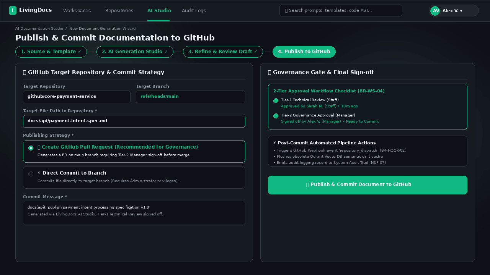

### 3.2.5 Manage Visual Assets & OCR

**3.2.5.1 Upload Architecture Diagram Asset**

- **Function trigger:**
    1. **User Action:** When an authorized user selects **"Visual Assets & OCR"** from the workspace top navigation header (`SCR-02`), accesses `/workspaces/{workspace_id}/assets/upload`, or clicks the **"Upload Diagram / Asset"** action button inside the AI Studio Canvas / Editor (`SCR-17`).
- **Function description:**
    - **Actors/roles:** Developer, Staff, Manager, Technical Lead, Administrator (All authenticated users with write permissions in the active workspace).
    - **Purpose:**
        1. To enable users to upload static architecture diagram images, legacy flowcharts, and system layout specs (PNG, JPG, SVG, WebP) into the workspace visual asset repository (`BR-OCR-01`).
        2. To execute Vision-LLM (GPT-4o Vision) image processing to extract structural diagram metadata, text labels, component boundaries, and directional relation arrows (`BR-OCR-02`).
        3. To automatically convert visual graph elements into editable, valid **Mermaid.js** code blocks (Architecture Graph, Sequence Diagram, C4 Diagram) for embedding into Markdown documents (`BR-OCR-03`).
        4. To associate uploaded image assets with target Markdown documentation files (`docs/architecture/payment-intent-spec.md`) and index extracted text vectors into Qdrant VectorDB for RAG retrieval.
    - **Data processing:**
        1. The client sends a multipart form request `POST /api/v1/workspaces/{workspace_id}/assets/upload` containing the raw image binary, asset title, target Markdown document link, and Vision engine selection (`GPT-4o Vision Engine`).
        2. The API Gateway validates file type, MIME header, and size limit (Max: 10MB). The binary file is persisted into S3 Object Storage, generating a secure CDN asset URL.
        3. The backend dispatches the image buffer to the Vision-LLM processing pipeline. The Vision API performs multi-layer analysis:
            - **Node Component Recognition:** Identifies web clients, API gateways, microservices, databases, and external cloud services.
            - **Edge & Relation Mapping:** Detects directional arrows, HTTP/gRPC protocol labels, and data payloads.
        4. The engine compiles the structural metadata into standard Mermaid.js syntax (`graph TD`), calculates an OCR confidence score (e.g., `96.4% Confidence`), and renders a live interactive diagram preview in the right pane.
        5. The client displays a success indicator and enables direct insertion of the synthesized Mermaid code block into the AI Studio Markdown Editor.
- **Business rules:** `BR-OCR-01` (Supported File Formats & 10MB Size Limit), `BR-OCR-02` (Multimodal Vision Engine Confidence Thresholds), `BR-OCR-03` (Mermaid.js Diagram Syntax Standards), `BR-SEC-04` (S3 Asset Encryption at Rest & Access Control).

- **Screen layout:**
- 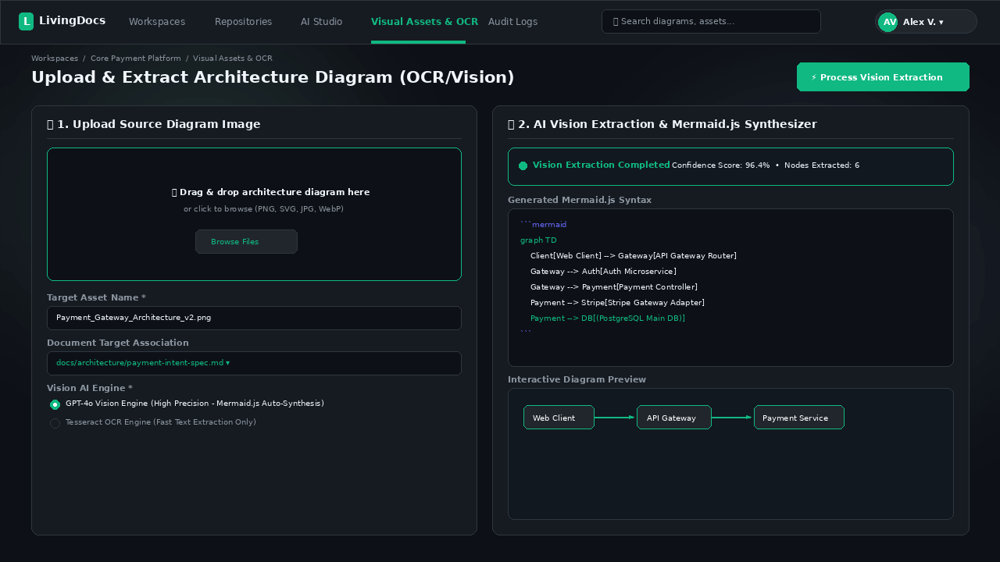

**3.2.5.2 Extract OCR & Convert to Mermaid.js Code**

- **Function trigger:**
    1. **Automated Trigger:** Initiated immediately upon completion of the image upload process in `3.2.5.1`.
    2. **User Action:** When an authorized user selects an uploaded visual asset from the Asset Gallery (`SCR-18`) and clicks **"⚡ Process Vision Extraction & Synthesize Mermaid"**.
- **Function description:**
    - **Actors/roles:** Developer, Staff, Manager, Technical Lead, Administrator.
    - **Purpose:**
        1. To execute multimodal Vision-LLM analysis (GPT-4o Vision API) for Optical Character Recognition (OCR) and spatial node extraction on uploaded architecture diagrams (`BR-OCR-02`).
        2. To map detected visual elements (component boxes, databases, protocol lines, directional arrows) into green OCR bounding box overlays with confidence score indicators (`BR-OCR-03`).
        3. To convert extracted structural metadata into editable, syntactically valid **Mermaid.js** code blocks (`graph TD`, `sequenceDiagram`, `erDiagram`) in real time (`BR-GEN-01`).
        4. To provide a live SVG vector preview rendered directly from the synthesized Mermaid.js code and enable one-click insertion (**"⚡ Insert to Document"**) into the target Markdown editor (`SCR-15`).
    - **Data processing:**
        1. The client triggers an HTTP request `POST /api/v1/workspaces/{workspace_id}/assets/{asset_id}/extract-ocr`.
        2. The Vision Processing Pipeline crops and sends the image buffer to the multimodal LLM API with structured extraction instructions.
        3. The engine returns structured JSON containing:
            - `nodes`: Array of detected text elements, component labels, spatial coordinates `[x, y, w, h]`, and recognition confidence scores (`96% - 99%`).
            - `edges`: Directional relations and connector protocol labels (`HTTP POST /v1`, `gRPC Route`, `SQL Query`).
        4. The backend compiler compiles the node-edge graph into standardized Mermaid.js code (e.g., `Client -->|HTTP POST /v1| Gateway`).
        5. The client renders a 3-pane layout:
            - **Pane 1 (Left):** Original image with interactive green OCR Bounding Box overlays.
            - **Pane 2 (Center):** Editable Mermaid.js code editor with live syntax validation.
            - **Pane 3 (Right):** Live SVG vector preview generated dynamically from the center code editor.
        6. Clicking **"⚡ Insert to Document"** embeds the generated Mermaid code block into the associated Markdown draft and persists the vector nodes to Qdrant VectorDB.
- **Business rules:** `BR-OCR-02` (Vision-LLM Confidence Thresholds & Auto-Retry Policy), `BR-OCR-03` (Mermaid.js Code Syntax Compliance & Fallback Handling), `BR-GEN-01` (Automated Call Graph Synthesizer).

- **Screen layout:**
- 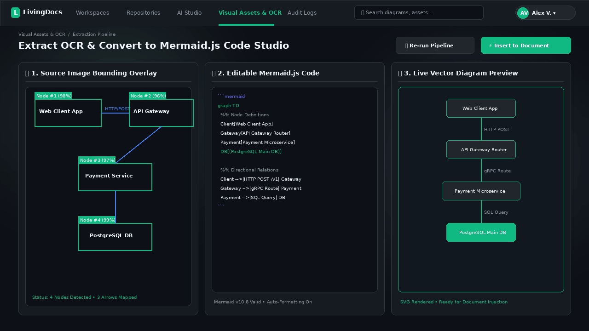

**3.2.5.3 Visual Asset Library & Vector Indexing**

- **Function trigger:**
    1. **User Action:** When an authorized user selects **"Visual Assets & OCR"** from the workspace main navigation bar (`SCR-02`) or accesses `/workspaces/{workspace_id}/assets/library` (`SCR-19`).
    2. **Direct Link:** Navigating via the **"View All Visual Assets"** action button on the Workspace Dashboard.
- **Function description:**
    - **Actors/roles:** Developer, Staff, Manager, Technical Lead, Administrator (All authenticated users with access to the target workspace).
    - **Purpose:**
        1. To provide a centralized visual asset management gallery for all uploaded architecture diagrams, flowcharts, and ERD schematics (PNG, SVG, JPG, WebP) (`BR-OCR-04`).
        2. To manage real-time **Qdrant VectorDB Indexing** statuses for OCR text embeddings, enabling semantic similarity search across visual diagram nodes (`BR-AI-01`).
        3. To allow quick access for copying synthesized Mermaid.js code blocks, previewing bounding box overlays, and re-linking visual assets to Markdown documentation files (`BR-OCR-03`).
        4. To monitor the health, storage allocation, and synchronization status of the workspace Qdrant vector store (`NSF-05`).
    - **Data processing:**
        1. The web client issues an HTTP request `GET /api/v1/workspaces/{workspace_id}/assets` to fetch the list of visual assets, OCR extraction metrics, and Qdrant vector status tags.
        2. The UI renders the asset grid layout displaying thumbnail previews, extracted node counts, OCR accuracy percentages (e.g., `96.4%`), and document association links (`docs/payment-spec.md`).
        3. When a user inputs a query in the search bar (e.g., *"PostgreSQL Schema"* or *"Stripe Gateway"*), the client dispatches a vector search request `POST /api/v1/workspaces/{workspace_id}/assets/vector-search` to query Qdrant vector embeddings via cosine distance metrics.
        4. Clicking **"⚡ Copy Mermaid"** copies the stored Mermaid.js code snippet directly to the clipboard for instant embedding into AI Studio drafts.
        5. Clicking **"🔄 Index Vectors Now"** or **"🔄 Sync Qdrant"** dispatches a re-indexing job (`POST /api/v1/workspaces/{workspace_id}/assets/{asset_id}/reindex`), re-embedding OCR nodes into the Qdrant vector database.
- **Business rules:** `BR-OCR-04` (Visual Asset Retention & Versioning Policies), `BR-AI-01` (Qdrant Vector Embedding Indexing Boundaries), `BR-SEC-04` (Asset Encryption at Rest & S3 Access Control).

- **Screen layout:**
- 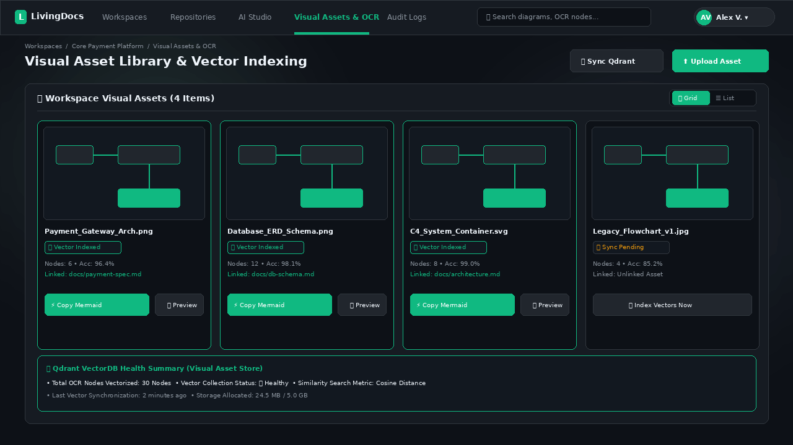

### 3.2.6 Manage Documentation Drift Alerts

**3.2.6.1 View Active Drift Alert List**

- **Function trigger:**
    1. **User Action:** When an authorized user selects **"Drift Alerts"** from the workspace top navigation header (`SCR-02`), accesses `/workspaces/{workspace_id}/drift-alerts` (`SCR-20`), or clicks the active alert badge notification (`3`).
    2. **Automated Event:** Triggered asynchronously via GitHub Webhook (`BR-HOOK-02`) after code commits are merged, initiating automated Tree-Sitter AST parsing and Qdrant vector alignment scoring.
- **Function description:**
    - **Actors/roles:** Developer, Staff, Manager, Technical Lead, Administrator.
    - **Purpose:**
        1. To provide a central real-time monitoring dashboard displaying all detected Documentation Drift Alerts caused by out-of-sync source code changes (`BR-DRIFT-01`).
        2. To categorize drift severity into distinct levels: **🔴 High Severity** (Breaking API change / Deleted AST method), **🟡 Medium Severity** (Modified function signature / Parameter additions), and **🔵 Low Severity** (Code comment updates / Refactored non-breaking types).
        3. To filter and search drift alerts by Repository, Severity, Status (`🔴 Active`, `🟡 In Review`, `🟢 Resolved`), and Semantic Alignment score (\< 90.0%).
        4. To provide direct action buttons on each alert card for immediate resolution (**"⚡ Auto-Generate AI Fix Patch"**), line-by-line diff inspection (**"👁️ Inspect Code/Doc Diff"**), provenance tracing (**"🔍 Grounding Evidence"**), or dismissal (**"🔕 Dismiss Alert"**).
    - **Data processing:**
        1. The client issues an HTTP request `GET /api/v1/workspaces/{workspace_id}/drift-alerts` to retrieve active alert records from PostgreSQL.
        2. The UI renders each card with computed metrics from Qdrant VectorDB (e.g., `Drift Score: 0.176`, `Semantic Alignment: 82.4%`).
        3. Clicking **"🔄 Trigger Manual AST Scan"** dispatches a background job `POST /api/v1/workspaces/{workspace_id}/drift-scan` to force re-indexing of AST nodes and vector alignment checks against all connected Markdown documents.
- **Business rules:** `BR-DRIFT-01` (Semantic Drift Thresholds & Cosine Distance Rules), `BR-HOOK-02` (GitHub Webhook Invalidation Pipeline), `BR-GOV-01` (Audit Logging Compliance).

- **Screen layout:**
- 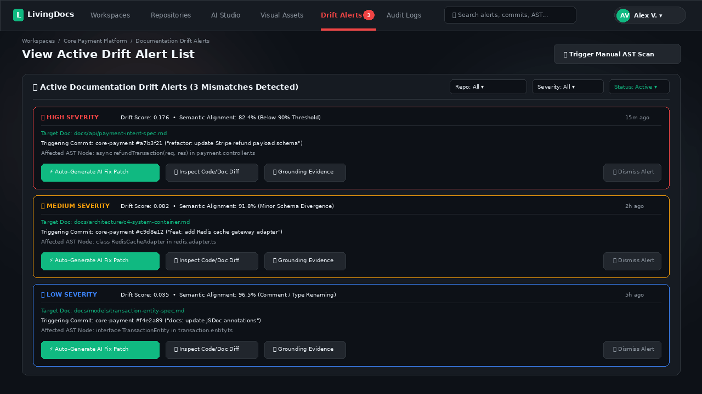

**3.2.6.2 Inspect Interactive Code-Doc Visual Diff**

- **Function trigger:**
    1. **User Navigation:** When an authorized user clicks **"👁️ Inspect Code/Doc Diff"** on any active drift alert card (`SCR-20`) or accesses `/workspaces/{workspace_id}/drift-alerts/{alert_id}/diff` (`SCR-21`).
- **Function description:**
    - **Actors/roles:** Developer, Staff, Manager, Technical Lead, Administrator.
    - **Purpose:**
        1. To present a side-by-side interactive visual diff canvas contrasting triggering Git code commit changes against out-of-date Markdown documentation sections (`BR-DRIFT-02`).
        2. To highlight precise code line modifications (Red `-` for deleted logic, Green `+` for added parameters/endpoints) alongside the AI-recommended Markdown documentation patch (`BR-AI-05`).
        3. To provide synchronized dual-pane scrolling and quick action routes to accept the patch and route it directly into the **AI Studio Editor** for Tier-1/Tier-2 approval sign-off (`BR-WS-04`).
    - **Data processing:**
        1. The client dispatches an HTTP request `GET /api/v1/workspaces/{workspace_id}/drift-alerts/{alert_id}/diff` to fetch the git commit delta and target Markdown block.
        2. The backend parses the code changes using Tree-Sitter AST, identifies affected parameters/types, and computes line-by-line diff markers.
        3. The LLM Orchestration engine (`GPT-4o`) constructs an updated Markdown code block reflecting the latest AST code structure.
        4. Clicking **"Accept Patch & Open in AI Studio Editor →"** creates a new document snapshot (`v1.2-drift-fix`) and redirects the user to Step 3 of the AI Studio Wizard (`3.2.4.3`).
- **Business rules:** `BR-DRIFT-02` (AST Code/Doc Line Diff Matching Rules), `BR-AI-05` (In-Place AI Prompt Patching), `BR-WS-04` (2-Tier Governance Gate Routing).

- **Screen layout:**
- 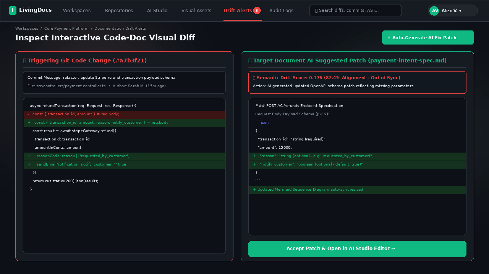

**3.2.6.3 Inspect Grounding Evidence Links**

- **Function trigger:**
    1. **User Action:** When an authorized user clicks **"🔍 Grounding Evidence"** on any active drift alert card (`SCR-20`) or expands the **"Grounding Evidence Links"** inspection panel inside the visual diff canvas (`SCR-21`).
- **Function description:**
    - **Actors/roles:** Developer, Staff, Manager, Technical Lead, Administrator.
    - **Purpose:**
        1. To provide transparent, cryptographic, and semantic traceability for detected documentation drifts by linking Markdown assertions directly back to source code origins (`BR-AI-01`).
        2. To display immutable evidence logs connecting affected Markdown text blocks to specific **GitHub Commit SHAs**, **AST Node Signatures**, **File Line Ranges**, and **Qdrant Vector Embedding IDs** with Cosine Distance scores (`BR-DRIFT-01`).
        3. To enable engineers to verify AI-detected anomalies, cross-examine exact vector similarity distances, and validate ground-truth evidence before approving automated documentation fix patches (`BR-GOV-01`).
    - **Data processing:**
        1. The client issues an HTTP request `GET /api/v1/workspaces/{workspace_id}/drift-alerts/{alert_id}/evidence` to retrieve provenance details.
        2. The backend queries the Audit Logging database (`postgresql_audit_logs`) and Qdrant Vector DB to assemble a structured evidence chain:
            - **Source Code Provenance:** Target repository, branch name, commit SHA hash (`a7b3f218c`), author details, and exact file path (`src/controllers/payment.controller.ts`, lines `42-58`).
            - **AST Parsing Node:** Parsed Abstract Syntax Tree node signature (e.g., `async refundTransaction(req: Request, res: Response)`).
            - **Vector Distance Metric:** Qdrant embedding collection ID (`vec_doc_nodes_v2`), cosine similarity distance score (`0.176`), and alignment threshold classification (`82.4% - Severe Drift`).
        3. The UI renders the evidence tree modal/drawer with deep-link shortcuts to open the exact commit on GitHub/GitLab or navigate directly to the Qdrant Vector Console.
- **Business rules:** `BR-AI-01` (RAG Vector Context Traceability & Citation Rules), `BR-DRIFT-01` (Semantic Drift Thresholds & Cosine Distance Calculations), `BR-GOV-01` (Immutable System Audit Logging Compliance).

- **Screen layout:**
- 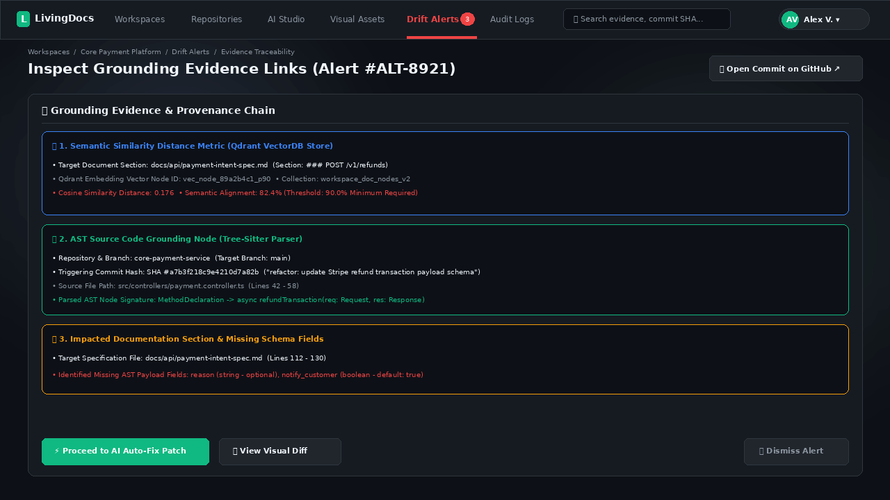

**3.2.6.4 Dismiss or Resolve Drift Alert**

- **Function trigger:**
    1. **User Action:** When an authorized user clicks **"⚡ Auto-Generate AI Fix Patch"**, **"✅ Resolve Alert"**, or **"🔕 Dismiss Alert"** on any drift alert item across `SCR-20`, `SCR-21`, or `SCR-22`.
- **Function description:**
    - **Actors/roles:** Staff, Manager, Technical Lead, Administrator (Requires appropriate governance permissions; Developer role can trigger AI patches but requires Staff/Manager approval to resolve or dismiss).
    - **Purpose:**
        1. **Resolve with AI Auto-Fix Patch:** To synthesize an updated Markdown documentation patch via LLM (`GPT-4o`), automatically routing the patch to the **AI Studio Refine & Review Workflow** (`3.2.4.3`) for 2-Tier governance approval (Staff Reviewer → Manager Sign-off) before publishing to GitHub.
        2. **Dismiss Alert:** To allow authorized leads/managers to mark a detected drift alert as a false positive, intentional code-doc divergence, or out-of-scope mismatch, suppressing notifications for the associated commit SHA.
        3. To enforce accountability by capturing mandatory user justification notes, updating the alert status to `🟢 Resolved` or `⚪ Dismissed`, and writing an immutable entry into the system audit log (`NSF-07`).
    - **Data processing:**
        1. The client opens the **Resolve or Dismiss Drift Alert Modal** (`SCR-23`).
        2. The user selects a resolution pathway:
            - **Option A (Resolve via AI Patch):** Triggers `POST /api/v1/workspaces/{workspace_id}/drift-alerts/{alert_id}/resolve`. The backend creates a new document snapshot (`v1.2-drift-fix`), routes it to Tier-1 review (`SCR-17`), and marks the alert as `🟡 In Review`.
            - **Option B (Dismiss Alert):** Requires inputting a mandatory justification note in the text area (e.g., *"Intentional API deprecation scheduled for v2 release"*). The client dispatches `PATCH /api/v1/workspaces/{workspace_id}/drift-alerts/{alert_id}/dismiss` with payload `{ reason_code: "INTENTIONAL_DIVERGENCE", justification: "..." }`.
        3. The backend updates the PostgreSQL alert record status to `⚪ Dismissed`, flushes obsolete Qdrant vector caches for the commit SHA, and emits a WebSocket notification updating active badge counters across connected clients (`3` -\> `2`).
        4. An audit log record (`#AUD-9021`) is appended to the audit database containing the user ID, timestamp, alert ID, action type, and justification string.
- **Business rules:** `BR-DRIFT-03` (Alert Dismissal Authority & Mandatory Justification Rules), `BR-WS-04` (2-Tier Governance Gate Approval Workflow), `BR-GOV-01` (System Audit Trail Compliance).

- **Screen layout:**
- 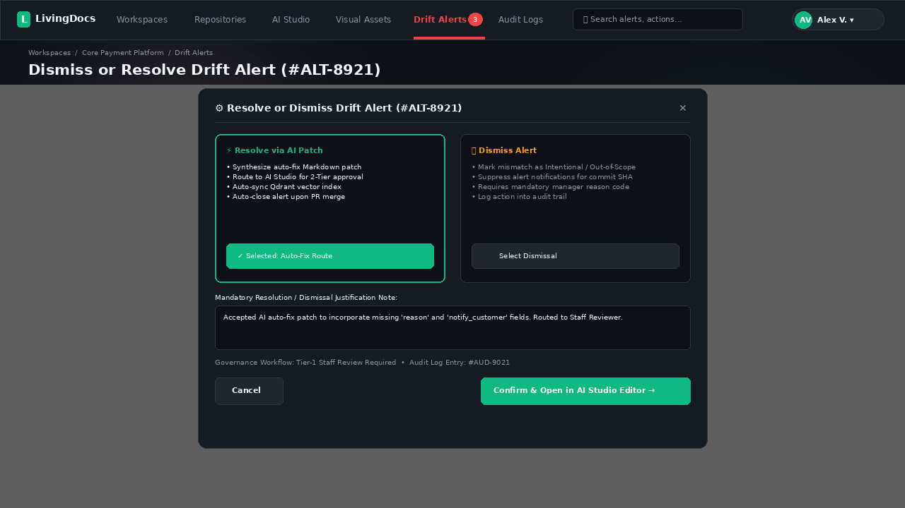

### 3.2.7 Manage Tier-1 Review Queue (Staff)

**3.2.7.1 View Tier-1 Pending Review List**

- **Function trigger:**
    1. **User Action:** When an authorized user with the Staff role selects **"AI Studio"** → **"Tier-1 Queue"** from the top header navigation (`SCR-02`), accesses `/workspaces/{workspace_id}/reviews/tier-1` (`SCR-24`), or clicks the pending review badge notification (`2`).
    2. **Automated Event:** Triggered asynchronously when a draft document, AI-generated specification, or automated drift fix patch is submitted for review from AI Studio (`3.2.4.3`) or Drift Alerts (`3.2.6.4`).
- **Function description:**
    - **Actors/roles:** Staff, Manager, Technical Lead, Administrator (Staff role is the primary actor assigned to Tier-1 reviews).
    - **Purpose:**
        1. To provide a dedicated monitoring queue for Staff reviewers to claim and manage pending document drafts, AI Studio generation outputs, and automated drift resolution patches.
        2. To display automated AI quality checks for each item before human evaluation: **AI Hallucination Score** (\< 0.05 threshold) and **AST Code Alignment Percentage** (\> 95.0% threshold).
        3. To categorize review submissions by type: **🔄 DRIFT AUTO-FIX PATCH**, **✨ NEW AI STUDIO SPECIFICATION**, or **🖼️ OCR DIAGRAM SPEC**.
        4. To track SLA countdown timers (e.g., `SLA: 2h left`), priority levels (`🔴 High Priority`, `🟡 Normal Priority`), submission authors, and target Markdown document file paths.
    - **Data processing:**
        1. The client issues an HTTP request `GET /api/v1/workspaces/{workspace_id}/reviews/tier-1` to retrieve items in PostgreSQL with status `🟡 Pending Tier-1 Review`.
        2. The UI renders each review item card with real-time health badges computed during LLM generation.
        3. Clicking **"🔍 Evaluate & Add Feedback"** opens the interactive document comparison canvas (`3.2.7.2`).
        4. Clicking **"✅ Endorse to Tier-2 Manager →"** or **"❌ Reject & Return to Author"** opens the Tier-1 decision confirmation dialog (`3.2.7.3`).
- **Business rules:** `BR-WS-04` (2-Tier Governance Gate Approval Workflow), `BR-GOV-01` (Audit Trail Logging for Tier-1 Queue Access), `BR-AI-01` (RAG Context Alignment Validation).

- **Screen layout:**
- 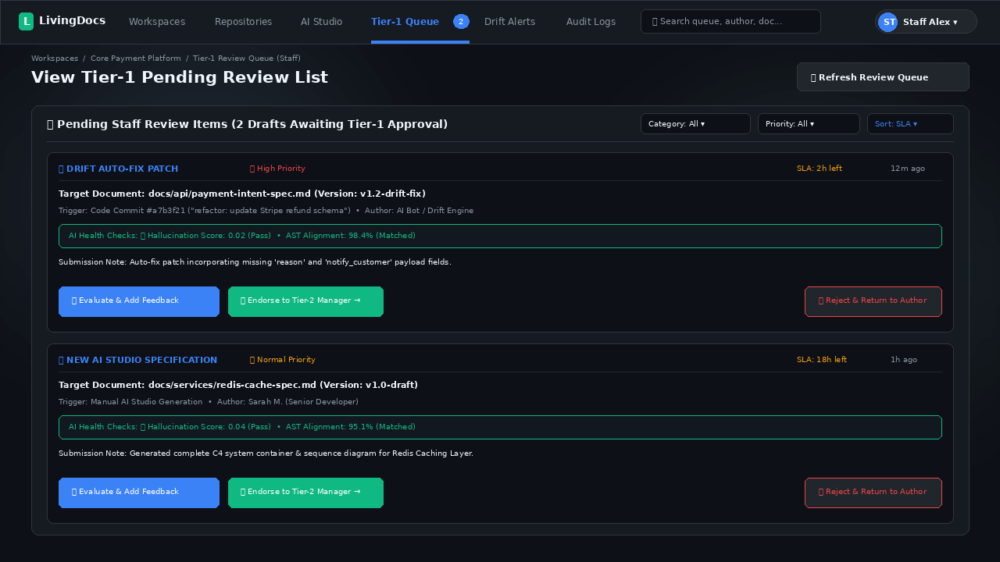

**3.2.7.2 Add Section Inline Feedback**

- **Function trigger:**
    1. **User Action:** When a Staff reviewer selects any document from the Tier-1 queue (`SCR-24`), highlights a line range or section on the document evaluation canvas (`SCR-25`), and clicks **"💬 Add Inline Feedback"** or selects an existing annotated line icon (`💬 1`).
- **Function description:**
    - **Actors/roles:** Staff, Manager, Technical Lead, Administrator (Staff users perform primary review and annotation duties).
    - **Purpose:**
        1. To enable Staff reviewers to attach precise line-by-line inline feedback, correction requirements, or ambiguity notes directly to Markdown sections, code blocks, or Mermaid.js diagram definitions before escalation.
        2. To categorize feedback severity levels: **🔴 Blocker Issue** (Mandatory fix required before Tier-2 endorsement; e.g., hallucinated parameters, wrong schema), **🟡 Suggestion** (Optional phrasing or structural improvement), and **🔵 Technical Query**.
        3. To provide interactive threaded conversations allowing authors or AI Studio operators to reply, clarify, and resolve issues in real time.
    - **Data processing:**
        1. The client captures the highlighted line numbers (e.g., `lines 46-47`) and dispatches `POST /api/v1/reviews/tier-1/{review_id}/comments` with payload `{ line_start: 46, line_end: 47, feedback_type: "BLOCKER", comment_text: "..." }`.
        2. The backend stores the thread in PostgreSQL, updates the document metadata to flag active unresolved issues, and applies an amber highlight background to lines `46-47` on the preview canvas.
        3. Clicking **"✓ Resolve Issue"** updates the comment thread status to `RESOLVED` via `PATCH /api/v1/reviews/comments/{comment_id}/resolve` and unblocks the document for final Tier-1 endorsement.
- **Business rules:** `BR-GOV-02` (Mandatory Rejection & Blocker Issue Resolution Rule), `BR-WS-04` (2-Tier Governance Gate Inline Auditability).

- **Screen layout:**
- 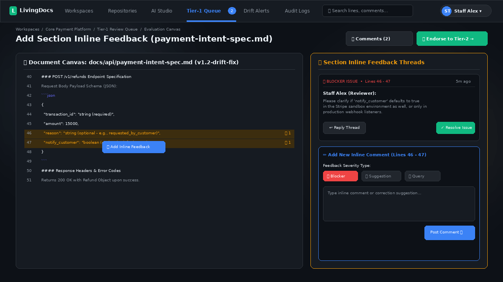

**3.2.7.3 Approve or Reject Tier-1 Draft**

- **Function trigger:**
    1. **User Action:** When a Staff reviewer clicks **"✅ Endorse to Tier-2 Manager →"** or **"❌ Reject & Return to Author"** on the evaluation action bar (`SCR-25`) or from the review queue list (`SCR-24`).
- **Function description:**
    - **Actors/roles:** Staff, Manager, Technical Lead, Administrator (Staff users perform primary Tier-1 review sign-off).
    - **Purpose:**
        1. **Approve Pathway (Endorse & Escalate):** To endorse a verified document draft or AI drift auto-fix patch, freezing its snapshot version (e.g., `v1.2-drift-fix`) and escalating it to the **Tier-2 Manager Approval Queue** (`3.2.8`) for final sign-off and GitHub publishing.
        2. **Reject Pathway (Return for Revisions):** To reject an unsatisfactory draft, reverting its status to `🔴 Revisions Required` and unlocking the editor for the author or AI Studio sandbox with mandatory feedback comments attached.
        3. To enforce governance pre-conditions: System validates that **0 Active Blocker Comments** (`🔴 BLOCKER ISSUE`) remain unresolved before allowing Tier-1 approval.
        4. To record immutable audit logs capturing the Staff reviewer ID, evaluation summary notes, timestamp, and review status transition (`NSF-07`).
    - **Data processing:**
        1. The client opens the **Tier-1 Decision Sign-Off Dialog** (`SCR-26`).
        2. The user inputs a mandatory evaluation summary note and selects the decision pathway:
            - **Approve & Escalate:** Dispatches `PATCH /api/v1/reviews/tier-1/{review_id}/approve` with payload `{ summary_notes: "Verified API schema against code. Endorsed for Manager approval." }`. The backend updates status to `🔵 Pending Tier-2 Manager Review`, emits a WebSocket event to Managers, and writes an audit log entry (`#AUD-T1-8812`).
            - **Reject & Return:** Dispatches `PATCH /api/v1/reviews/tier-1/{review_id}/reject` with payload `{ rejection_reason: "Unresolved blocker comments on schema lines 46-47." }`. The backend reverts status to `🔴 Draft Revisions Required` and sends notification alerts to the document author.
- **Business rules:** `BR-WS-04` (2-Tier Governance Gate Approval & Escalation Workflow), `BR-GOV-02` (Zero Active Blocker Rule for Approval), `BR-GOV-01` (System Audit Logging Compliance).

- **Screen layout:**
- 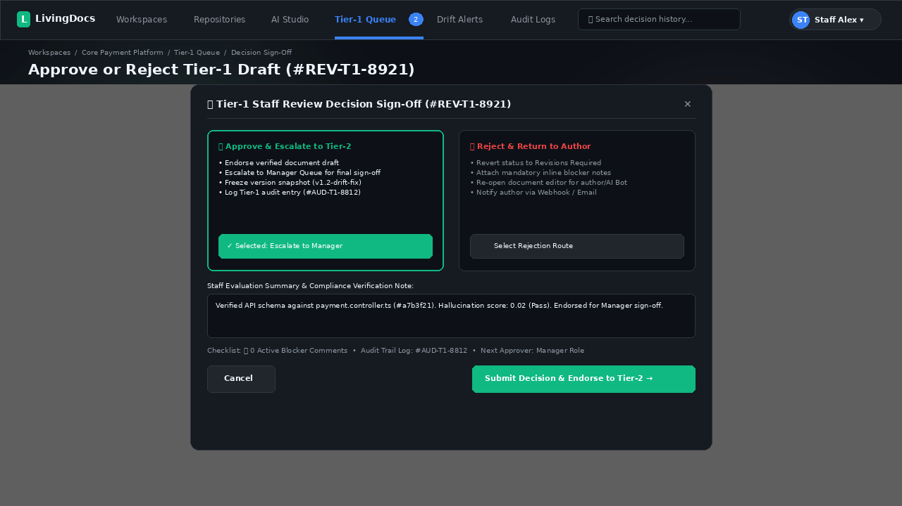

### 3.2.8 Manage Tier-2 Approval & GitHub Publishing (Manager)

**3.2.8.1 View Tier-2 Final Approval Queue**

- **Function trigger:**
    1. **User Action:** When an authorized Manager selects **"AI Studio"** → **"Tier-2 Queue"** from the top navigation bar (`SCR-02`), accesses `/workspaces/{workspace_id}/reviews/tier-2` (`SCR-27`), or clicks the pending Manager review badge notification (`1`).
    2. **Automated Event:** Triggered when a Staff reviewer endorses and escalates a draft document or drift resolution patch from Tier-1 review (`3.2.7.3`).
- **Function description:**
    - **Actors/roles:** Manager, Technical Lead, Administrator (Manager holds primary publishing authority).
    - **Purpose:**
        1. To present an executive queue of all document drafts and AI drift fixes that have successfully passed Tier-1 Staff endorsement and are awaiting final publication sign-off.
        2. To display Tier-1 Staff endorsement notes, reviewer signatures, SLA publication deadlines, target GitHub repository and branch details (`main`, `release/v2.0`).
        3. To automatically evaluate and display **PR Merge Block Policy Verification** statuses (**Hallucination Score**, **AST Alignment Percentage**, **Staff Gate Status**, **Active Blocker Comment Counter**).
        4. To filter and sort queue items by Workspace, Target Repository, Branch, Priority level (`🔴 Critical Milestone`), and Endorsement Timestamp.
    - **Data processing:**
        1. The client dispatches an HTTP request `GET /api/v1/workspaces/{workspace_id}/reviews/tier-2` to fetch PostgreSQL records with status `🔵 Pending Tier-2 Manager Review`.
        2. The backend evaluates active workspace block policies (`3.2.8.3`) against the draft's metadata and returns policy verification flags.
        3. The UI renders the queue card with green policy check badges (`🟢 PASSED`) or red warning badges (`🔴 BLOCKED`).
        4. Clicking **"🚀 Approve & Execute Auto-Commit to GitHub →"** opens the execution confirmation dialog (`3.2.8.2`).
- **Business rules:** `BR-WS-04` (2-Tier Governance Gate Workflow), `BR-GOV-03` (Automated Quality Gate Blocking Rules), `BR-GOV-01` (System Audit Logging).

- **Screen layout:**
- 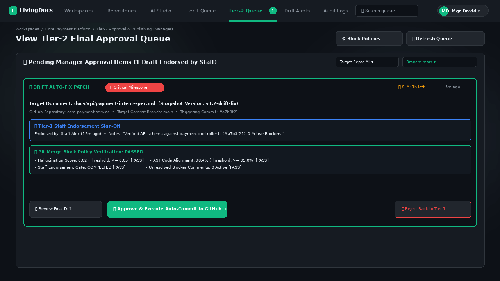

Dưới đây là đặc tả SRS chi tiết hoàn chỉnh cùng hình ảnh giao diện **Screen Layout Dark Mode** thực tế cho mục **3.2.8.2 Approve & Execute Auto-Commit to GitHub** thuộc phân hệ **3.2.8 Manage Tier-2 Approval & GitHub Publishing (Manager)** của dự án **LivingDocs**:

**3.2.8.2 Approve & Execute Auto-Commit to GitHub**

- **Function trigger:**
    1. **User Action:** When an authorized Manager clicks **"🚀 Approve & Execute Auto-Commit to GitHub →"** on any item within the Tier-2 Manager review queue (`SCR-27`) or final diff audit screen (`SCR-28`).
- **Function description:**
    - **Actors/roles:** Manager, Technical Lead, Administrator (Manager role holds executive authority to publish directly to GitHub production branches).
    - **Purpose:**
        1. **Approve & Auto-Commit Pathway:** To execute final Tier-2 executive sign-off and trigger an automated API commit or Pull Request merge directly to the target GitHub repository (`BR-SEC-04`).
        2. **Post-Publish Automated Pipeline:** Automatically triggers real-time Qdrant VectorDB re-indexing (`POST /api/v1/assets/reindex`) to update semantic RAG search embeddings and marks linked Drift Alerts as `🟢 RESOLVED` (`3.2.6.4`).
        3. **Reject Pathway:** Allows Managers to reject drafts back to Tier-1 Staff reviewers (`3.2.7`) with mandatory override justification notes.
        4. To generate an immutable audit trail entry capturing the Manager Key ID, target commit SHA, release notes, and timestamp (`NSF-07`).
    - **Data processing:**
        1. The client opens the **GitHub Publish Sign-Off Modal** (`SCR-28`).
        2. Upon Manager confirmation, the client dispatches `POST /api/v1/reviews/tier-2/{review_id}/approve-and-commit` with body `{ manager_notes: "...", target_branch: "main" }`.
        3. The backend executes a synchronous GitHub API OAuth call (`BR-SEC-04`) to push the Markdown content update to `docs/api/payment-intent-spec.md` on branch `main`.
        4. The backend updates document status in PostgreSQL to `🟢 Published`, dispatches a re-indexing task to Qdrant VectorDB, updates active workspace counters, and writes audit record `#AUD-PUB-9042`.
- **Business rules:** `BR-WS-04` (2-Tier Governance Gate Final Approval), `BR-SEC-04` (GitHub Access & Commit Credentials Boundaries), `BR-AI-01` (Automated Vector Re-indexing Post-Publish), `BR-GOV-01` (System Audit Trail Compliance).

- **Screen layout:**
- 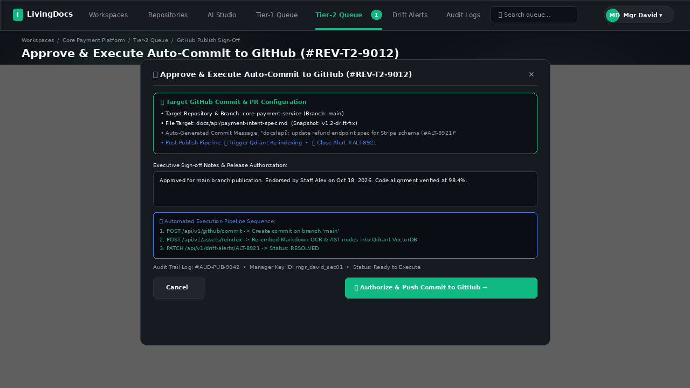

**3.2.8.3 Configure PR Merge Block Policies**

- **Function trigger:**
    1. **User Action:** When an authorized Manager or Administrator clicks **"⚙️ Block Policies"** on the Tier-2 queue header (`SCR-27`), or accesses **"Workspace Settings"** -\>**"Governance & Block Policies"** (`SCR-29`).
- **Function description:**
    - **Actors/roles:** Manager, Administrator (Requires administrative governance management privileges).
    - **Purpose:**
        1. To establish automated merge gate rules that evaluate every document draft and drift fix patch before allowing auto-commit or Pull Request merging to GitHub.
        2. To configure quality thresholds:
            - **Maximum Allowed AI Hallucination Score:** Block commit execution if LLM hallucination metric exceeds limit (e.g., max `0.05` / `5.0%`).
            - **Minimum Required AST Source Code Alignment:** Block commit if semantic alignment with code falls below threshold (e.g., min `95.0%`).
            - **Enforce Tier-1 Staff Endorsement Gate:** Prevent direct Manager bypass without prior Staff review endorsement (`3.2.7.3`).
            - **Enforce Zero Active Blocker Comments:** Block merge execution if any unresolved `🔴 BLOCKER ISSUE` inline comments exist (`3.2.7.2`).
        3. To provide emergency override toggles for Administrators, requiring mandatory audit justification notes upon activation.
    - **Data processing:**
        1. The client loads current policy rules via `GET /api/v1/workspaces/{workspace_id}/governance/policies`.
        2. When the user modifies rule toggles or input thresholds and clicks **"💾 Save Policy Rules"**, the client dispatches `PUT /api/v1/workspaces/{workspace_id}/governance/policies` with payload `{ max_hallucination_score: 0.05, min_ast_alignment: 0.95, enforce_tier1_gate: true, block_active_comments: true, allow_admin_override: true }`.
        3. The backend saves policy configurations to PostgreSQL, logs audit entry `#AUD-POL-7712`, and immediately applies these blocking rules to all subsequent Tier-2 commit attempts (`3.2.8.2`).
- **Business rules:** `BR-WS-04` (2-Tier Governance Gate Approval Workflow), `BR-GOV-03` (Automated Quality Gate Blocking Rules), `BR-GOV-01` (System Audit Logging Compliance).

- **Screen layout:**
- 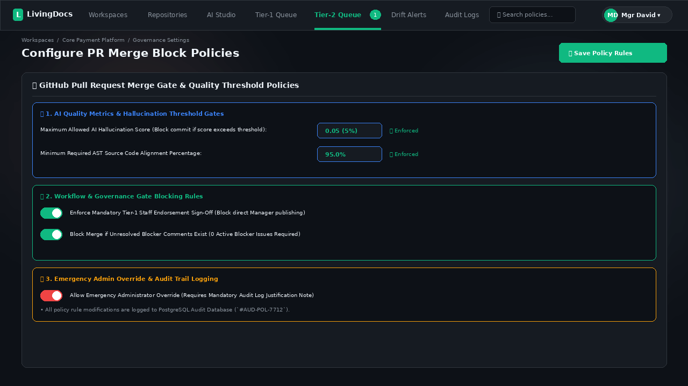

### **3.2.9 Manage Dynamic Documentation Templates**

**3.2.9.1 View Dynamic Template Library**

Dưới đây là đặc tả SRS chi tiết hoàn chỉnh cùng hình ảnh giao diện **Screen Layout Dark Mode** thực tế cho mục **3.2.9.1 View Dynamic Template Library** thuộc phân hệ **3.2.9 Manage Dynamic Documentation Templates** của dự án **LivingDocs**, tuân thủ danh mục 13 màn hình chuẩn (`SCR-04`):

### 3.2.9 Manage Dynamic Documentation Templates

**3.2.9.1 View Dynamic Template Library**

- **Function trigger:**
    1. **User Action:** When an authorized user selects **"AI Studio"** $\\rightarrow$ **"Template Library"** from the workspace header navigation (`SCR-02`) or accesses `/workspaces/{workspace_id}/templates` (`SCR-04`).
- **Function description:**
    - **Actors/roles:** Staff, Manager, Technical Lead, Administrator.
    - **Purpose:**
        1. To provide a centralized catalog of predefined system templates and user-defined dynamic Markdown templates (e.g., *OpenAPI REST Spec*, *Microservice C4 Spec*, *Database Entity Model*).
        2. To display template scope indicators: **SYSTEM DEFAULT** (Immutable standard templates provided by LivingDocs) versus **CUSTOM WORKSPACE** (User-created or modified templates).
        3. To list dynamic Liquid.js variable placeholders bound to Tree-Sitter AST code parsing nodes (e.g., `{{endpoint_path}}`, `{{payload_schema}}`, `{{ast_struct_bind}}`).
        4. To show real-time template usage statistics across active workspace specifications (e.g., *Used by: 12 Active Specs in core-payment-service*).
        5. To filter and search template cards by Domain Category (*API Documentation*, *System Architecture*), Template Scope, and Creation Timestamp.
    - **Data processing:**
        1. The client dispatches an HTTP request `GET /api/v1/workspaces/{workspace_id}/templates` to fetch template schema definitions stored in PostgreSQL.
        2. The backend resolves template scopes and associated AST node bindings.
        3. The UI renders interactive template cards with status badges and action triggers:
            - Clicking **"👁️ Preview Template"** opens an overlay showing rendered Markdown sample outputs (`SCR-04`).
            - Clicking **"📋 Duplicate & Edit"** or **"✏️ Customize Template"** opens the dynamic template customization canvas (`3.2.9.2`).
            - Clicking **"📌 Bind to Workspace Path"** opens the path binding configuration modal (`3.2.9.3`).
- **Business rules:** `BR-WS-01` (Workspace Context Isolation), `BR-TMP-01` (System Default Template Immutability).

- **Screen layout:**
- 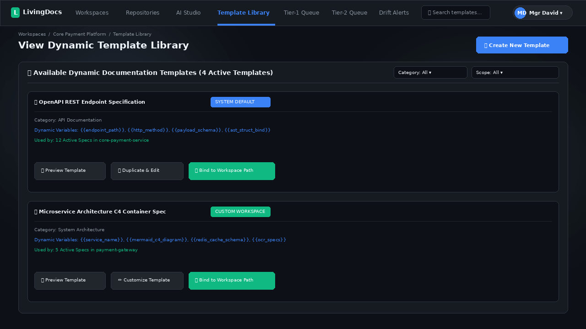

**3.2.9.2 Create & Customize Dynamic Template**

- **Function trigger:**
    1. **User Action:** When an authorized user clicks **"➕ Create New Template"**, **"✏️ Customize Template"**, or **"📋 Duplicate & Edit"** on the Template Library dashboard (`SCR-04`).
- **Function description:**
    - **Actors/roles:** Technical Lead, Manager, Administrator (Staff users can duplicate and draft, but saving custom templates requires Lead/Manager permissions).
    - **Purpose:**
        1. To provide a dual-pane interactive editor featuring a dynamic Markdown/Liquid.js code editor on the left and a real-time rendered preview canvas with sample source data on the right (`SCR-04`).
        2. To enable dynamic variable insertion using Tree-Sitter AST source code tokens (e.g., `{{service_name}}`, `{{mermaid_c4_diagram}}`, `{{ast_structs}}`, `{{ocr_specs}}`).
        3. To support control flow logic (e.g., ``, ``) for rendering lists of API parameters, database entities, and microservice dependencies automatically.
        4. To perform automated syntax validation verifying Liquid.js tag balance, Markdown formatting, and AST variable binding availability before saving.
    - **Data processing:**
        1. The client captures template name, category, and Liquid syntax template string from the editor canvas.
        2. Clicking **"🧪 Validate Syntax"** sends `POST /api/v1/templates/validate` to parse Liquid syntax and check AST token validity.
        3. Clicking **"💾 Save Template"** dispatches `POST /api/v1/templates` (for new) or `PUT /api/v1/templates/{template_id}` (for updates) with payload `{ template_name, category, template_body, ast_bindings }`.
        4. The backend validates permissions, stores template definitions in PostgreSQL, logs audit record `#AUD-TMP-8812`, and returns the created template object.
- **Business rules:** `BR-TMP-01` (System Default Template Immutability - Must duplicate system templates to edit), `BR-TMP-02` (Dynamic Token Syntax Validation Rule), `BR-GOV-01` (System Audit Trail Logging).

- **Screen layout:**
- 

**3.2.9.3 Bind Template to Workspace & Governance Rules**

- **Function trigger:**
    1. **User Action:** When an authorized Manager or Administrator clicks **"📌 Bind to Workspace Path"** on any template item card in the Template Library dashboard (`SCR-04`), or navigates to **"Workspace Settings"** $\\rightarrow$ **"Template Governance Bindings"** (`SCR-13`).
- **Function description:**
    - **Actors/roles:** Manager, Technical Lead, Administrator (Requires workspace management privileges).
    - **Purpose:**
        1. To bind specific dynamic documentation templates (e.g., *OpenAPI REST Endpoint Specification*) as mandatory standards for designated code repositories and file path glob patterns (e.g., `docs/api/v2/**/*.md`).
        2. To enforce structural consistency during AI document generation in **AI Studio** (`3.2.4`), blocking document creation or generation if the mandatory bound template structure is bypassed.
        3. To automatically route newly generated documents matching the bound target path into the **Tier-1 Staff Review Queue** (`3.2.7.1`).
        4. To link AST code parsing tokens (`{{ast_struct_bind}}`) within the bound template directly to continuous **Documentation Drift Alerts** tracking (`3.2.6`).
    - **Data processing:**
        1. The client opens the **Workspace Path & Governance Binding Modal** (`SCR-13`).
        2. The user selects the target GitHub repository (`core-payment-service`), inputs the path glob pattern (`docs/api/v2/**/*.md`), and enables enforcement toggles.
        3. Clicking **"📌 Save & Apply Binding Rules →"** dispatches an HTTP request `POST /api/v1/workspaces/{workspace_id}/template-bindings` with payload:

```
JSON
```

```
{
  "template_id": "tmpl_openapi_v2",
  "repository_id": "repo_core_payment",
  "path_pattern": "docs/api/v2/**/*.md",
  "enforce_mandatory": true,
  "auto_trigger_tier1_review": true,
  "enable_ast_drift_tracking": true
}
```
        4. The backend stores the binding rule in PostgreSQL, logs an immutable system audit entry `#AUD-BND-9921` (`NSF-07`), and immediately enforces template checks on all matching workspace document paths.  
**Business rules:** `BR-WS-01` (Workspace Context Scoping), `BR-WS-04` (2-Tier Governance Gate Integration), `BR-TMP-04` (Repository Path Pattern Matching & Structural Enforcement).
        - **Screen layout:**
        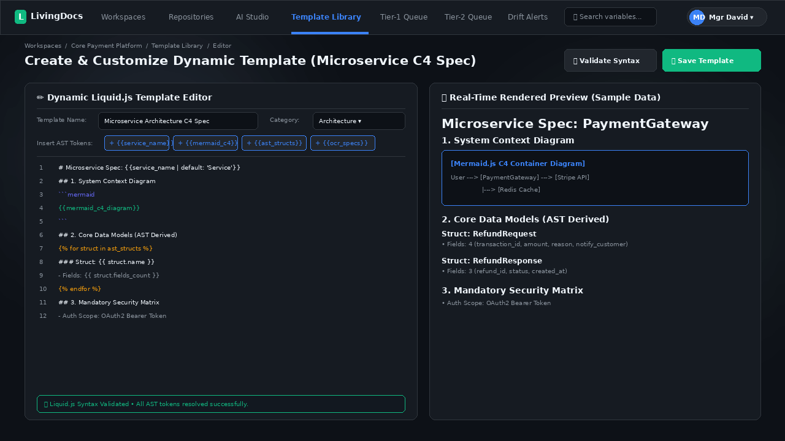

### **3.2.10 Manage Knowledge Base & Hybrid RAG**

**3.2.10.1 Search Code & Documentation via Natural Language**

- **Function trigger:**
    1. **User Action:** When an authorized user enters a natural language query into the primary search bar on the header navigation (`SCR-02`) or accesses `/workspaces/{workspace_id}/rag-search`.
- **Function description:**
    - **Actors/roles:** Developer, Staff, Manager, Technical Lead, Administrator.
    - **Purpose:**
        1. To perform semantic hybrid search across multi-repo AST source code (TypeScript, Go, Python), Markdown API documentation, and OCR visual diagram specs simultaneously.
        2. To synthesize an immediate AI answer card powered by GPT-4o with confidence score metrics (e.g., *Confidence: 98.2%*) and grounding accuracy verification.
        3. To display verifiable provenance links connecting AI answers directly to exact document sections (`SCR-08`) and source code function lines (`refund.controller.ts #Line 142`).
        4. To list retrieved content chunks combining Qdrant Dense Vector embeddings with PostgreSQL Sparse BM25 keyword matching results.
    - **Data processing:**
        1. The client dispatches `POST /api/v1/rag/search` with payload:

```
JSON
```

```
{
  "query": "How does refund payment processing handle failure?",
  "top_k": 5,
  "include_ast": true
}
```
        2. The backend generates vector embeddings via OpenAI `text-embedding-3-large`, queries Qdrant VectorDB for semantic similarity, and executes PostgreSQL BM25 text search.
        3. The LLM RAG engine synthesizes the contextual answer, calculates confidence scores, and maps exact source line numbers.
        4. The UI renders the AI answer card along with interactive provenance verification buttons (**"👁️ Inspect Source"**, **"👁️ View AST Code"**).
- **Business rules:** `BR-AI-01` (Hybrid Vector + BM25 RAG Retrieval Engine), `BR-AI-02` (Grounding Provenance & Zero Hallucination Audit Requirement).

- **Screen layout:**
- 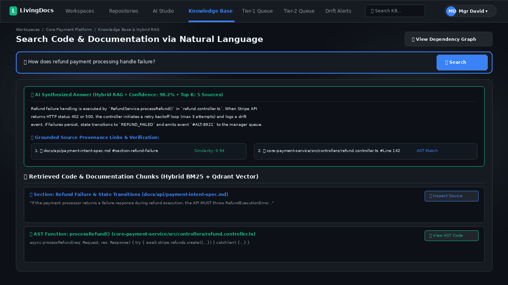

**3.2.10.2 View Code-Doc Dependency Graph**

- **Function trigger:**
    1. **User Action:** When an authorized user clicks **"🕸️ View Dependency Graph"** from the natural language search header (`3.2.10.1`), accesses `/workspaces/{workspace_id}/graph-view`, or selects any code/doc item on the Repository Canvas (`SCR-03`).
- **Function description:**
    - **Actors/roles:** Developer, Staff, Manager, Technical Lead, Administrator.
    - **Purpose:**
        1. To render an interactive 2D/3D knowledge graph network visualizing structural dependencies between multi-repo AST code entities (Controllers, Services, Structs), Markdown API specs, and visual OCR diagram assets (`SCR-03`).
        2. To visually highlight active documentation drift paths using glowing red alert node indicators (`🔴 DRIFT ALERT`) when source code changes are out-of-sync with linked documentation (`3.2.6`).
        3. To provide a **Selected Node Metadata Panel** displaying detailed entity properties, target repository/branch details, AST node types, active drift warning flags (`#ALT-8921`), and direct action links (**"🔍 Open AST Code & Doc Diff →"**).
        4. To filter and inspect graph networks by Entity Type (*AST Code*, *Markdown Spec*, *Drift Mismatch*, *OCR Asset*) or Layout Mode (*2D Force-Directed*, *3D Sphere Network*).
    - **Data processing:**
        1. The client dispatches an HTTP request `GET /api/v1/workspaces/{workspace_id}/graph-nodes` to fetch adjacency matrices and node relationship edges from PostgreSQL.
        2. The backend resolves Tree-Sitter AST symbol references against Qdrant vector IDs and active PostgreSQL drift alert records.
        3. The UI renders the node graph using WebGL/D3.js canvas and updates the right metadata panel upon node selection.
- **Business rules:** `BR-DRIFT-01` (AST Code/Doc Line Diff Matching Rules), `BR-WS-01` (Workspace Context Scoping), `BR-AI-02` (Grounding Provenance Link Verification).

- **Screen layout:**
- 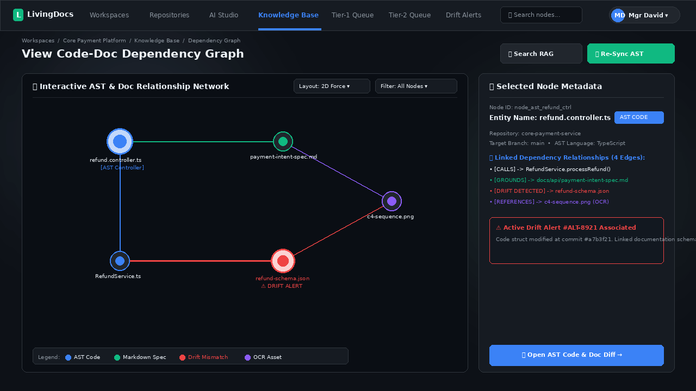

**3.2.10.3 Manage Vector Indexing & Hybrid RAG Chunking**

- **Function trigger:**
    1. **User Action:** When an authorized Technical Lead, Manager, or Administrator selects **"AI Studio"** $\\rightarrow$ **"Vector Indexing Settings"** (`SCR-13`) or navigates to `/workspaces/{workspace_id}/rag-settings`.
- **Function description:**
    - **Actors/roles:** Technical Lead, Manager, Administrator (Requires system configuration privileges).
    - **Purpose:**
        1. To monitor real-time health and usage metrics of the Qdrant Vector DB cluster (*Total Indexed Vectors*, *Embedding Model Dimensions*, *RAM Memory Consumption*, *BM25 Index Sync Status*).
        2. To configure hybrid text chunking strategies for multi-language code ASTs (Tree-Sitter Function/Class Scope) and Markdown documentation (Header Depth Splitters).
        3. To define target token chunk sizes (e.g., `512 Tokens`) and token overlap windows (e.g., `64 Tokens`) for optimal Hybrid RAG search accuracy.
        4. To trigger manual full/incremental re-indexing (`⚡ Trigger Re-index`) or enable automated background synchronization upon Tier-2 GitHub publishing (`3.2.8.2`) and GitHub Webhook `git push` events.
    - **Data processing:**
        1. The client requests `GET /api/v1/rag/indexing-status` to fetch current Qdrant cluster telemetry.
        2. The user modifies chunking parameters or clicks **"⚡ Trigger Re-index"**.
        3. The client dispatches `POST /api/v1/rag/reindex` with payload:

```
JSON
```

```
{
  "ast_chunk_strategy": "tree_sitter_scope",
  "doc_chunk_strategy": "markdown_header_l2_l3",
  "target_chunk_tokens": 512,
  "chunk_overlap_tokens": 64,
  "auto_sync_on_publish": true,
  "auto_sync_on_webhook": true
}
```
        4. The backend enqueues Celery background tasks to re-embed modified source files into Qdrant VectorDB, updates PostgreSQL sparse index, and writes audit record `#AUD-RAG-3021`.
- **Business rules:** `BR-AI-01` (Hybrid Vector + BM25 RAG Indexing Pipeline), `BR-GOV-01` (System Audit Trail Compliance).

- **Screen layout:**
- 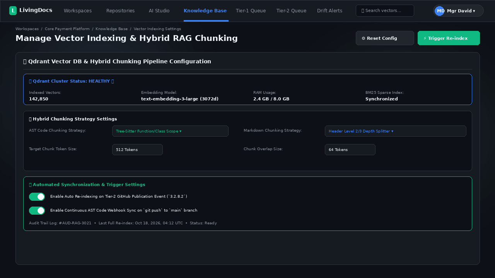

### 3.2.11 Manage Quality & Governance Metrics

**3.2.11.1 View Health & Coverage Dashboard**

- **Function trigger:**
    1. **User Action:** When an authorized user selects **"Metrics"** from the primary navigation header (`SCR-02`) or accesses `/workspaces/{workspace_id}/metrics`.
- **Function description:**
    - **Actors/roles:** Staff, Manager, Technical Lead, Administrator.
    - **Purpose:**
        1. To present a centralized executive dashboard summarizing real-time documentation coverage, AI quality health metrics, and governance compliance status across multi-repo AST codebases.
        2. To display top-level KPI summary cards:
            - **Doc Coverage Rate:** Percentage of AST code functions/classes documented (e.g., `87.4% [🟢 GOOD]`).
            - **Avg Hallucination Score:** Average LLM hallucination metric across AI Studio outputs (e.g., `0.02 [🟢 PASSED]`).
            - **AST Code Alignment:** Semantic precision between source code structures and Markdown specifications (e.g., `96.8% [🟢 HIGH]`).
            - **Active Drift Alerts:** Count of active unresolved code-doc drift issues (e.g., `1 Issue - ⚠️ #ALT-8921`).
        3. To visualize repository-level coverage breakdown progress bars, highlighting compliance statuses (e.g., `🟢 Compliant` vs `⚠️ Below 80% Gate`).
        4. To track 2-Tier review cycle speeds (*Avg Tier-1 Review Speed*, *Avg Tier-2 Approval Speed*) and AI drift auto-resolution rates (`88.2% via AI Fix`).
    - **Data processing:**
        1. The client dispatches an HTTP request `GET /api/v1/workspaces/{workspace_id}/metrics/dashboard` to fetch pre-aggregated quality metrics stored in PostgreSQL.
        2. The backend queries active AST mappings, Qdrant vector alignment scores, and audit log tables (`#AUD-MET-1029`).
        3. The UI renders interactive KPI cards, progress breakdown bars, and review telemetry widgets.
- **Business rules:** `BR-WS-01` (Workspace Context Scoping), `BR-GOV-02` (Governance Quality Metric Calculation Rules), `BR-GOV-01` (System Audit Trail Compliance).

- **Screen layout:**
- 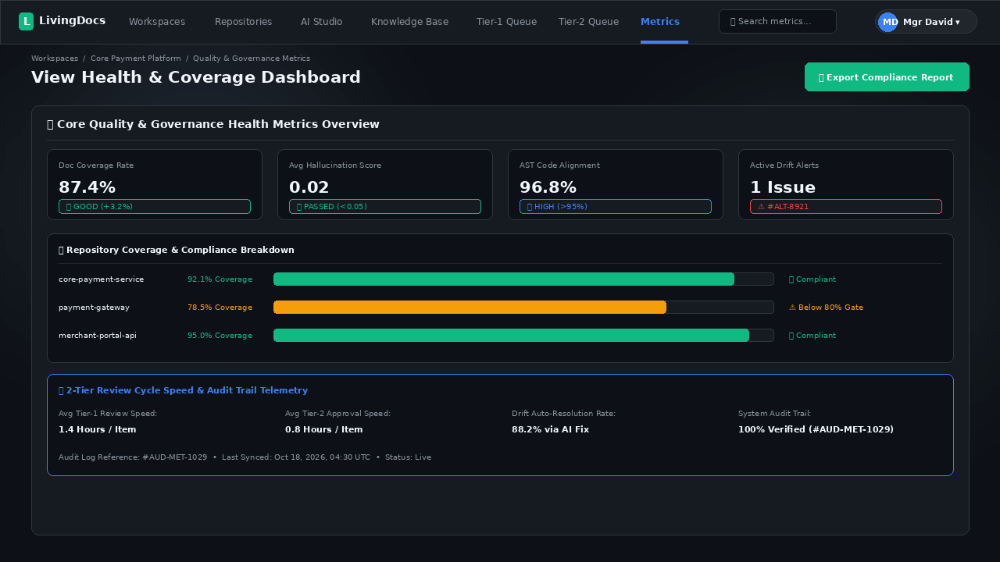

**3.2.11.2 Export Compliance Reports**

- **Function trigger:**
    1. **User Action:** When an authorized Manager or Administrator clicks **"📥 Export Compliance Report"** on the metrics dashboard (`SCR-13`) or navigates to `/workspaces/{workspace_id}/metrics/export`.
- **Function description:**
    - **Actors/roles:** Manager, Technical Lead, Administrator (Executive-level access boundary).
    - **Purpose:**
        1. To configure and generate formal audit and compliance reports verifying document-code alignment for regulatory standards (e.g., ISO 27001, SOC2, Open API Standards).
        2. To export reports in multiple formats (**PDF Document**, **CSV Raw Audit Data**, or **JSON Audit Trail**).
        3. To embed verifiable 2-Tier review sign-off logs capturing Reviewer IDs, Manager Key Signatures, GitHub commit SHAs (`3.2.8.2`), and AST alignment verification records (`#AUD-REP-5012`).
        4. To filter audit data by reporting time window (e.g., `Q3 2026`) and selected code repositories (`core-payment-service`, `payment-gateway`, `merchant-portal-api`).
    - **Data processing:**
        1. The client opens the **Export Regulatory Compliance & Governance Audit Report Modal** (`SCR-13`).
        2. The user selects framework standards, file format, repositories, and auditing toggle options.
        3. Clicking **"⚡ Generate & Download PDF Report →"** dispatches an HTTP request `POST /api/v1/metrics/export-report` with payload:

```
JSON
```

```
{
  "compliance_framework": "ISO_27001_SOC2",
  "time_window": "Q3_2026",
  "output_format": "pdf",
  "repositories": ["core-payment-service", "payment-gateway", "merchant-portal-api"],
  "include_signoffs": true,
  "include_ast_metrics": true,
  "include_drift_logs": true
}
```
        4. The backend enqueues a background PDF/CSV generation task, compiles immutable audit logs from PostgreSQL, attaches cryptographic signature hashes, logs audit event `#AUD-REP-5012`, and returns a secure, signed download URL.
- **Business rules:** `BR-GOV-01` (System Audit Trail Compliance), `BR-SEC-04` (Executive Export Security Boundary), `BR-WS-01` (Workspace Context Scoping).

- **Screen layout:**
- 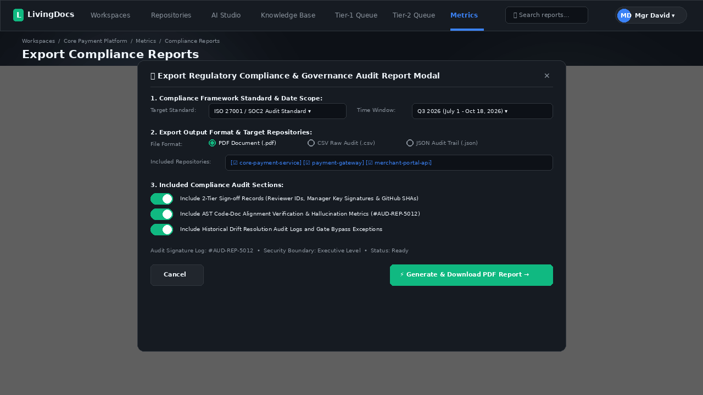

**3.2.11.3 Configure Metric Thresholds & Scheduled Reports**

- **Function trigger:**
    1. **User Action:** When an authorized Manager or Administrator selects **"Metrics"** $\\rightarrow$ **"Thresholds & Schedule Settings"** (`SCR-13`) or navigates to `/workspaces/{workspace_id}/metrics/config`.
- **Function description:**
    - **Actors/roles:** Manager, Administrator (Requires system quality governance configuration privileges).
    - **Purpose:**
        1. To establish automated quality gate threshold rules enforced across all pull requests and AI Studio generation workflows (`3.2.4`):
            - **Minimum Doc Coverage Gate:** Threshold below which GitHub PR merge blocks are triggered (e.g., `80.0%`).
            - **Max Hallucination Score Limit:** Threshold above which AI-generated documentation outputs are rejected (e.g., `0.05`).
            - **Min AST Code Alignment Rate:** Threshold triggering mandatory Tier-1 Staff Review for symbol mismatches (e.g., `90.0%`).
        2. To configure automated recurring compliance report dispatch schedules (e.g., *Weekly - Every Monday 08:00 UTC*) delivering PDF Executive Summaries directly to stakeholder channels.
        3. To set multi-channel delivery destinations including corporate email distribution lists (`exec-group@co.com`) and Slack webhook channels (`#gov-compliance-alerts`).
    - **Data processing:**
        1. The client requests `GET /api/v1/workspaces/{workspace_id}/metrics/config` to fetch current active threshold rules and dispatch schedules stored in PostgreSQL.
        2. The user adjusts threshold parameters or notification channels and clicks **"💾 Save Settings"**.
        3. The client dispatches an HTTP request `PUT /api/v1/workspaces/{workspace_id}/metrics/config` with payload:

```
JSON
```

```
{
  "min_doc_coverage": 80.0,
  "max_hallucination_score": 0.05,
  "min_ast_alignment_rate": 90.0,
  "schedule_frequency": "weekly_monday_0800",
  "report_format": "pdf_executive",
  "destination_channels": {
    "email": "exec-group@co.com",
    "slack_webhook": "#gov-compliance-alerts"
  }
}
```
        4. The backend updates configuration tables in PostgreSQL, enqueues background Celery cron tasks, and records audit entry `#AUD-CFG-7712`.
- **Business rules:** `BR-GOV-03` (Automated Quality Gate Thresholds), `BR-GOV-01` (System Audit Trail Compliance), `BR-WS-01` (Workspace Context Scoping).

- **Screen layout:**
- 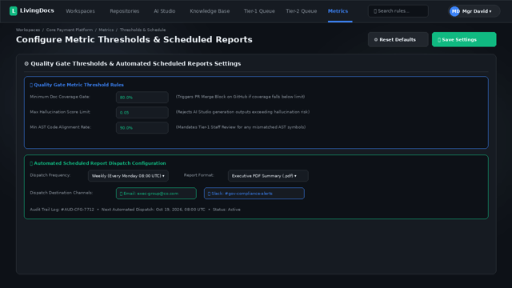

###   
**3.2.12 Manage Audit Trail & Version Control**

**3.2.12.1 View Immutable Audit Logs**

- **Function trigger:**
    1. **User Action:** When an authorized user selects **"Audit Trail"** from the workspace header navigation (`SCR-13`) or accesses `/workspaces/{workspace_id}/audit-logs`.
- **Function description:**
    - **Actors/roles:** Staff, Manager, Technical Lead, Administrator.
    - **Purpose:**
        1. To render an append-only, tamper-proof real-time audit log stream recording every operational action across the 2-Tier Governance Workflow, AI Studio generation runs, and system settings modifications.
        2. To capture mandatory regulatory audit fields: **Event ID** (e.g., `#AUD-PUB-9042`), **SHA-256 Cryptographic Hash Verification** (e.g., `SHA: e3b0c44298fc`), **Timestamp (UTC)**, **Actor Email & Role Badge** (`[ MANAGER ]`, `[ STAFF ]`, `[ SYSTEM ]`), **Event Category** (*Tier-1 Review*, *Tier-2 Approval*, *Version Rollback*, *Drift Alert*, *Template Binding*), and detailed **Action Description with Target Resource References**.
        3. To support log stream filtering by keyword text, event categories, date ranges, and severity levels (*INFO*, *WARN*, *SECURITY\_ALERT*).
        4. To allow exporting filtered log streams for external regulatory compliance review (`📥 Export Log Stream`).
    - **Data processing:**
        1. The client dispatches an HTTP request `GET /api/v1/workspaces/{workspace_id}/audit-logs` to query PostgreSQL append-only audit tables.
        2. The backend validates SHA-256 integrity hashes on log records to guarantee non-tampering before returning payload responses.
        3. The UI renders the structured audit stream table with status indicators (`Verified 🟢`).
- **Business rules:** `BR-GOV-01` (System Audit Trail Compliance & Tamper Prevention), `BR-WS-01` (Workspace Context Scoping).

- **Screen layout:**
- 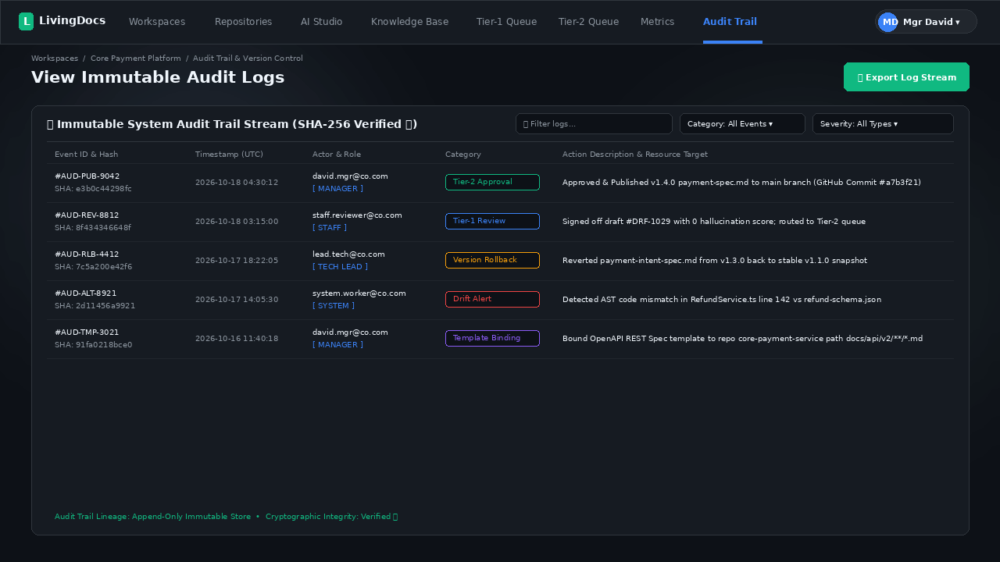

**3.2.12.2 Compare & Diff Historical Versions**

- **Function trigger:**
    1. **User Action:** When an authorized user selects any document version from the version history panel on the Document Editor canvas (`SCR-07`) or clicks **"🔍 Compare Versions"** on an item in the Audit Trail log stream (`3.2.12.1`).
- **Function description:**
    - **Actors/roles:** Developer, Staff, Manager, Technical Lead, Administrator.
    - **Purpose:**
        1. To present a side-by-side split view comparing any two historical document revisions (e.g., Base Version `v1.2.0` vs Target Head Version `v1.4.0`).
        2. To highlight text additions in green (`+ "amount_cents": "integer"`, `+ "currency": "USD"`) and removals/modifications in red (`- "amount": "number"`).
        3. To provide a Tree-Sitter **AST Differential Summary** mapping exact schema field renames, type conversions (`float -> integer`), and added structural parameters (`enum ISO-4217`).
        4. To enable direct one-click execution to revert the document to the base version (`⏪ Rollback to v1.2.0`).
    - **Data processing:**
        1. The client issues an HTTP request `GET /api/v1/documents/{doc_id}/diff?base_version=1.2.0&target_version=1.4.0`.
        2. The backend computes line-by-line Git-style text deltas and cross-references Tree-Sitter AST symbol diff trees.
        3. The UI renders highlighted Markdown code panes and displays the summary box with action buttons.
- **Business rules:** `BR-DRIFT-01` (AST Code/Doc Line Diff Matching Rules), `BR-VER-01` (Non-Destructive Lineage Versioning Rule), `BR-WS-01` (Workspace Context Scoping).

- **Screen layout:**
- 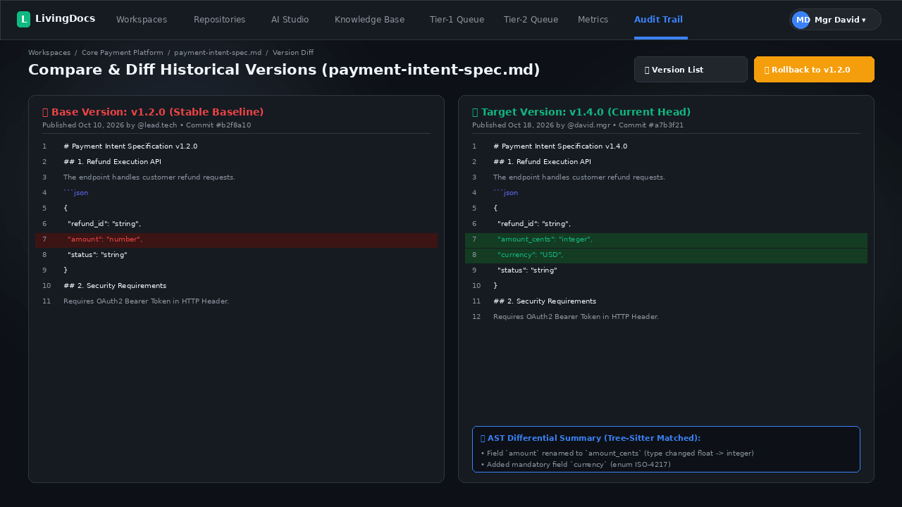

**3.2.12.3 Rollback Document Version**

- **Function trigger:**
    1. **User Action:** When an authorized Technical Lead, Manager, or Administrator clicks **"⏪ Rollback to Version"** on any historical snapshot card in Version Diff/History view (`SCR-07`, `SCR-12`) or navigates to `/workspaces/{workspace_id}/documents/{doc_id}/rollback`.
- **Function description:**
    - **Actors/roles:** Technical Lead, Manager, Administrator (Requires management rollback authority).
    - **Purpose:**
        1. To revert a published or drafted documentation specification back to a selected historical baseline snapshot (e.g., reverting current Head `v1.4.0` back to stable `v1.2.0`).
        2. To enforce a **Non-Destructive Lineage Rule** (`BR-VER-01`), automatically creating a new incremented version entry (e.g., `v1.5.0 (Reverted from v1.2.0)`) without overwriting historical records.
        3. To capture a mandatory rollback reason recorded directly in system audit trail `#AUD-RLB-4412`.
        4. To trigger automated downstream synchronization tasks:
            - **Automated GitHub Sync:** Pushing a revert commit (`revert: payment-spec.md to v1.2.0`) to target repo `main` branch (`3.2.8.2`).
            - **Re-index Knowledge Base:** Instantly updating Qdrant VectorDB embeddings (`3.2.10.3`).
            - **Clear Drift Alerts:** Auto-resolving active drift alerts (`#ALT-8921`) associated with rolled-back schemas (`3.2.6.2`).
    - **Data processing:**
        1. The client opens the **Confirm Document Version Rollback & GitHub Sync Modal** (`SCR-12`).
        2. The user inputs the mandatory rollback reason and verifies automated synchronization toggles.
        3. Clicking **"⏪ Execute Rollback & Push GitHub →"** dispatches an HTTP request `POST /api/v1/documents/{doc_id}/rollback` with payload:

```
JSON
```

```
{
  "target_version": "1.2.0",
  "rollback_reason": "Deprecating untested breaking API parameters (amount_cents) and restoring v1.2.0 schema",
  "auto_github_push": true,
  "auto_reindex_rag": true,
  "auto_resolve_drift": true
}
```
        4. The backend generates a new incremented version `v1.5.0` in PostgreSQL, executes GitHub API commit push, updates Qdrant VectorDB, clears active drift flags, and logs immutable audit record `#AUD-RLB-4412`.
- **Business rules:** `BR-VER-01` (Non-Destructive Lineage Versioning Rule), `BR-GOV-01` (System Audit Trail Compliance), `BR-WS-04` (2-Tier Governance Integration).

- **Screen layout:**
- 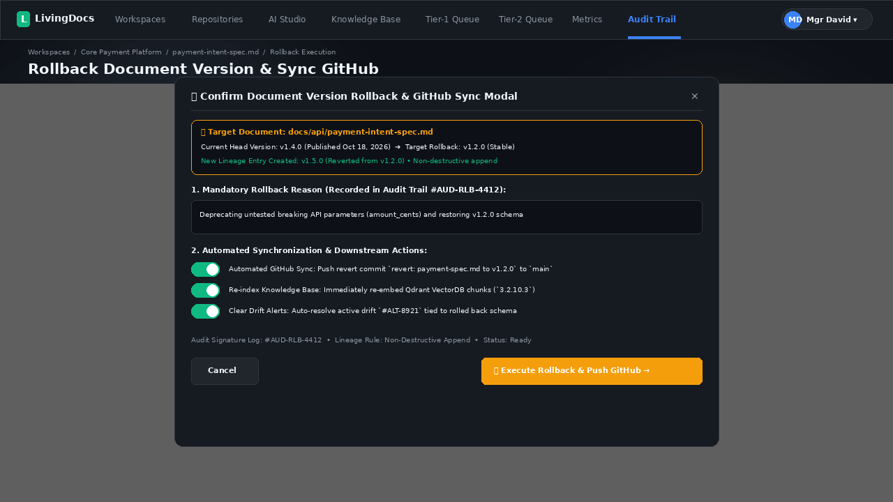

### **3.2.13 Manage User Accounts & RBAC Authorization**

**3.2.13.1 View User Account List**

- **Function trigger:**
    1. **User Action:** When an authorized System Administrator selects **"System Admin"** from the primary header navigation (`SCR-13`) or accesses `/admin/users`.
- **Function description:**
    - **Actors/roles:** Administrator (Requires enterprise administration privileges).
    - **Purpose:**
        1. To display a centralized enterprise user directory listing all active, invited, and suspended user accounts across the organization.
        2. To summarize key user account details: **User Name & Email**, **Global System Role** (`DEVELOPER`, `STAFF`, `MANAGER`, `ADMINISTRATOR`) with sub-role badges (`Tier-1 Reviewer`, `Tier-2 Approver`, `Super Admin`), **Assigned Workspaces Count**, **Single Sign-On (SSO) Authentication Provider** (*GitHub OAuth2*, *Okta SSO*, *Azure AD SSO*), and **Account Activity Status** (`🟢 ACTIVE`, `🟡 PENDING INVITE`, `🔴 SUSPENDED`).
        3. To support real-time user directory search, filtering by Global System Role and Account Status, and triggering user invitation modal dialogs (`👤 Invite User`).
        4. To provide direct action controls (`⚙️ Edit Role`) for modifying system access permissions (`3.2.13.2`).
    - **Data processing:**
        1. The client issues an HTTP request `GET /api/v1/admin/users` to fetch user directory records from PostgreSQL.
        2. The backend validates Administrator OAuth2 JWT claims and returns paginated user profiles mapped to active workspaces.
        3. The UI renders the user account table with security audit verification signatures (`#AUD-SEC-8812`).
- **Business rules:** `BR-SEC-01` (OAuth2 & Single Sign-On Authentication), `BR-SEC-02` (System Administrator Privilege Boundary), `BR-WS-01` (Workspace Context Scoping).

- **Screen layout:**

**3.2.13.2 Manage Roles & System Permissions**

- **Function trigger:**
    1. **User Action:** When an authorized System Administrator selects **"System Admin"** -\> **"Roles & Permissions Matrix"** (`SCR-13`) or navigates to `/admin/roles`.
- **Function description:**
    - **Actors/roles:** Administrator (Requires enterprise security administration authority).
    - **Purpose:**
        1. To configure fine-grained Role-Based Access Control (RBAC) permission matrices for default system roles (`DEVELOPER`, `STAFF`, `MANAGER`, `ADMINISTRATOR`).
        2. To grant or restrict operational capabilities across core system modules:
            - **AI Studio Generation & Editing (**`3.2.4`**):** Permitted for all roles (`DEVELOPER`, `STAFF`, `MANAGER`, `ADMINISTRATOR`).
            - **Tier-1 Review Sign-Off (**`3.2.7`**):** Restricted to `STAFF`, `MANAGER`, `ADMINISTRATOR`.
            - **Tier-2 Approval & GitHub Publishing (**`3.2.8`**):** Restricted to `MANAGER`, `ADMINISTRATOR`.
            - **Template Binding (**`3.2.9`**):** Restricted to `MANAGER`, `ADMINISTRATOR`.
            - **Vector Re-indexing & RAG Settings (**`3.2.10.3`**):** Restricted to `MANAGER`, `ADMINISTRATOR`.
            - **Export Compliance Reports (**`3.2.11.2`**):** Restricted to `MANAGER`, `ADMINISTRATOR`.
            - **Rollback Document Versions (**`3.2.12.3`**):** Restricted to `MANAGER`, `ADMINISTRATOR`.
            - **Manage RBAC Matrix & Users (**`3.2.13.2`**):** Strictly restricted to `ADMINISTRATOR`.
        3. To enforce instant session token invalidation upon saving updated RBAC privilege matrices (`💾 Save Matrix`).
    - **Data processing:**
        1. The client issues an HTTP request `GET /api/v1/admin/roles/permissions` to retrieve the active capability matrix from PostgreSQL.
        2. The Administrator modifies capability permission check-boxes and clicks **"💾 Save Matrix"**.
        3. The client dispatches an HTTP request `PUT /api/v1/admin/roles/permissions` with payload:

```
JSON
```

```
{
  "roles": {
    "DEVELOPER": ["AI_STUDIO_GENERATE"],
    "STAFF": ["AI_STUDIO_GENERATE", "TIER1_REVIEW"],
    "MANAGER": ["AI_STUDIO_GENERATE", "TIER1_REVIEW", "TIER2_APPROVE_PUBLISH", "TEMPLATE_BIND", "VECTOR_REINDEX", "COMPLIANCE_EXPORT", "DOC_ROLLBACK"],
    "ADMINISTRATOR": ["*"]
  }
}
```
        4. The backend updates RBAC claims tables in PostgreSQL, revokes outdated session JWT tokens, and records audit entry `#AUD-SEC-8815`.
- **Business rules:** `BR-SEC-03` (RBAC Authorization Enforcement), `BR-SEC-02` (System Administrator Privilege Boundary), `BR-GOV-01` (System Audit Trail Compliance).

- **Screen layout:**

**3.2.13.3 Assign Workspace & Repository Access Permissions**

- **Function trigger:**
    1. **User Action:** When an authorized Manager or Administrator selects **"Workspace Settings"** -\> **"Team Access Control"** (`SCR-13`) or navigates to `/workspaces/{workspace_id}/settings/access`.
- **Function description:**
    - **Actors/roles:** Manager, Administrator (Requires workspace management privileges).
    - **Purpose:**
        1. To bind target user accounts to specific Workspaces (e.g., *Core Payment Platform*) and select granular workspace-level authorization roles (*Workspace Admin*, *Workspace Contributor*, *Workspace Viewer*).
        2. To enforce repository-level access boundaries within a workspace, granting or restricting write/edit privileges per code repository (`core-payment-service`, `payment-gateway`, `merchant-portal-api`).
        3. To automatically synchronize scoped RBAC policy claims into OAuth2 JWT session tokens, preventing unauthorized access to unassigned repositories.
    - **Data processing:**
        1. The client opens the **Assign Workspace & Repository Access Scopes Modal** (`SCR-13`).
        2. The user selects the target account (`Alex Vance`), workspace scope, authorization role, and bound repository permissions.
        3. Clicking **"💾 Save & Apply Scoped Access →"** dispatches an HTTP request `POST /api/v1/workspaces/{workspace_id}/members` with payload:

```
JSON
```

```
{
  "user_id": "usr-alex-9912",
  "workspace_id": "ws-core-payment-01",
  "workspace_role": "WORKSPACE_CONTRIBUTOR",
  "repository_permissions": [
    { "repo_id": "core-payment-service", "access_level": "FULL_EDIT_DRAFT" },
    { "repo_id": "payment-gateway", "access_level": "READ_ONLY" },
    { "repo_id": "merchant-portal-api", "access_level": "RESTRICTED" }
  ]
}
```
        4. The backend updates workspace authorization mapping tables in PostgreSQL, re-evaluates security claims, and records immutable audit log record `#AUD-SEC-8818`.
- **Business rules:** `BR-WS-01` (Workspace Context Scoping), `BR-SEC-03` (Scoped RBAC Authorization Enforcement), `BR-GOV-01` (System Audit Trail Compliance).

- **Screen layout:**

### **3.2.14 Manage System Integrations & AI Engine Parameters**

**3.2.14.1 Configure Third-Party Integrations**

- **Function trigger:**
    1. **User Action:** When an authorized System Administrator selects **"System Admin"** -\> **"Integrations"** from the navigation menu or navigates to `/admin/integrations`.
- **Function description:**
    - **Actors/roles:** Administrator (Requires global system administration authority).
    - **Purpose:**
        1. To provide a centralized hub for managing connections between LivingDocs and essential enterprise third-party services.
        2. To categorize integrations into logical domains: **Version Control** (GitHub Enterprise, GitLab), **Identity & SSO** (Microsoft Azure AD, Okta), **Communication** (Slack, MS Teams), and **Ticketing/Issue Tracking** (Atlassian Jira).
        3. To display real-time connection status (`🟢 CONNECTED`, `🟡 CONFIGURING`, `⚪ DISCONNECTED`) and crucial metadata (Webhook status, Provider IDs).
        4. To facilitate OAuth2 authorization flows, API Key/Client Secret injections, and Webhook URL generation for each provider via dedicated configuration modals (`⚙️ Configure` or `🔗 Connect`).
    - **Data processing:**
        1. The client issues an HTTP request `GET /api/v1/admin/integrations` to retrieve the current status of all supported third-party providers.
        2. Clicking `🔗 Connect` initiates an OAuth2 handshake or opens a form to securely input API Keys.
        3. The backend stores credentials securely (encrypted at rest in PostgreSQL) via `POST /api/v1/admin/integrations/{provider_id}/connect` and establishes necessary webhooks.
        4. Upon successful connection, an immutable audit log `#AUD-INT-7701` is generated.
- **Business rules:** `BR-SEC-04` (Encrypted Storage for Secrets & API Keys), `BR-SEC-02` (System Administrator Privilege Boundary), `BR-INT-01` (OAuth2 State Validation).

- **Screen layout:**

**3.2.14.2 Tune LLM Models & Drift Confidence Thresholds**

- **Function trigger:**
    1. **User Action:** When an authorized Administrator accesses **"System Admin"** -\> **"AI Engine Parameters"** (`SCR-13`) or navigates directly to `/admin/ai-config`.
- **Function description:**
    - **Actors/roles:** Administrator, AI Lead (Requires global AI infrastructure management authority).
    - **Purpose:**
        1. To configure primary and secondary Large Language Model (LLM) routing gateways (e.g., Azure OpenAI `GPT-4o` for deep spec generation, `Claude 3.5 Sonnet` for fast review & summarization).
        2. To tune generation hyperparameters including **Temperature** (default `0.20` for precise technical specification generation) and inject global **System Prompt Guardrails**.
        3. To set the **RAG Minimum Vector Cosine Similarity Threshold** (default `0.85` or `85%`), enforcing an anti-hallucination boundary where query responses below this confidence level explicitly state "Insufficient Context" rather than inventing unverified API endpoints.
        4. To define the **AST Code-to-Doc Drift Alert Severity Threshold** (default `0.75` or `75%`) for automatically firing drift warnings (`3.2.6.2`).
        5. To manage Vector DB (Qdrant `3.2.10.3`) chunking parameters (**Chunk Size**: 512 tokens, **Chunk Overlap**: 64 tokens, Model: `text-embedding-3-large`).
    - **Data processing:**
        1. The client issues an HTTP request `GET /api/v1/admin/ai-config` to fetch active model settings and threshold parameters from PostgreSQL.
        2. The Administrator modifies model choices, sliders, and guardrail prompts, then clicks **"💾 Save Parameters"**.
        3. The client dispatches an HTTP request `PUT /api/v1/admin/ai-config` with payload:

```
JSON
```

```
{
  "primary_llm_model": "gpt-4o-enterprise",
  "review_llm_model": "claude-3-5-sonnet",
  "temperature": 0.20,
  "rag_similarity_threshold": 0.85,
  "ast_drift_threshold": 0.75,
  "chunk_size_tokens": 512,
  "chunk_overlap_tokens": 64,
  "anti_hallucination_guardrail": "STRICT_CITATION_REQUIRED",
  "system_prompt_guardrail": "You are LivingDocs Enterprise AI Spec Architect. Rules: 1. Strict adherence to OpenAPI 3.1 & AST structures. 2. If RAG similarity < 0.85, explicitly state 'Insufficient Context'."
}
```
        4. The backend updates the LLM gateway settings, re-initializes Qdrant retrieval pipelines, and logs audit entry `#AUD-AI-9910`.
- **Business rules:** `BR-AI-01` (RAG Anti-Hallucination Minimum Confidence Rule), `BR-AI-02` (Deterministic Spec Generation Temperature Bound \<= 0.3), `BR-SEC-02` (System Administrator Privilege Boundary).

- **Screen layout:**

**3.2.14.3 Manage Workspace Token Quotas & Budgets**

- **Function trigger:**
    1. **User Action:** When an authorized Administrator accesses **"System Admin"** -\> **"Manage Workspace Token Quotas & Budgets"** or navigates directly to `/admin/billing/quotas`.
- **Function description:**
    - **Actors/roles:** Administrator, Billing Manager (Requires global administration or billing authority).
    - **Purpose:**
        1. To provide a global overview of the enterprise monthly LLM token budget limit, month-to-date (MTD) usage, and billing cycle reset dates.
        2. To allocate specific LLM token consumption limits (Budgets) per individual Workspace to prevent API billing cost overruns (Billing Explosion prevention).
        3. To monitor real-time token usage across workspaces and display visual progress bars and exact token metrics.
        4. To configure configurable alert thresholds (e.g., send alerts at 80% or 90% utilization) and enforce hard caps (automatically pausing AI Generation services for a workspace when its budget hits 100%, changing status to `🔴 EXHAUSTED`).
    - **Data processing:**
        1. The client issues an HTTP request `GET /api/v1/admin/billing/quotas` to fetch the global budget metrics and paginated workspace usage statistics.
        2. The Administrator modifies a workspace's limit by clicking **"⚙️ Edit"** and submitting the new limit.
        3. The client dispatches an HTTP request `PUT /api/v1/admin/billing/quotas/{workspace_id}` with payload:

```
JSON
```

```
{
  "allocated_quota_tokens": 10000000,
  "alert_threshold_percentage": 80,
  "hard_cap_enforcement": true
}
```
        4. The backend updates the API gateway rate-limiting service (e.g., Redis Token Bucket) and logs the configuration change.
- **Business rules:** `BR-BIL-01` (Hard Cap Policy: Reject LLM generation requests if workspace token usage \>= allocated quota), `BR-BIL-02` (Threshold Alerts: Dispatch email/Slack alerts to Workspace Admins when utilization hits defined percentages).

- **Screen layout :**
